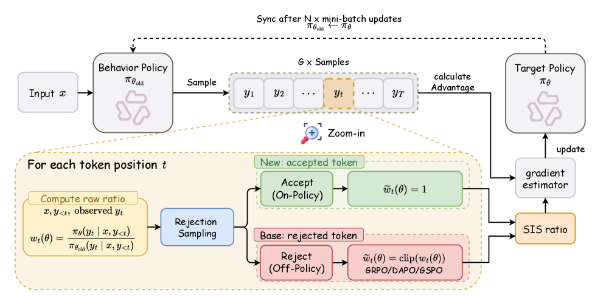

# SIS: Turning off-policy tokens on-policy

<!-- source-sha256: 4e080a9273c0628a7f80856248c6774a8e4bc2961759fd5c2601aff8a4f2ba30 -->

[简体中文](README.md)

> **Fidelity: core mechanism reproduction.** Executes the token-level ratio transformation, not full Qwen3 RL.

## Paper information

| Field | Details |
|---|---|
| Paper | [Paper or original source](https://arxiv.org/abs/2607.04728) |
| Institution | Paper author team |
| First public release | 2026-07-06 (arXiv v1) |
| Author code | No official author code identified (checked 2026-08-09). |
| Local adapter or method key | `sis` |
| Local reproduction code | [`src/auto_research/reproductions/sis/`](https://github.com/daiwk/auto-research/tree/main/src/auto_research/reproductions/sis/) |

## Paper method and evidence

Asynchronous rollouts, reuse and stale policies make LLM RL off-policy. Products of token IS ratios can have high variance on long sequences; clipping discards useful gradients. SIS rejection-samples stale tokens. Accepted tokens are treated as current-policy samples with ratio one; rejected tokens use GRPO clipping, DAPO asymmetric clipping or GSPO sequence correction. The exact envelope is $M_t=\max_v\pi_\theta(v)/\pi_{\mathrm{old}}(v)$, approximated on behavior top-K $V_K$. The analysis bounds accumulated log deviation $D=\sum_t|\log w_t|$.

<!-- paper-figure:start -->
### Original paper figure

Figure 1 shows the ratio-transformation method. From the [original paper](https://arxiv.org/abs/2607.04728); copyright remains with the authors.
<!-- paper-figure:end -->

### Core equation

$$
w_t(\theta)=\frac{\pi_\theta(y_t\mid x,y_{<t})}{\pi_{\mathrm{old}}(y_t\mid x,y_{<t})},\qquad w(\theta)=\prod_{t=1}^{T}w_t(\theta).
$$

$$
\widetilde w_t=\begin{cases}1,&z_t=1\\g(w_t),&z_t=0,\end{cases}
$$

### Reported results

The study uses Qwen3-8B/14B and 30B-A3B, DAPO-Math-17K and NQ+HotpotQA, with ten math/agent benchmarks:

| Backbone / algorithm | Math Avg → SIS | Gain | Agent Avg → SIS | Gain |
|---|---:|---:|---:|---:|
| Qwen3-8B GRPO | 49.05 → 52.59 | +3.54 | 45.85 → 47.83 | +1.98 |
| Qwen3-8B DAPO | 51.24 → 55.14 | +3.90 | 44.59 → 47.64 | +3.05 |
| Qwen3-30B-A3B GRPO (agent: Qwen3-14B) | 51.29 → 57.66 | +6.37 | 48.03 → 49.60 | +1.57 |

No production A/B.

## Local reproduction

Algorithm 1 on Tiny Shakespeare fits stale character-bigram behavior on the first 45% and current policy on the next 35%. Draw 50,000 tokens per seed, top-K=10; baseline is standard token IS.

| Seed | Variance reduction | Accept rate |
|---:|---:|---:|
| 41 | 14.56% | 68.67% |
| 42 | 4.78% | 68.65% |
| 43 | 0.53% | 68.81% |
| Mean | 6.62% | 68.71% |

All seeds reduce weight variance; this is distribution-shift mechanism evidence, not Qwen3 benchmark reproduction, complete GRPO/DAPO/GSPO training or recommendation ranking. DIN does not apply. [Stable metrics](metrics/tiny-shakespeare-seeds41-43.json).
