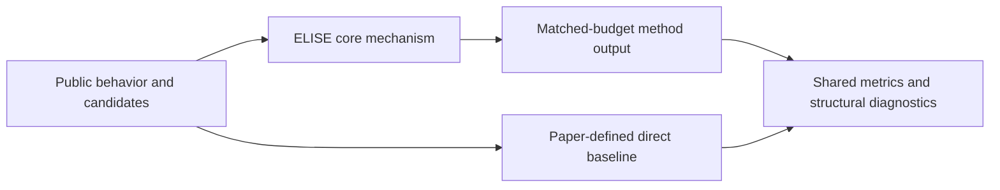
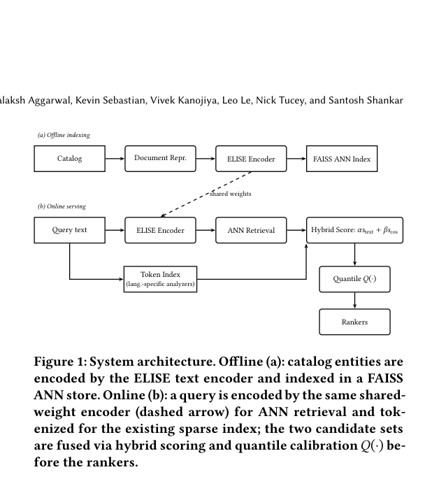

# ELISE: multilingual semantic retrieval for Apple Music

<!-- source-sha256: ec459cd30a83a0ac510efa5d748d80951ba3ead30f7437468004533ddd3c4865 -->

[简体中文](README.md)

> **Fidelity: core mechanism.** Runs the defining mechanism verifiable on public data. Private data, production models, and serving are outside scope.

## Paper information

| Field | Details |
|---|---|
| Paper | [arXiv 2607.10239](https://arxiv.org/abs/2607.10239) |
| Organization | Apple |
| First public release | 2026-07-11 (arXiv v1) |
| Authors' code | The paper did not provide official or author code when checked on 2026-09-02. |
| Adapter / method | `elise` |
| Local reproduction code | [`src/auto_research/reproductions/elise/`](https://github.com/daiwk/auto-research/tree/main/src/auto_research/reproductions/elise/) |

## Original paper

### Motivation and method

A Siamese bi-encoder complements a lexical inverted index. Quantile distribution matching calibrates dense and token scores to one scale and limits semantic results.



<!-- paper-figure:start -->
### Key figure from the paper

[](https://arxiv.org/pdf/2607.10239#page=2)

> **Figure 1:** Core architecture, modules, and their connections. From the [original paper](https://arxiv.org/abs/2607.10239); copyright remains with the authors.
<!-- paper-figure:end -->

### Core equation

$$
s_{hybrid}=\\alpha F_d(s_d)+(1-\\alpha)F_l(s_l).
$$

### Paper results

In a global 18-day Apple Music A/B test, conversion improved +2.28%, no-result rate fell -86.0%, and tail-query conversion improved +7.93%. These are paper-reported online measurements only, not local public-data results.

## Local reproduction

> **Local comparison:** Under the same full-catalog protocol, NDCG@10 is 0.05401 for the baseline and 0.04739 for ELISE, **-12.24%** relative. This is a negative result on a public proxy task and does not extrapolate to production lift.

See the [three-seed artifact](metrics/public-seeds42-44.json) for complete results, means, standard deviations, and 95% confidence intervals.

```bash
auto-research reproduce --paper elise --dataset-dir data --seed 42
```

## Reproduction boundaries

The local run uses a public MovieLens-1M subset and auditable proxy objectives. It does not reproduce private company logs, online traffic assignments, production model scale, or serving. This is core-mechanism validation, not reproduction of the paper's absolute results or online gain.
