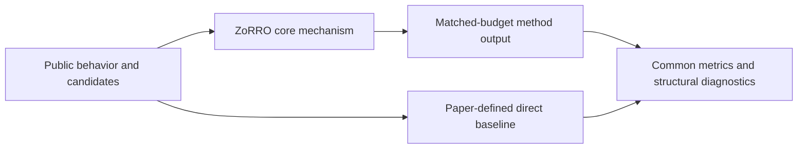
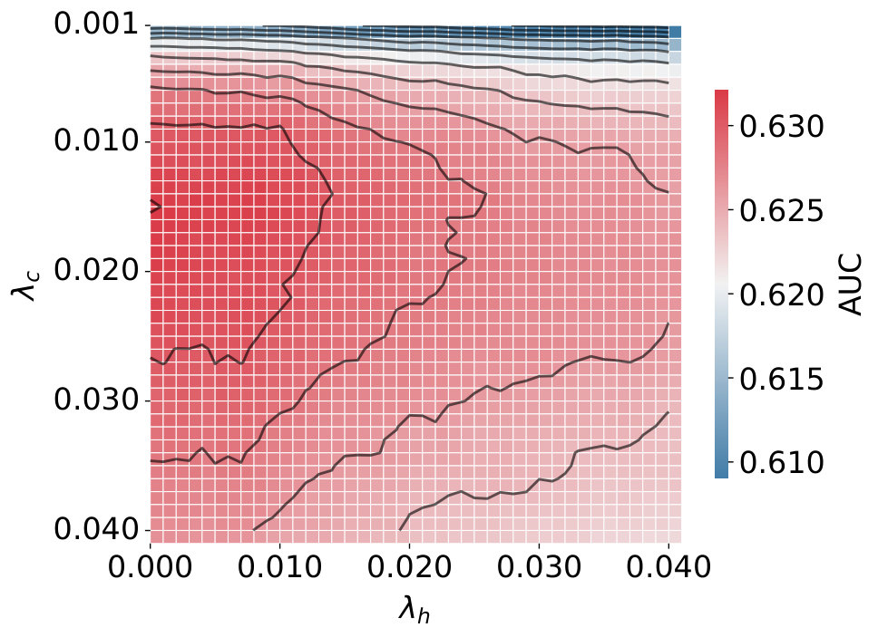

# ZoRRO: personalized news recommendation with no trained parameters

<!-- source-sha256: 8a0d47cc26dbfea76c6038b056e5db2d7930234af560e789a8d1ee285e8491ba -->

[简体中文](README.md)

> **Fidelity: core mechanism.** Runs the defining mechanism verifiable on public data. Private data, production models, and serving remain outside scope.

## Paper information

| Field | Details |
|---|---|
| Paper | [arXiv 2607.10910](https://arxiv.org/abs/2607.10910) |
| Organization | Technical University of Denmark |
| First public release | 2026-07-12 (arXiv v1) |
| Authors' code | [johanneskruse/zorro](https://github.com/johanneskruse/zorro) |
| Adapter / method | `zorro` |
| Local reproduction code | [`src/auto_research/reproductions/zorro/`](https://github.com/daiwk/auto-research/tree/main/src/auto_research/reproductions/zorro/) |

## Original paper

### Motivation and method

Without model training, combine time decay, semantic similarity, and category relations among historical articles for high-throughput news-candidate ranking.



<!-- paper-figure:start -->
### Key figure from the paper

[](https://arxiv.org/html/2607.10910v1/heatmap_lambda.png)

> **Figure 2:** Overview of the paper's method and key components. From the [original paper](https://arxiv.org/abs/2607.10910); copyright remains with the authors.
<!-- paper-figure:end -->

### Core equations

$$
s(i|H)=\\lambda_h\\sum_{j\\in H}w_j\\cos(e_j,e_i)+\\lambda_c\\sum_{j\\in H}w_j\\mathbf1[c_j=c_i].
$$

### Paper results

In a six-day real-traffic experiment at Ekstra Bladet, CTR is 4.19%, close to NRMS at 4.33% and above the popularity baseline at 2.96%. This is paper evidence, not a local public-data outcome.

## Local reproduction

> **Local comparison:** Under the same full-catalog protocol, baseline NDCG@10 is 0.05401 and ZoRRO NDCG@10 is 0.05201, **-3.70%** relative, a negative public-proxy result. The local proxy does not extrapolate to online lift.

See the [three-seed artifact](metrics/public-seeds42-44.json) for complete results, means, standard deviations, and 95% confidence intervals.

```bash
auto-research reproduce --paper zorro --dataset-dir data --seed 42
```

## Reproduction boundaries

The local run uses a public MovieLens-1M subset and auditable proxies to validate the core computation. It does not reproduce private logs, production models, online traffic assignment, or serving. No claim is made to reproduce absolute paper metrics or online gains.
