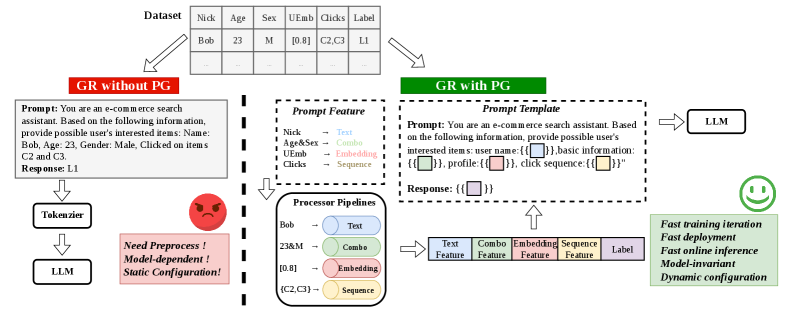

# Prompt Generation: Configuration-driven feature engineering for generative retrieval

<!-- source-sha256: 22d582380c8a28a7017bcfdeeac8e7ae11ccf3e0582b6d6ec9f3123c75b83f8a -->

[简体中文](README.md)

> **Fidelity: core mechanism reproduction.** Uses actual Qwen2.5-0.5B, official three-stage SID and MiniOneRec Office, the shared JSON protocol, embedding-space mean fusion, LoRA SFT, validation-only selection and held-out candidate scoring. Taobao full training, C++ batched kernels, production event replay and serving are not reproduced.

## Paper information

| Field | Details |
|---|---|
| Paper | [Paper or original source](https://arxiv.org/abs/2607.11326) |
| Institution | Alibaba / Taobao Search |
| First public release | 2026-07-13 (arXiv v1) |
| Author code | No official author code identified (checked 2026-08-09). |
| Local adapter or method key | `prompt-generation` |
| Local reproduction code | [`src/auto_research/reproductions/prompt_generation/`](https://github.com/daiwk/auto-research/tree/main/src/auto_research/reproductions/prompt_generation/) |

## Paper method and evidence

Generative retrieval sends the query, behavioral history and heterogeneous signals into an LLM that emits product or document semantic IDs. Manually changing data, training and serving together invites training–serving skew; concatenating long text and histories expands token budgets. PG separates feature engineering from model code with `prompt_template.json` and `prompt_feature.json`. Four feature types—text, embedding, combo and sequence—use orthogonal preprocessors, projectors and mergers. The same interpreter serves training and production; mergers fuse and compress inputs, with parameter-free embedding-space mean pooling a strong default. Event tracking captures online source features for offline replay.


<!-- paper-figure:start -->
### Original paper figure

[](https://arxiv.org/html/2607.11326v1/x1.png)

Figure 1 shows the end-to-end stages and feature flow. From the [original paper](https://arxiv.org/abs/2607.11326); copyright remains with the authors.
<!-- paper-figure:end -->

### Core equation

$$
Z_i=M_i\left(R_i\left(P_i(x_i)\right)\right),\qquad X_{PG}=\mathcal{T}(Z_1,\ldots,Z_n).
$$

$$
z_{mean}=\frac{1}{m}\sum_{j=1}^{m}e_j.
$$

$$
\mathcal{L}_{NTP}=-\sum_{t=1}^{L}\log p_\theta(s_t\mid X_{PG},s_{<t}).
$$

For feature $x_i$, $P_i$, $R_i$ and $M_i$ denote preprocessing, projection and fusion; $\mathcal T$ assembles features for autoregressive SID prediction. The shared interpreter targets $PG_{train}(x,c)=PG_{serve}(x,c)$.

### Reported results

The paper evaluates Taobao Search and Recommendation, S1-tiny, RecIF and Amazon Industrial/Office. Office uses Qwen2.5-Instruct-0.5B and three-token SIDs:

| Office configuration | HR@1 | HR@5 | HR@10 | HR@20 | HR@50 |
|---|---:|---:|---:|---:|---:|
| SID only | 7.52 | 11.27 | 12.99 | 14.66 | 18.81 |
| + Title | **8.06** | 11.16 | 12.70 | 14.73 | 18.25 |
| + Title + Brand | 7.93 | 11.39 | 12.86 | **15.18** | 18.93 |
| + merger(Title) + merger(Brand) | 7.60 | **11.47** | 12.88 | 14.95 | **19.37** |

No configuration dominates at every cutoff. Taobao Search (1% traffic, 14 days) reports transactions +0.47% and GMV +0.51%; Recommendation Newdetail (2%, 12 days) reports IPV +0.66% and PVR +7.93%; Shop Search (10%, >2 weeks) reports transactions +4.01%. Training-side processing fell from 176.2 ms to 19.8 ms (−88.8%); throughput rose from 1.32 to 1.83 iterations/s (+38.6%). A 20-round internal configuration-only search improved HR@20 by 3.05%.

## Local reproduction

The public Office files provide 3,459 items with title, brand, descriptions, Qwen item vectors and official SIDs. Arms share initialization, LoRA rank, seed, users, optimization steps and sampled candidates. The validation rule compares HR@10 then HR@5; the test set is never used to choose the configuration. The general comparison description mentions 50 sampled candidates; the measured run below uses a fixed **20-item** catalog, 12 validation and 12 test users, 4,000 training rows and 20 steps. The paper uses 36,586 training rows and a full catalog.

| Local arm | Mean prompt tokens | Loss first 5 → last 5 | Test HR@1 | HR@5 | HR@10 | Test scoring time |
|---|---:|---:|---:|---:|---:|---:|
| SID only | 61.1 | 2.6339 → 1.7992 | 0.4167 | 0.4167 | **0.7500** | 14.45s |
| SID + Title (validation winner) | 128.7 | 2.9980 → 2.3921 | 0.3333 | 0.4167 | 0.6667 | 154.92s |
| SID + mean(Title) + mean(Brand) | 67.0 | 2.6500 → 1.9926 | 0.4167 | 0.4167 | 0.5000 | 14.90s |

SID-only and Title tie on validation HR@10 at 0.8333; Title wins on HR@5 (0.6667 vs 0.5833), but test HR@10 falls **11.11%**. Compression is not an accuracy gain: it saves 47.94% of Title's prompt tokens and 90.38% of scoring time and is only 3.15% slower than SID-only. This supports the efficiency mechanism and shows that more text is not necessarily better. Neither a DIN comparison nor production A/B is claimed. [Stable metrics](metrics/office-qwen05b-seed42.json). Data, checkpoints and raw runs are not committed; raise environment limits to expand the run without changing the model or feature protocol.

```bash
GIT_LFS_SKIP_SMUDGE=1 git clone --depth 1 \
  https://huggingface.co/kkknight/MiniOneRec data/minionerec-public
git -C data/minionerec-public lfs pull \
  --include='Amazon/train/Office_Products_5_2016-10-2018-11.csv,Amazon/valid/Office_Products_5_2016-10-2018-11.csv,Amazon/test/Office_Products_5_2016-10-2018-11.csv,Amazon/index/Office_Products.*'

AUTO_RESEARCH_PG_MODEL=Qwen/Qwen2.5-0.5B-Instruct \
AUTO_RESEARCH_PG_STEPS=20 \
AUTO_RESEARCH_PG_TRAIN_ROWS=4000 \
AUTO_RESEARCH_PG_EVAL_USERS=12 \
AUTO_RESEARCH_PG_CANDIDATES=20 \
auto-research reproduce --paper prompt-generation --seed 42
```
