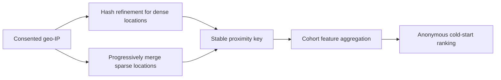
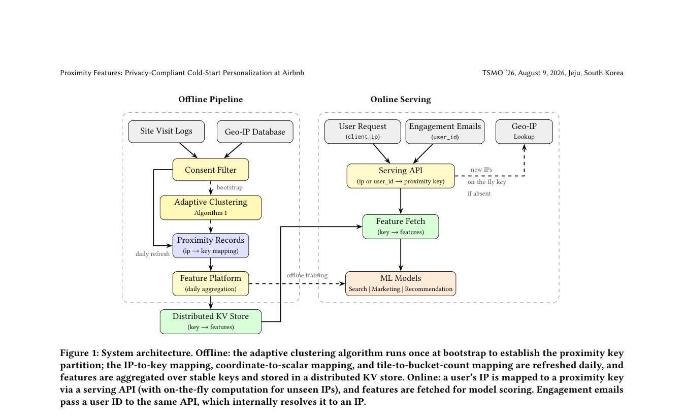

# Proximity Features: privacy-aware cohort features for cold start

<!-- source-sha256: 2b27d736d73f727b59cfacc3ca77b6597a86bf8f3df88c86ca099d758565fa5b -->

[简体中文](README.md)

> **Fidelity: core mechanism.** Runs dense hash refinement, sparse fine-to-coarse clustering, stable proximity keys, cohort aggregation, and cold-start scoring.

## Paper information

| Field | Details |
|---|---|
| Paper | [arXiv 2607.12246](https://arxiv.org/abs/2607.12246) |
| Organization | Airbnb |
| First public release | 2026-07-14 (arXiv v1) |
| Authors' code | The paper did not provide official or author code when checked on 2026-08-09. |
| Adapter / method | `proximity-features` |
| Local reproduction code | [`src/auto_research/reproductions/proximity_features/`](https://github.com/daiwk/auto-research/tree/main/src/auto_research/reproductions/proximity_features/) |

## Original paper

### Motivation and method

Anonymous users have no user ID. Airbnb clusters consented geo-IP population-center coordinates into proximity keys of about 1,000 users. Dense locations split by IP hash; sparse locations progressively merge at coarser geographic precision. Cohort behavior is aggregated daily by stable key without persistent personal identifiers online.



<!-- paper-figure:start -->
### Key figure from the paper

[](https://arxiv.org/pdf/2607.12246#page=3)

> **Figure 1:** Core architecture, modules, and connections. From the [original paper](https://arxiv.org/abs/2607.12246); copyright remains with the authors.
<!-- paper-figure:end -->

### Core equations

$$
key=base64(\lfloor lat\,s\rfloor,\lfloor lng\,s\rfloor,h(ip)\bmod b),
$$

$$
\max |\mathcal P|\quad\text{s.t.}\quad\sum_{i\in B_j}n_i\ge T,\ \forall B_j.
$$

### Paper results

Marketing pages report global bookings `+0.011%` and first-time bookers `+2.0%`. AutoSuggest reports global bookings `+0.16%` and first-time bookings `+0.33%`.

## Local reproduction

> **Local comparison:** The baseline is a global cold-start aggregate. The treatment uses adaptive MovieLens ZIP proximity aggregation with validation-selected blend `1.0`. Relative Hit@10 is **+16.67%** and NDCG@10 **+22.91%**.

The 932 users with ZIP data form 99 buckets, median size 10. Cohort signal beats the global aggregate using all original item features. See the [stable metrics](metrics/movielens-100k-seed42.json).

```bash
auto-research reproduce --paper proximity-features --seed 42
```

## Reproduction boundaries

ZIP prefixes are not geo-IP coordinates. The threshold is reduced to 12 for algorithm validation; this does not establish the paper's roughly 1,000-user privacy guarantee.
