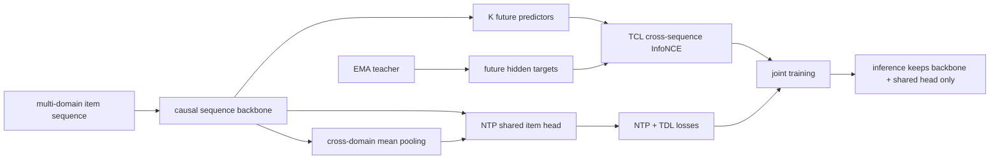
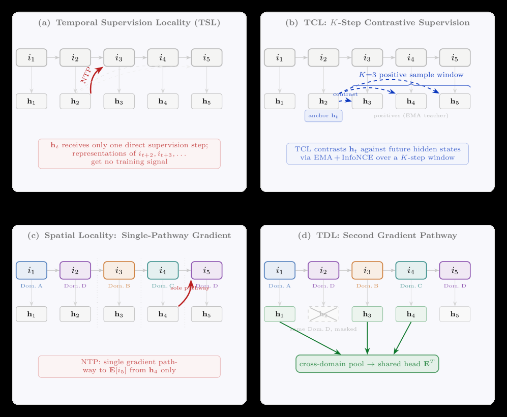

# NONTP: Breaking the Spatiotemporal Locality of Next-Token Prediction in Generative Recommendation

<!-- source-sha256: cabecbfcdd0ba985ef1d645aa713ed1ca4abb5eab520040186d35adff4bb0ace -->

[简体中文](README.md)

> **Fidelity: core mechanism.** Runs NTP, an EMA teacher, three future-step predictors, cross-sequence InfoNCE, cross-domain hidden-state pooling, and a shared prediction head. All training branches are removed at inference.

## Paper information

| Field | Details |
|---|---|
| Paper | [arXiv 2607.12277](https://arxiv.org/abs/2607.12277) |
| Organization | Meituan |
| First public release | 2026-07-14 (arXiv v1) |
| Authors' code | No official or author implementation is linked by the paper (checked 2026-08-09). |
| Adapter / method | `nontp` |
| Local reproduction code | [`src/auto_research/reproductions/nontp/`](https://github.com/daiwk/auto-research/tree/main/src/auto_research/reproductions/nontp/) |

## Original paper

### Motivation and method

Standard next-token prediction supervises only the next item. Hidden states need not represent longer future trajectories, and cross-business context cannot directly update sparse-domain targets. NONTP calls these temporal and spatial locality, respectively.

TCL predicts the EMA teacher's future state at $j+k$ from the online backbone state at $j$, with negatives from other users' sequences only. TDL averages hidden states before the target that belong to different domains and predicts the target through the same item head as NTP. The auxiliary modules exist only in training, leaving online architecture, parameter count, and latency unchanged.



<!-- paper-figure:start -->
### Key figure from the paper

[](https://arxiv.org/html/2607.12277v1/x1.png)

> **Figure 1:** Training flow and key optimization stages. From the [original paper](https://arxiv.org/abs/2607.12277); copyright remains with the authors.
<!-- paper-figure:end -->

### Core equations

The objective uses the paper's default weights:

$$
\mathcal L=\mathcal L_{NTP}+0.1\mathcal L_{TCL}+0.1\mathcal L_{TDL}.
$$

The EMA teacher update is:

$$
\theta_{ema}\leftarrow 0.999\theta_{ema}+0.001\theta_{online}.
$$

At future offset $k$, TCL aligns $g_k(h_j)$ to teacher state $h_{j+k}^{ema}$:

$$
\mathcal L_{TCL}=-\frac{1}{K}\sum_{k=1}^{K}\log
\frac{\exp(\operatorname{sim}(g_k(h_j),h_{j+k}^{ema})/\tau)}
{\sum_{s'\ne s,j'}\exp(\operatorname{sim}(g_k(h_j),h_{j'+k}^{ema,s'})/\tau)}.
$$

TDL uses earlier states outside the target domain:

$$
z_j^{tdl}=\frac{1}{|C_j|}\sum_{l\in C_j}h_l,\qquad
C_j=\{l<j:d_l\ne d_{j+1}\},
$$

$$
\mathcal L_{TDL}=-\log\operatorname{softmax}(z_j^{tdl}E^T)_{i_{j+1}}.
$$

### Paper results

On Amazon Movie-Book-CDs with 999 candidates, NTP HR@10/NDCG@10 are 0.3455/0.2371 and NONTP reaches 0.3553/0.2459, relative gains of 2.8%/3.7%. In Meituan's industrial full-catalog test, all-item HR@10 rises from NTP 0.0361 to NONTP 0.0485.

A 14-day online Meituan DSP retrieval A/B allocated 5% traffic to each of control and treatment: CTR +1.8% and GMV +2.1%, both p<0.01.

## Local reproduction

> **Local comparison.** Baseline `ntp` and treatment `nontp` with TCL+TDL use the same causal backbone, initialization, and budget. Across three seeds, Hit@10 falls from 0.05079 to 0.04828 (**-4.93%**) and NDCG@10 from 0.02431 to 0.02222 (**-8.62%**). This is a MovieLens genre-domain comparison, not the paper's Amazon or online A/B setting.

MovieLens-100K time sequences with primary genre as the public domain label replace the original 3.2M-item Amazon three-domain dataset. `ntp/tcl/tdl/nontp` use identical leave-two-out splits, full-catalog ranking, and seeds 42/43/44.

| Variant | Hit@10 | NDCG@10 | Head share@10 |
|---|---:|---:|---:|
| NTP | **0.05079 ± 0.00268** | **0.02431 ± 0.00062** | 0.99961 |
| NTP + TCL | 0.05043 ± 0.00382 | 0.02304 ± 0.00205 | 0.99979 |
| NTP + TDL | 0.04828 ± 0.00175 | 0.02354 ± 0.00109 | 0.99971 |
| NONTP | 0.04828 ± 0.00488 | 0.02222 ± 0.00270 | 0.99982 |

No auxiliary variant beats NTP with short sequences and weak domain labels. Head shares near 1 show that compact full-catalog training still heavily favors popular items. This negative result is consistent with the paper's analysis of weaker gains on Amazon (average length 12) than in industry (average length 280), but does not establish failure on original data.

```bash
AUTO_RESEARCH_NONTP_STEPS=80 \
AUTO_RESEARCH_NONTP_SEEDS=3 \
auto-research reproduce --paper nontp --seed 42
```

See [stable metrics](metrics/movielens-100k-seeds42-44.json). Checkpoints and raw runs are not committed.

## Reproduction limits

- Retains $K=3$, $m=0.999$, $\tau=0.07$, and both 0.1 auxiliary weights.
- TCL excludes positions from the same sequence as negatives; TDL uses prior positions in other domains without target leakage.
- A compact causal Transformer replaces HSTU; MovieLens genres replace Amazon Movie/Book/CDs domains and private Meituan business labels. This is a core-mechanism reproduction.
- Inference executes only the backbone and shared item head, not the teacher, predictors, or TDL pooling.
