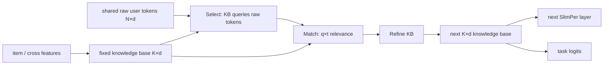
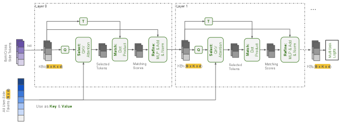

<!-- source-sha256: c305aaa3be95e1e769d647a4476f8aa40fc52b8be7772c5495f02508deefd8e2 -->

[简体中文](README.md) · English

# SlimPer: Long-sequence personalized ranking with a fixed knowledge base

> **Fidelity: core-mechanism reproduction.** Trains layered Select–Match–Refine, a fixed-capacity knowledge base, and request-only sharing of user tokens. History length and modalities are scaled down.

## Paper information

| Field | Details |
| --- | --- |
| Paper | [arXiv 2607.12281](https://arxiv.org/abs/2607.12281) |
| Institution | Meta Platforms, Inc. |
| First public release | 2026-07-14 (arXiv v1) |
| Author code | No official or author-released code found in the paper (checked 2026-08-09). |
| Local adapter or method key | `slimper` |
| Local reproduction code | [`src/auto_research/reproductions/slimper/`](https://github.com/daiwk/auto-research/tree/main/src/auto_research/reproductions/slimper/) |

## Original paper summary

### Background and main changes

A generative Transformer keeps intermediate state for every token, whereas recommendation ranking returns only a few user-item relevance scores. SlimPer replaces per-layer `N×d` history state with a fixed `K×d` knowledge base. Each layer revisits raw sparse and sequence tokens, selects relevant evidence, explicitly matches it with knowledge templates, and refines the knowledge base. User tokens are encoded once per request and shared across all candidates.



<!-- paper-figure:start -->
### Key figure from the paper

[](https://arxiv.org/html/2607.12281v1/x2.png)

> **Figure 2:** The core architecture, its main modules, and their connections. From the [paper](https://arxiv.org/abs/2607.12281); copyright belongs to the authors. Click for the source.
<!-- paper-figure:end -->

### Core equations

$$
Q=\mathcal L(X^k),\qquad
R=\operatorname{Softmax}(Q E^\top/\sqrt d)E,\qquad
T=\mathcal L(X^k).
$$

$$
\lambda_e=RT^\top,\qquad
X^{k+1}=X^k+\operatorname{MLP}_\mu\!\left([\operatorname{RMSNorm}(\lambda_e),\mathcal L(X^k),D]\right).
$$

Per-layer compute is $O(KN)$ with fixed intermediate state $O(LK)$, versus $O(N^2)$ compute and $O(LN)$ state for full-sequence attention.

### Offline and online results

For Reels with 2k events, reshare NE `-0.51%`, QPS `+11.0%`, memory `-9.32%`; for Feed with 1k events, memory `-18.12%`. The paper reports `8×–25×` fewer actual FLOPs. SlimPer reached full traffic in Instagram Reels and Feed, with statistically significant engagement gains, no ecosystem guardrail regressions, and nearly neutral GPU capacity. Exact online lifts are not disclosed; aggregate top-line impact is about `10×` a typical statistically significant launch. This project accepts full-traffic evidence as an explicit user-approved exception to its industrial inclusion gate.

## Local reproduction

> **Local comparison:** A parameter-matched 6-layer full-sequence Transformer (138,337 parameters) is compared with 3-layer SlimPer (145,027 parameters). Relative NDCG@10 is **`+1.29%`**.

MovieLens-100K uses 220 users, 360 items, 32-event histories, matched examples and optimizer, and 120 steps. SlimPer Hit@10 `+14.29%`, attention-score elements `-94.12%`, and layer intermediate-state elements `-87.88%`. Full-catalog inference encodes user tokens once per request. See [`metrics/movielens-100k-seed42.json`](metrics/movielens-100k-seed42.json).

```bash
auto-research reproduce --paper slimper --seed 42
```

## Scope

MovieLens item, genre, and sequence features replace Instagram sparse, dense, and multimodal features. The run uses 32 instead of 1k–10k+ events, and AdamW instead of Shampoo. It does not reproduce production kernels, multi-task heads, or measured QPS, reporting analytical attention and intermediate-state element counts only.
