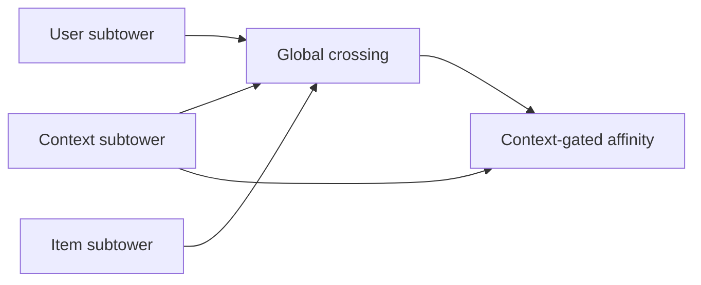
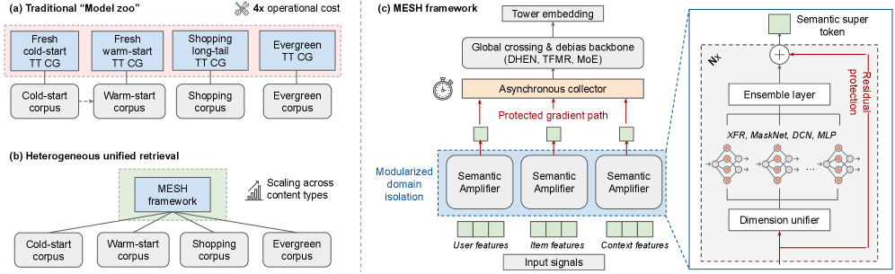

# MESH: Scalable retrieval with decoupled heterogeneous content

<!-- source-sha256: f07420170270d6ebb41f9a1fc23cfcb70c9e0a635202baa05cdd04f4cc53d5cf -->

[简体中文](README.md)

> Core grouped manifolds, independent residual amplifiers, global crossing, and RGBC.

## Paper information

| Field | Details |
|---|---|
| Paper | [arXiv 2607.12392](https://arxiv.org/abs/2607.12392) |
| Institution | Pinterest. |
| First public release | 2026-07-14 (arXiv v1) |
| Author code | No official author code linked by the paper as checked on 2026-08-09. |
| Local adapter or method key | `mesh` |
| Local reproduction code | [`src/auto_research/reproductions/mesh/`](https://github.com/daiwk/auto-research/tree/main/src/auto_research/reproductions/mesh/) |

## Paper method and evidence

Flat retrieval scaling can let high-frequency evergreen gradients overwhelm fresh/tail signals. Separate user, item, and context subtowers and amplify each via residual crossing before global interaction. RGBC gates user–item affinity with context; serving can parallelize subtowers and cache item features asynchronously.



<!-- paper-figure:start -->
### Original paper figure

[](https://arxiv.org/html/2607.12392v1/x1.png)

The original figure shows separated subtowers and gated affinity. From the [original paper](https://arxiv.org/abs/2607.12392); copyright remains with the authors.
<!-- paper-figure:end -->

### Core equation

$$
H_k^l=\operatorname{Norm}(H_k^{l-1}+\Phi(H_k^{l-1},H_k^{l-1})),\qquad H_0=\operatorname{LN}(\sigma(MLP(T_c))\odot(T_u\odot T_i)+T_c).
$$

### Reported results

Pinterest reports fresh-item repins **+5.5%**, funnel efficiency **+55%**, retention **+0.46%**, and system throughput **2.87×**.

## Local reproduction

Flat retrieval baseline versus three amplified towers and RGBC. Validation selects blend `0.1`; local Hit@10 **+0.00%**, NDCG@10 **-3.54%**. Small Python batch microbenchmark **0.33×**, retained as a counterexample rather than compared with TorchScript/GPU parallel serving. [Metrics](metrics/movielens-100k-seed42.json).

```bash
auto-research reproduce --paper mesh --seed 42
```

No complete DHEN or production GPU inter-op; local timings do not validate paper throughput.
