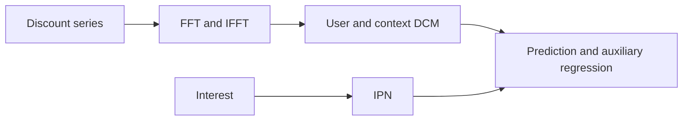
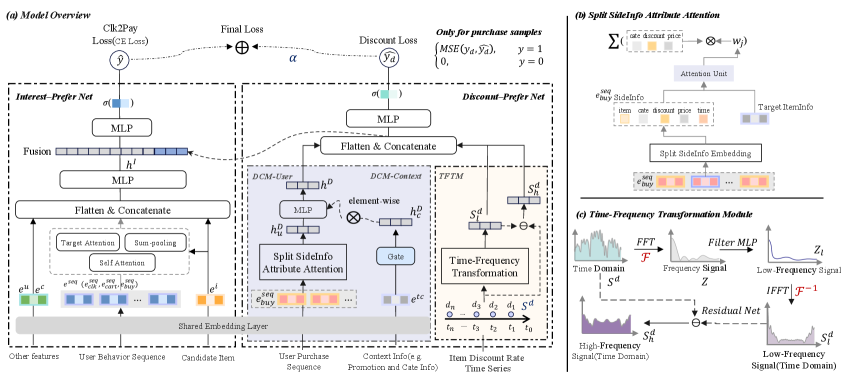

# DANet: Discount-Aware Conversion Prediction

<!-- source-sha256: ce7e4967d4b7869bba48f451961f37f4b09c4d68d3d0cc5dd908f7f97f141501 -->

[简体中文](README.md)

> **Core mechanism evidence.** Paper and local evaluations are separate.

## Paper information

| Field | Value |
| --- | --- |
| Paper | [arXiv 2607.12578](https://arxiv.org/abs/2607.12578) |
| Affiliations | Alibaba Group / Tmall |
| First public release | 2026-07-14 (arXiv v1) |
| Authors' code | [Author code](https://github.com/tangrc/DANet). |
| Adapter / method | `danet` |
| Local code | [`src/auto_research/reproductions/danet/`](https://github.com/daiwk/auto-research/tree/main/src/auto_research/reproductions/danet/) |

## Original paper

### Background and contribution

Interest alone does not explain price sensitivity. IPN models general interest. DPN FFT-filters a 400-day discount series; DCM-User extracts preferences from similar purchases, DCM-Context gates promotion regimes, and positive purchases supervise discount regression.



<!-- paper-figure:start -->
### Key figure from the paper

[](https://arxiv.org/html/2607.12578v1/x2.png)

Original Figure 2: DANet. From the [paper](https://arxiv.org/abs/2607.12578); copyright belongs to the authors. Not a local result.
<!-- paper-figure:end -->

### Core mechanism

$$
Z=FFT(S^d),\quad S_l^d=IFFT(f_t(Z)),\quad S_h^d=S^d-S_l^d,
$$

$$
\mathcal L=\mathcal L_{CE}+\alpha\mathbf 1[y=1]\operatorname{MSE}(y_d,\hat y_d).
$$

### Paper results

Tmall online pCVR +3.63%, GMV +2.23%; discount-item PVR 7.56→11.14 (+47.32%).

## Local reproduction

Compare IPN with TFTM/DCM using periodic popularity/rating as a discount proxy: Hit@10 +0.00%, NDCG@10 −1.46%, fresh Hit@10 +50.00%. [Metrics](metrics/movielens-100k-seed42.json).

```bash
auto-research reproduce --paper danet --seed 42
```

## Reproduction limits

No real prices, 400-day Tmall discounts, or promotion features. NumPy implementation is distinct from authors' TensorFlow; ranking is not CVR.
