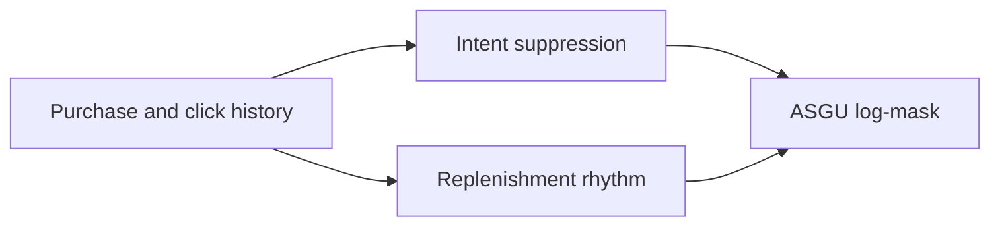
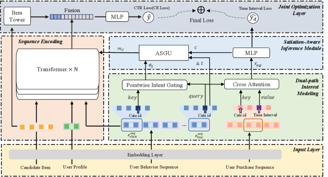

# SAM: Post-Purchase Interest Suppression and Personalized Recovery

<!-- source-sha256: fe91de0e5bf8921386b31d0d6e59b66bc2fa6e5927a0ae317407281aa1877946 -->

[简体中文](README.md)

> **Core mechanism evidence.** Paper and local evaluations are separate.

## Paper information

| Field | Value |
| --- | --- |
| Paper | [arXiv 2607.12714](https://arxiv.org/abs/2607.12714) |
| Affiliations | Alibaba Group |
| First public release | 2026-07-14 (arXiv v1) |
| Authors' code | No official author code linked as of 2026-08-09. |
| Adapter / method | `sam` |
| Local code | [`src/auto_research/reproductions/sam/`](https://github.com/daiwk/auto-research/tree/main/src/auto_research/reproductions/sam/) |

## Original paper

### Background and contribution

Purchase satisfies a cluster of interests, so reinforcing pre-purchase clicks can repeat recommendations. Pointwise cross-attention finds history to suppress; long purchases predict replenishment. ASGU strongly suppresses just after purchase and restores attention near the cycle through a log mask.



<!-- paper-figure:start -->
### Key figure from the paper

[](https://arxiv.org/html/2607.12714v1/x1.png)

Original Figure 1: SAM. From the [paper](https://arxiv.org/abs/2607.12714); copyright belongs to the authors. Not a local result.
<!-- paper-figure:end -->

### Core mechanism

$$
m_{ij}=1-a_j\sigma\left(k\left(\alpha-\frac{\Delta t_{ij}}{c}\right)\right),\qquad \ell_{ij}=q_i^Tk_j/\sqrt d+\log\operatorname{clip}(m_{ij},\epsilon,1).
$$

### Paper results

Paper vs. DIN: CTR +1.1%, GMV +0.9%, bad cases −74.5%, and PPRR 15.5%→4.1%.

## Local reproduction

Compare DIN-like scores to genre-based cycles and ASGU: Hit@10 −12.50%, NDCG@10 −6.60%. Intent/rhythm paths, ASGU, log-mask and TTNP run. [Metrics](metrics/movielens-100k-seed42.json).

```bash
auto-research reproduce --paper sam --seed 42
```

## Reproduction limits

High-rating genre repetitions proxy purchase intervals; no replenishment goods or censored purchase logs. Negative local results do not extrapolate online.
