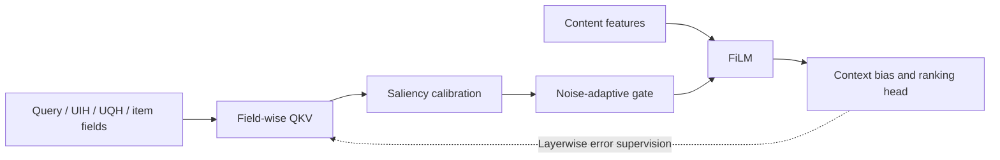
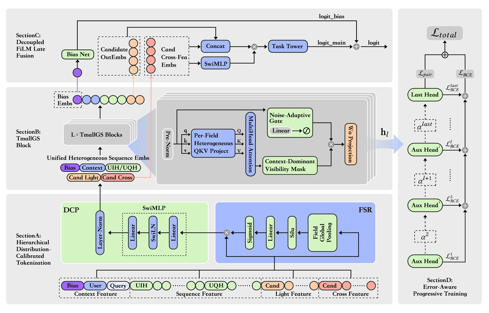

<!-- source-sha256: e1a28df22fae88f1a2fcbf46c5c0b9770d62a45967ddeafec9f83c2010a68f3c -->

[简体中文](README.md) · English

# TMallGS: Unified feature and sequence modeling for generative e-commerce search

> **Core mechanism reproduction.** Trains field-adaptive interactions and progressive loss. Private Tmall fields and production scale are not reproduced.

## Paper information

| Field | Details |
| --- | --- |
| Paper | [arXiv 2607.13398](https://arxiv.org/abs/2607.13398) |
| Institution | Taobao & Tmall Group of Alibaba |
| First public release | 2026-07-15 (arXiv v1) |
| Author code | No official author code in the paper when checked on 2026-08-09. |
| Local adapter or method key | `tmallgs` |
| Local reproduction code | [`src/auto_research/reproductions/tmallgs/`](https://github.com/daiwk/auto-research/tree/main/src/auto_research/reproductions/tmallgs/) |

## Original paper summary

### Background and main changes

Search mixes heterogeneous query, short- and long-term behavior, user and item fields. Direct concatenation can amplify field noise. TMallGS learns field-specific Q/K/V and controls interactions with distribution-calibrated saliency and noise-adaptive gates. It injects content through FiLM, corrects final scores with context bias, and assigns progressive supervision by intermediate-layer errors.



<!-- paper-figure:start -->
### Key figure from the paper

[](https://arxiv.org/html/2607.13398v1/Arc_New.png)

> **Figure 1:** Core architecture, modules and connections. From the [paper](https://arxiv.org/abs/2607.13398); copyright belongs to the authors. Click for the source.
<!-- paper-figure:end -->

### Core equations

$$
\tilde a_{ij}^{(f)}
=g_f(x)\cdot
\operatorname{softmax}_j
\left(\frac{Q_f(x_i)K_f(x_j)^\top}{\sqrt d}
+b_f\right),
$$

$$
h'=\gamma(c)\odot h+\beta(c),\qquad
\mathcal L=\sum_l\alpha_l(\epsilon_l)\mathcal L_l.
$$

### Offline and online results

Offline PV-AUC +0.79%, IMP-GAUC +0.34%. A 30-day Tmall Search A/B ($p<0.05$) reports UCTCVR +1.38%, GMV +1.52% and roughly 6 ms additional latency.

## Local reproduction

MovieLens genres and sequences become heterogeneous fields. Field-wise QKV, noise gates, explicit content FiLM, context bias and error-aware progressive loss all train.

> **Comparison:** DIN/RankMixer-style late-fusion Transformer versus the TMallGS field-adaptive gated Transformer. Seed 42 NDCG@10 rises from 0.00068 to 0.00278, +310.42% relative.

See `metrics/movielens-100k-seed42.json`. Absolute hits are sparse. The result shows a runnable combination of training components, not statistical stability of Tmall's 0.05B production model.

```bash
auto-research reproduce --paper tmallgs --dataset-dir data --seed 42
```
