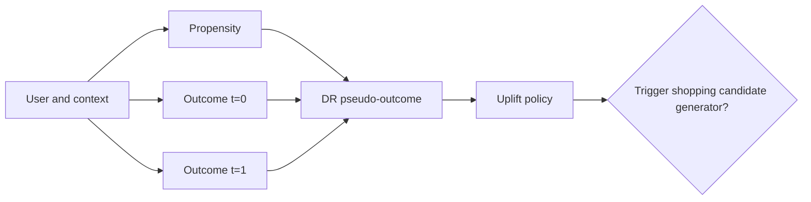
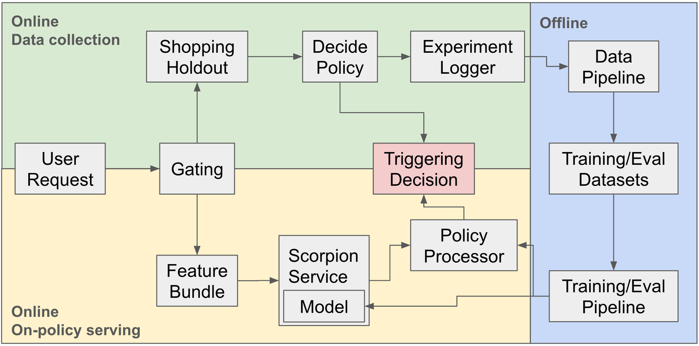

# Pinterest causal retrieval: using uplift to trigger shopping candidates

<!-- source-sha256: 5b44584b6bc488dd14ead4ac82a96d1fa2d61804dfa80b55fe6ddf2085b97be0 -->

[简体中文](README.md)

> **Fidelity: core mechanism.** Runs propensity estimation, two outcomes, doubly robust pseudo-outcomes, and a trigger threshold.

## Paper information

| Field | Details |
|---|---|
| Paper | [arXiv 2607.14161](https://arxiv.org/abs/2607.14161) |
| Organization | Pinterest |
| First public release | 2026-07-14 (arXiv v1) |
| Authors' code | The paper did not provide official or author code when checked on 2026-08-09. |
| Adapter / method | `causal-retrieval` |
| Local reproduction code | [`src/auto_research/reproductions/causal_retrieval/`](https://github.com/daiwk/auto-research/tree/main/src/auto_research/reproductions/causal_retrieval/) |

## Original paper

### Motivation and method

Always triggering the shopping candidate generator wastes resources and can over-distribute to users without shopping intent. The paper learns multi-event outcomes and doubly robust uplift from randomized logs, selects a threshold via offline linear replay, and runs online in parallel with remote retrieval.



<!-- paper-figure:start -->
### Key figure from the paper

[](https://arxiv.org/html/2607.14161v2/sys_overview.png)

> **Figure 1:** Training flow and key optimization steps. From the [original paper](https://arxiv.org/abs/2607.14161); copyright remains with the authors.
<!-- paper-figure:end -->

### Core equation

$$
\tilde\tau(x)=\hat\mu_1-\hat\mu_0+
\frac{t(y-\hat\mu_1)}{\hat e(x)}
-\frac{(1-t)(y-\hat\mu_0)}{1-\hat e(x)}.
$$

### Paper results

Shopping triggers decline by up to `85%` with neutral shopping sessions, total sessions `+0.26%`, and Pin Saves `+1.10%`.

## Local reproduction

> **Local comparison:** The baseline is a fixed noncausal transition/content/popularity retrieval ensemble. DR uplift triggers shopping on about 30% of cases. NDCG@10 improves `0.03540→0.06399`, or **+80.77%** relative.

This large gain comes from synthetic randomized treatment on public data. It validates the causal training path, not a reproduction of Pinterest. See the [metrics](metrics/movielens-seed42.json).

```bash
auto-research reproduce --paper causal-retrieval --dataset-dir data --seed 42
```

## Reproduction boundaries

No Pinterest randomized logs, shopping sessions, or RPC costs are available. The local pseudo-treatment is used only for an identifiable mechanism experiment.
