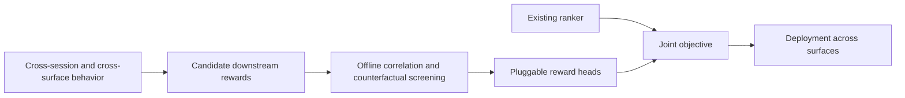
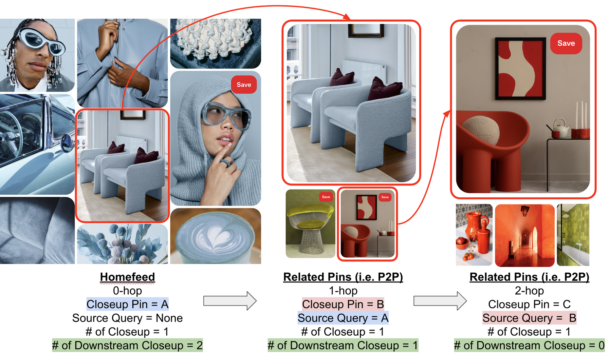

<!-- source-sha256: 66a9e7c1507d0e03041592282691a394b1c11f009c0bb23c1ab81854100d8c67 -->

[简体中文](README.md) · English

# Downstream Rewards: Model-agnostic optimization for long-term engagement

> **Fidelity: core-mechanism reproduction.** Runs reward screening and auxiliary heads. Pinterest's private cross-surface long-term labels are not reproduced.

## Paper information

| Field | Details |
| --- | --- |
| Paper | [arXiv 2607.14192](https://arxiv.org/abs/2607.14192) |
| Institution | Pinterest |
| First public release | 2026-07-15 (arXiv v1) |
| Author code | No official or author-released code found in the paper (checked 2026-08-09). |
| Local adapter or method key | `downstream-rewards` |
| Local reproduction code | [`src/auto_research/reproductions/downstream_rewards/`](https://github.com/daiwk/auto-research/tree/main/src/auto_research/reproductions/downstream_rewards/) |

## Original paper summary

### Background and main changes

Optimizing only current clicks or saves can reduce future user engagement. Pinterest proposes and screens candidate downstream rewards offline for their ability to predict future engagement. Reward heads that pass are added as model-agnostic auxiliary objectives across Homefeed, Search, Related Pins, and Notifications without replacing the existing ranker.



<!-- paper-figure:start -->
### Key figure from the paper

[](https://arxiv.org/html/2607.14192v2/figures/p2p_nhop_closeup_v2.png)

> **Figure 1:** Overall design and components. From the [paper](https://arxiv.org/abs/2607.14192); copyright belongs to the authors. Click for the source.
<!-- paper-figure:end -->

### Core equations

$$
r_k=\phi_k(s_t,a_t,s_{t+1:t+H}),\qquad
\mathcal K=\{k:\operatorname{Corr}(r_k,Y_{\mathrm{long}})>\tau\},
$$

$$
s_{\mathrm{final}}=s_{\mathrm{immediate}}+
\sum_{k\in\mathcal K}\lambda_k\hat r_k.
$$

### Offline and online results

Online A/B results: Homefeed successful sessions +0.36% and total time up to +0.35%; Search fulfillment +0.25%; Related Pins successful sessions +0.15%; Notifications successful sessions +0.14% and WAU +0.11%.

## Local reproduction

The local experiment starts from four types of session signal: deeper transition, content depth, new use-case exploration, and shallow closeup. It uses future category coverage as a long-term engagement proxy for offline screening, trains independent reward heads, and selects their blend with the immediate ranking score on validation.

> **Local comparison:** The baseline ranks by immediate next-item engagement. The experimental arm adds screened downstream rewards. At seed 42, NDCG@10 falls from 0.02629 to 0.02495 (−5.10% relative), so the local run does not confirm a ranking benefit.

Stable metrics: `metrics/movielens-100k-seed42.json`. MovieLens cannot fully substitute for Pinterest's save, download, P2P, and cross-surface retention labels. The negative result remains part of the documented applicability limits.

```bash
auto-research reproduce --paper downstream-rewards --dataset-dir data --seed 42
```
