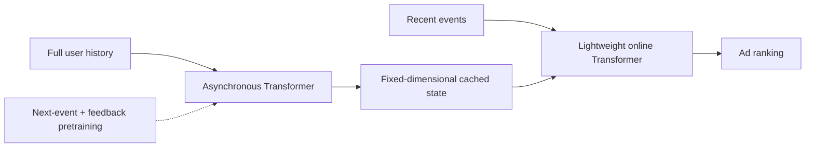
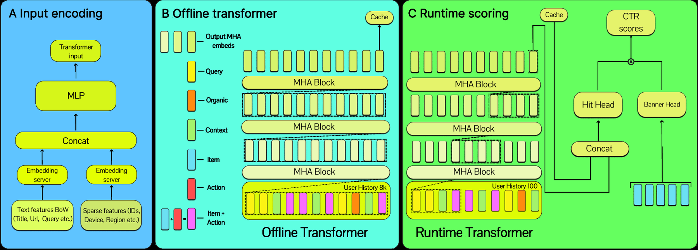

<!-- source-sha256: d03752cc71fedfab7176e922e7092c3a0ebd39c12e5595c885ecf65cd5cd97b6 -->

[简体中文](README.md) · English

# Long-History User Transformers: Long user histories in real-time ad ranking

> **Fidelity: core-mechanism reproduction.** Trains two encoders for offline caching and online recent events. Yandex's production feature system is not reproduced.

## Paper information

| Field | Details |
| --- | --- |
| Paper | [arXiv 2607.14331](https://arxiv.org/abs/2607.14331) |
| Institution | Yandex |
| First public release | 2026-07-15 (arXiv v1) |
| Author code | No official or author-released code found in the paper (checked 2026-08-09). |
| Local adapter or method key | `long-history-transformer` |
| Local reproduction code | [`src/auto_research/reproductions/long_history_transformer/`](https://github.com/daiwk/auto-research/tree/main/src/auto_research/reproductions/long_history_transformer/) |

## Original paper summary

### Background and main changes

Ad ranking benefits from long histories, but recomputing an entire sequence on every request adds latency. The paper separates an asynchronous full-history Transformer from a lightweight online Transformer. The offline component periodically refreshes a fixed-dimensional user state. The online component reads that cache and encodes only recent events. Training starts with auxiliary next-event and feedback tasks, then fine-tunes for the target ad surface.



<!-- paper-figure:start -->
### Key figure from the paper

[](https://arxiv.org/html/2607.14331v1/x2.png)

> **Figure 2:** The core architecture, its main modules, and their connections. From the [paper](https://arxiv.org/abs/2607.14331); copyright belongs to the authors. Click for the source.
<!-- paper-figure:end -->

### Core equations

$$
z_u=\operatorname{Cache}\!\left(
\operatorname{Transformer}_{\mathrm{offline}}(H_u)
\right),
$$

$$
\hat y=\operatorname{Ranker}\!\left(
\operatorname{Transformer}_{\mathrm{online}}(H_u^{\mathrm{recent}},z_u),x_{\mathrm{ad}}
\right).
$$

### Offline and online results

For Yandex Search Ads, the primary metric rose +2.77%, clicks +2.87%, and revenue +2.26%. For Yandex Advertising Network, the primary metric rose +2.10%, clicks +2.59%, and revenue +0.43%. The paper reports no increase in serving latency.

## Local reproduction

The implementation trains an offline encoder with a 24-step history, a 32-dimensional cache, an online encoder that sees only the 4 most recent events, and auxiliary next-item and feedback objectives. The request-time baseline sees only the 4 most recent events.

> **Local comparison:** The baseline is a request-time recent-history Transformer. The experimental arm adds the cached full history to a lightweight online Transformer. At seed 42, NDCG@10 rises from 0.00187 to 0.00294, a relative gain of +57.08%.

Stable metrics: `metrics/movielens-100k-seed42.json`. The local run does not have Yandex's cross-surface logs, downstream CatBoost, or feature-store refresh infrastructure. Serving cost is discussed only in terms of system structure.

```bash
auto-research reproduce --paper long-history-transformer --dataset-dir data --seed 42
```
