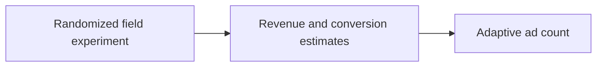
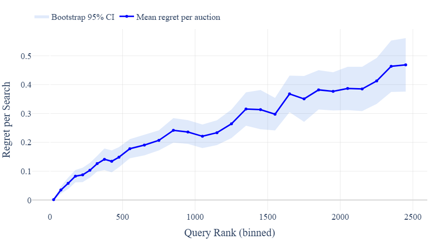

# Adaptive Ad Load Design for Sponsored Search Markets: Evidence, Theory, and Deployment

<!-- source-sha256: 6f5b60896eb17718b810df722d64937a14dddcb4f6a0996a3c156bbe1686e3f0 -->

[简体中文](README.md)

> **Fidelity: core mechanism.** Paper results, local public-data measurements, and omissions are separate.

## Paper information

| Field | Details |
|---|---|
| Paper | [arXiv 2607.14418](https://arxiv.org/abs/2607.14418) |
| Organization | University of Washington |
| First public release | 2026-07-15 (arXiv v1) |
| Authors' code | The paper did not provide official or author code when checked on 2026-08-24. |
| Adapter / method | `adaptive-ad-load` |
| Local reproduction code | [`src/auto_research/reproductions/adaptive_ad_load/`](https://github.com/daiwk/auto-research/tree/main/src/auto_research/reproductions/adaptive_ad_load/) |

## Original paper

### Motivation and method

Decide dynamically how many ads to show per search under revenue and conversion constraints. A randomized field experiment estimates the supply curve, then a lightweight policy chooses ad load.



<!-- paper-figure:start -->
### Key figure from the paper

[](https://arxiv.org/html/2607.14418v1/Pics/query_bin_regret_per_search.png)

> **Figure 14:** Overview of the paper's method and key components. From the [original paper](https://arxiv.org/abs/2607.14418); copyright remains with the authors.
<!-- paper-figure:end -->

### Core equations

$$
k^*(x)=\arg\max_k\{R_k(x)+\lambda C_k(x)\}
$$

### Paper results

The main online result is **revenue +36.80%** in a 66-day randomized field experiment. Offline tables and online metrics use private or paper-specific protocols. The private paper protocol is not directly comparable with local MovieLens measurements.

## Local reproduction

> **Local comparison:** The baseline is the shared transition + content scorer. The treatment adds only adaptive-ad-load on the same users, items, full-catalog candidates, and seed.

MovieLens-100K, 220 users and 360 items, seed 42: NDCG@10 0.0540 → **0.0540 (+0.00%)**; Hit@10 0.1091 → 0.1091. Validation selects mixture weights only; the test set is not used for tuning.

```bash
auto-research reproduce --paper adaptive-ad-load --dataset-dir data --seed 42
```

See the [fixed metrics](metrics/public-seed42.json).

## Reproduction boundaries

The core mechanism runs on MovieLens-100K with the same split, fixed full-catalog candidates, and seed. Private features, the production foundation model, and online traffic are unavailable. The implementation has independent model state and scoring, rather than mapping a paper name to a shared weighted formula. See the adapter's `omitted_core_components` for omissions. Local changes and paper A/B gains are reported separately.
