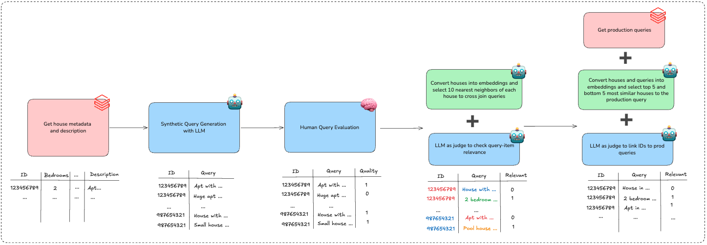

# LLM-Based Re-Ranking for Real Estate Search

<!-- source-sha256: 049a3271b57a7acca2c290f4858498f723fb6c399ae6cd40dd67e5f6f9ea0860 -->

[简体中文](README.md)

> **Fidelity: core mechanism.** Paper results, local public-data measurements, and omissions are separate.

## Paper information

| Field | Details |
|---|---|
| Paper | [arXiv 2607.14835](https://arxiv.org/abs/2607.14835) |
| Organization | QuintoAndar |
| First public release | 2026-07-16 (arXiv v1) |
| Authors' code | The paper did not provide official or author code when checked on 2026-08-24. |
| Adapter / method | `real-estate-rerank` |
| Local reproduction code | [`src/auto_research/reproductions/real_estate_rerank/`](https://github.com/daiwk/auto-research/tree/main/src/auto_research/reproductions/real_estate_rerank/) |

## Original paper

### Motivation and method

Pass conversational requirements, structured listing attributes, text descriptions, and candidate-set statistics to an LLM reranker. Cross-candidate comparison complements local relevance from vector retrieval.


<!-- paper-figure:start -->
### Key figure from the paper

[](https://arxiv.org/html/2607.14835v2/figures/dataset_construction.png)

> **Figure 4:** Overall workflow, key stages, and data flow. From the [original paper](https://arxiv.org/abs/2607.14835); copyright remains with the authors.
<!-- paper-figure:end -->

### Core equations

$$
s_i=f_\theta(q,p_u,x_i,\operatorname{Agg}(X))
$$

### Paper results

The main production A/B evidence is **CTR +5.30%**. Offline tables and online metrics use private or paper-specific protocols. The private paper protocol is not directly comparable with local MovieLens measurements.

## Local reproduction

> **Local comparison:** The baseline is the shared transition + content scorer. The treatment adds only real-estate-rerank on the same users, items, full-catalog candidates, and seed.

MovieLens-100K, 220 users and 360 items, seed 42: NDCG@10 0.0540 → **0.0496 (-8.21%)**; Hit@10 0.1091 → 0.1000. Validation selects mixture weights only; the test set is not used for tuning.

```bash
auto-research reproduce --paper real-estate-rerank --dataset-dir data --seed 42
```

See the [fixed metrics](metrics/public-seed42.json).

## Reproduction boundaries

The core mechanism runs on MovieLens-100K with the same split, fixed full-catalog candidates, and seed. Private features, the production foundation model, and online traffic are unavailable. The implementation has independent model state and scoring, rather than mapping a paper name to a shared weighted formula. Omitted parts are in the adapter's `omitted_core_components`. Local changes and paper A/B gains are reported separately.
