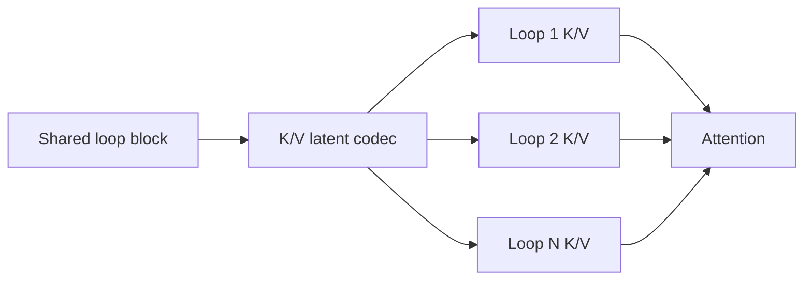
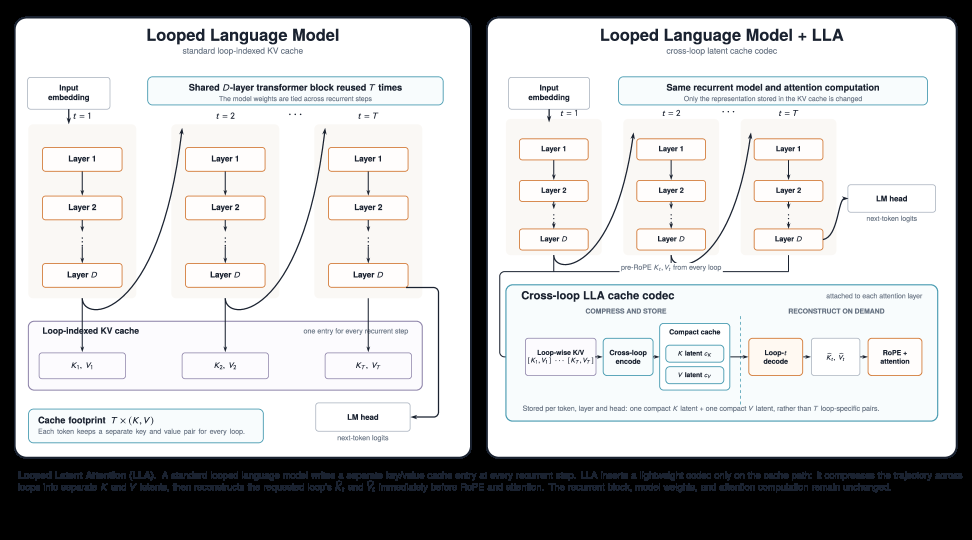

# Looped Latent Attention: compressing KV caches across loops

<!-- source-sha256: 7ae31bde2489f4c6d5b2f15e7b4a9bd1753ffc570db37c04bbd2b294962456e5 -->

[简体中文](README.md)

> **Fidelity: core mechanism.** Trains a weight-shared looped block and stores K/V in shared latents.

## Paper information

| Field | Details |
|---|---|
| Paper | [arXiv 2607.15456](https://arxiv.org/abs/2607.15456) |
| Organization | University of Maryland / Meta AI |
| First public release | 2026-07-16 (arXiv v1) |
| Authors' code | The paper did not provide official or author code when checked on 2026-08-09. |
| Adapter / method | `looped-latent-attention` |
| Local reproduction code | [`src/auto_research/reproductions/looped_latent_attention/`](https://github.com/daiwk/auto-research/tree/main/src/auto_research/reproductions/looped_latent_attention/) |

## Original paper

### Motivation and method

Looped Transformers reuse weights but still duplicate KV caches across loops. LLA learns shared low-rank K/V latents and reconstructs loop-specific K/V during serving, exploiting recurrence redundancy for near-lossless compression.



<!-- paper-figure:start -->
### Key figure from the paper

[](https://arxiv.org/html/2607.15456v2/x1.png)

> **Figure 1:** Overview of the paper's method and key components. From the [original paper](https://arxiv.org/abs/2607.15456); copyright remains with the authors.
<!-- paper-figure:end -->

### Core equations

$$
z_t^K=P_Kh_t,\quad z_t^V=P_Vh_t,\qquad
K_t^{(\ell)}=U_K^{(\ell)}z_t^K,\quad
V_t^{(\ell)}=U_V^{(\ell)}z_t^V.
$$

### Paper results

Near-lossless KV compression reaches `32×`; at `4×` compression, MATH-500 improves from `0.43` to `0.66`. These are offline and serving results, so the online A/B admission criterion does not apply.

## Local reproduction

> **Local comparison:** The baseline is two-layer `llama_modern`. The treatment loops a shared block twice and uses 2× K/V latents. LM loss moves `5.7471→5.8012`, or **+0.94%** worse; parameters move `139584→80576`.

Parameters fall 42.3%, but short-run perplexity rises 5.56%. See the [metrics](metrics/wikitext2-seed42.json).

```bash
auto-research reproduce --paper looped-latent-attention --dataset-dir data --seed 42
auto-research evolve --model micro-llm --dataset wikitext-2 --direction "Looped Latent Attention KV 压缩"
```

## Reproduction boundaries

A width-64 model is trained from scratch. No post-hoc codec is fitted to a large checkpoint, and no fused serving kernel is used.
