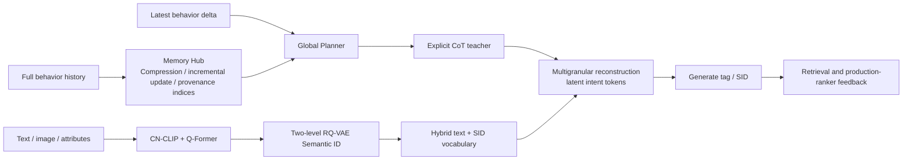
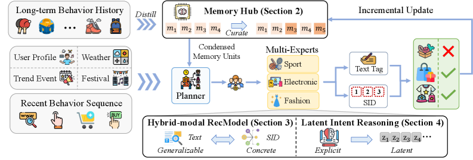

<!-- source-sha256: cd223db758c2d1ef0b2628b8bd66761a6bb1e288d58fd19e98ac42fd3d98f457 -->

[简体中文](README.md) · English

# RecGPT-V3: Stateful, hybrid-modal generative recommendation

> **Fidelity: core-mechanism reproduction.** Trains two-level Semantic IDs, a structured Memory Hub, explicit teacher-to-latent reconstruction distillation, and ranking feedback. The foundation model, data, and serving system are scaled down.

## Paper information

| Field | Details |
| --- | --- |
| Paper | [arXiv 2607.15591](https://arxiv.org/abs/2607.15591) |
| Institution | Alibaba / Taobao |
| First public release | 2026-07-17 (arXiv v1) |
| Author code | No official or author-released code found in the paper (checked 2026-08-09). |
| Local adapter or method key | `recgpt-v3` |
| Local reproduction code | [`src/auto_research/reproductions/recgpt_v3/`](https://github.com/daiwk/auto-research/tree/main/src/auto_research/reproductions/recgpt_v3/) |

## Original paper summary

### Background and main changes

RecGPT-V1 introduced user intent into recommendation; V2 expanded inference using multiple agents. Each request still reread the full history of up to about 55K tokens. Mapping natural-language tags to products was lossy, and thousands of explicit CoT tokens were impractical at high QPS. V3 changes three parts:

1. **Memory Hub** compresses behavior into traceable memory units with behavior patterns, preference summaries, raw behavior indices, and timestamps. New behavior updates related units or creates new ones.
2. **Hybrid-modal foundation model** fuses content with CN-CLIP/Q-Former and quantizes products into SIDs with a two-level RQ-VAE. It adds 65,536 SID tokens to the Qwen3-14B vocabulary and learns `SID↔text` and `SID→SID` through continued pretraining and SFT.
3. **Latent Intent Reasoning** compresses the teacher's long CoT segments into at most 10 latent tokens, keeps interpretability through single-segment, multisegment, and full-chain reconstruction, and uses the production ranker's CTRScore for RLRF.



<!-- paper-figure:start -->
### Key figure from the paper

[](https://arxiv.org/html/2607.15591v2/x2.png)

> **Figure 2:** Overall design and components. From the [paper](https://arxiv.org/abs/2607.15591); copyright belongs to the authors. Click for the source.
<!-- paper-figure:end -->

### Core equations

Initial Memory Hub compression and incremental updates:

$$
\mathcal M=\mathcal F_\phi(\mathcal B),\qquad
\mathcal M^{(t+\delta)}=\mathcal G\!\left(\mathcal M^{(t)},\Delta\mathcal B^{(t,t+\delta)}\right).
$$

Two-level RQ-VAE quantizes each item embedding into $\mathrm{SID}(i)=(c_1,c_2)$. The model jointly trains `sid2title`, `title2sid`, `sid2tag`, `tag2sid`, `sid2cmd`, and sequential `sid2sid`.

Explicit reasoning $R$ is split into $K$ segments and replaced by latent tokens:

$$
K=\min\!\left(\left\lceil\frac{N}{C}\right\rceil,K_{\max}\right),\qquad
\mathcal L(\mathcal J)=-\log p_\theta\!\left(R_{\mathcal J}\mid c(\mathcal J),\mathcal P\right).
$$

RLRF takes dense rewards directly from the downstream ranker:

$$
r_{\mathrm{ctr}}(y)=\frac{1}{K}\sum_{k=1}^{K}s_k,\qquad
\mathcal R(y)=r_{\mathrm{ctr}}(y)\prod_{q\in\{\mathrm{align,div,len}\}}\mathbf 1[q(y)\ge\tau_q].
$$

### Offline and online results

- Human accuracy for Memory Hub patterns and indices is `82.89% / 95.27%`. Total Global Planner compute falls `55.8%` from V2.
- The hybrid model starts from Qwen3-14B. With general data mixed in, GSM8K drops from `94.31%` to `92.65%`; without it, it drops to `4.70%`. Continued pretraining/SFT cannot use recommendation data alone.
- Latent reasoning compresses about 2,300 explicit reasoning tokens into at most 10 latent tokens. The paper reports about `200×` lower inference token cost and `52.4%` less end-to-end serving resource.
- Taobao's “You May Also Like” allocates `1%` traffic each to the V3 arm and RecGPT-V2 control. Item: IPV `+3.08%`, CTR `+0.98%`, TC `+3.10%`, GMV `+7.51%`. Feed: IPV `+1.28%`, CTR `+1.00%`, DAU `+0.56%`, TC `+1.97%`, GMV `+3.97%`.

## Local reproduction

> **Local comparison:** The same MovieLens-1M split, item tower, and training steps are used in both arms. The stateless hybrid Transformer baseline recomputes a full 40-event history. The experimental arm adds a 6-slot Memory Hub, 8 recent events, 4 latent tokens, teacher warmup, reconstruction, and ranking feedback. Relative NDCG@10 rises **`+36.96%`**.

The run uses 360 users and 520 items from MovieLens-1M, full-item ranking, and seed 42. Baseline Hit@10/NDCG@10 are `0.0556 / 0.0279`; V3 reaches `0.0778 / 0.0382`. Memory input falls from 40 to 14 tokens (`-65.00%`), and latent reasoning slots from 40 to 4 (`-90.00%`), with reconstruction cosine `0.8189`. Head share also rises from `0.1108` to `0.1900`, so the local gain comes with stronger popularity concentration.

When the teacher and student drifted together in the first round, relative NDCG was `-26.65%`. The second round warmed up and froze the explicit teacher before latent internalization, yielding the reported result and becoming the selected setting. See [`metrics/movielens-1m-seed42.json`](metrics/movielens-1m-seed42.json).

```bash
auto-research reproduce --paper recgpt-v3 --seed 42
```

## Scope

The local run trains two-level RQ-VAE, the SID/text item tower, explicit teacher, memory attention, multi-segment latent reconstruction, and dense ranking-feedback KL. MovieLens genres substitute for Taobao text/image/attributes, 520 items for the industrial pool, and a public teacher plus popularity reward for the production CTR ranker. This is not Qwen3-14B continued pretraining/SFT, a DeepSeek-V3.2 teacher, online GRPO, or a production resource test. Local `+36.96%` is not the paper's online lift.
