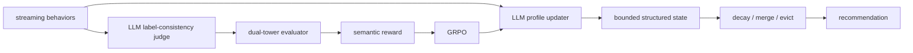
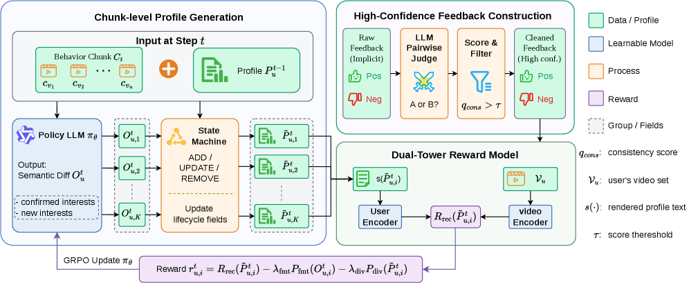

<!-- source-sha256: 5ab8da9461cf7b4c7acb4ad5d9baca8fe82f51dbd9c8d57ee742b18b4d869a6b -->

[简体中文](README.md) · English

# RECAP: Closed-loop recommendation feedback for streaming semantic profiles

> **Fidelity: core-mechanism reproduction.** Trains a causal Transformer updater, a two-tower evaluator, and clipped GRPO, and runs a fixed-capacity profile state machine.

## Paper information

| Field | Details |
| --- | --- |
| Paper | [arXiv 2607.15730](https://arxiv.org/abs/2607.15730) |
| Institution | Kuaishou Technology / USTC |
| First public release | 2026-07-17 (arXiv v1) |
| Author code | No official or author-released code found in the paper (checked 2026-08-09). |
| Local adapter or method key | `recap` |
| Local reproduction code | [`src/auto_research/reproductions/recap/`](https://github.com/daiwk/auto-research/tree/main/src/auto_research/reproductions/recap/) |

## Original paper summary

### Background and main changes

Conventional LLM profiles aim to summarize users plausibly without directly optimizing future recommendations. RECAP makes the profile a structured, capacity-constrained streaming state. The LLM handles semantic updates, while deterministic logic handles lifecycle, merging, and eviction. An LLM judge screens for label-consistent behavior pairs, a two-tower evaluator learns from them, and its matching score becomes the GRPO reward for closing the profile-update loop.



<!-- paper-figure:start -->
### Key figure from the paper

[](https://arxiv.org/html/2607.15730v1/x1.png)

> **Figure 1:** The core architecture, its main modules, and their connections. From the [paper](https://arxiv.org/abs/2607.15730); copyright belongs to the authors. Click for the source.
<!-- paper-figure:end -->

### Core equations

RECAP samples a group of profile updates $o_i$ for the same context and normalizes advantages within the group:

$$
A_i=\frac{r_i-\operatorname{mean}(r)}{\operatorname{std}(r)+\epsilon},\qquad
r_i=s_{\mathrm{eval}}(p_i,b^+).
$$

The policy update uses clipped ratios with reference KL, format, and diversity constraints. The state machine always satisfies $|P_t|\le C$.

### Offline and online results

Compared with the base generator, offline uAUC rises `+0.0084` absolute and Recall@2000 rises about `+4.9%`. In a 7-day online A/B test, time spent in the app per user rises significantly by `+0.139%`.

## Local reproduction

> **Local comparison:** The baseline is an open-loop SFT streaming profile. The experimental arm adds the feedback evaluator and GRPO. Relative NDCG@10 changes by **`-6.77%`**.

MovieLens-100K uses 220 users and 360 items. Genre tokens provide interpretable semantics, and profile capacity is 4. GRPO mean reward rises from `0.5245` to `0.7096`, but test NDCG falls from `0.04838 to 0.04511` and head share from `0.2400 to 0.1914`. Local evaluator reward gains do not transfer reliably to next-item metrics. See [`metrics/movielens-100k-seed42.json`](metrics/movielens-100k-seed42.json).

```bash
auto-research reproduce --paper recap --seed 42
```

## Scope

Natural-language profiles and industrial LLMs are scaled down to a category-token causal Transformer. There are no private Kuaishou logs, production LLM judge, or online feedback loop. The core SFT → evaluator → GRPO → bounded-state pipeline executes, but it does not reproduce online gains.
