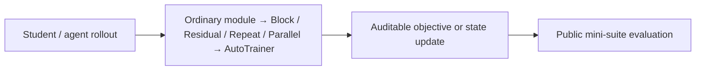
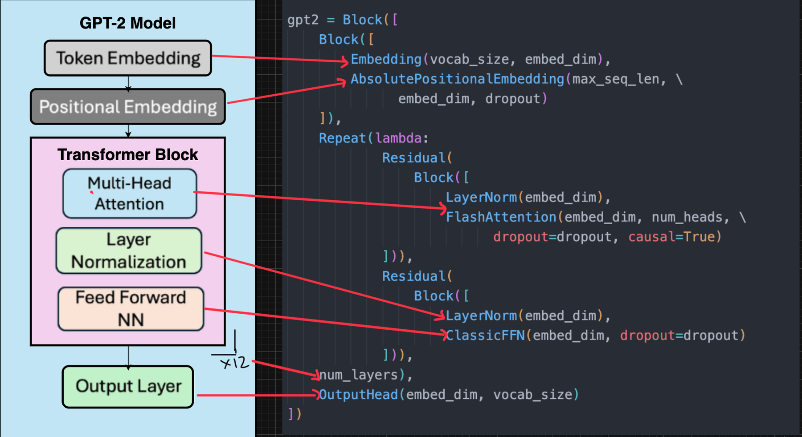

<!-- source-sha256: 5cdc9361687e729b18bda418a58f9d0d1d45a6363c14abf54ed0ffcc1457734e -->

[简体中文](README.md) · English

# OpenLanguageModel: Readable, composable small-model pretraining for education and research

> **Fidelity: core-mechanism reproduction.** Public data verifies the mechanism without simulating production traffic.

## Paper information

| Field | Details |
| --- | --- |
| Paper | [arXiv 2607.16669](https://arxiv.org/abs/2607.16669) |
| Institution | Indian Institute of Technology Madras |
| First public release | 2026-07-18 (arXiv v1) |
| Author code | [Official author code](https://github.com/openlanguagemodel/openlanguagemodel) |
| Local adapter or method key | `open-language-model` |
| Local reproduction code | [`src/auto_research/reproductions/open_language_model/`](https://github.com/daiwk/auto-research/tree/main/src/auto_research/reproductions/open_language_model/) |

## Original paper summary

### Background and main changes

Many pretraining frameworks tightly couple the model architecture, training loop, and distributed runtime, making transparent ablations difficult. OLM keeps components as ordinary PyTorch modules and expresses wiring with Block, Residual, Repeat, and Parallel. The same model can move from a notebook to CPU, one GPU, or multiple GPUs on one host.



<!-- paper-figure:start -->
### Key figure from the paper

[](https://arxiv.org/html/2607.16669v1/figures/gpt2-architecture-code.png)

> **Figure 1:** Overall design and components. From the [paper](https://arxiv.org/abs/2607.16669); copyright belongs to the authors. Click for the source.
<!-- paper-figure:end -->

### Core equations

$$
h_{l+1}=\operatorname{Block}_l(h_l),\quad \operatorname{Residual}(f)(x)=x+f(x),\quad \operatorname{Parallel}(f,g)(x)=f(x)+g(x).
$$

### Offline and online results

The authors provide 27 presets across 9 model families. At 348M parameters, four-GPU weak-scaling efficiency is 90.6%, and results closely match an independent reference implementation. No production A/B test is reported.

## Local reproduction

> **Local comparison:** Same-budget LLaMA-modern is the baseline, and `olm_composable` is the experimental arm. Relative PPL change is −0.000001%.

The `olm_composable` genome exposes ordinary modules, the four composition operators, and cpu/mps/cuda portability. It is an evolve candidate after live paper retrieval.

On WikiText-2, at 30 steps and seed 42, PPL is 313.27 for both same-budget LLaMA-modern and OLM composable, with 139584 parameters each. This verifies that the compositional DSL preserves execution semantics; the near-zero difference is not a quality improvement.

```bash
auto-research reproduce --paper open-language-model --dataset-dir data --seed 42
auto-research evolve --model micro-llm --dataset wikitext-2 --direction "探索 open-language-model 的已安装核心算子" --generations 2 --population 4
```

Stable metrics: [`metrics/public-seed42.json`](metrics/public-seed42.json).

## Scope

The reproduction does not port the entire upstream package or its 27 presets and does not reproduce the 348M-parameter four-GPU run. It verifies architectural semantics and a shared evaluator interface locally.
