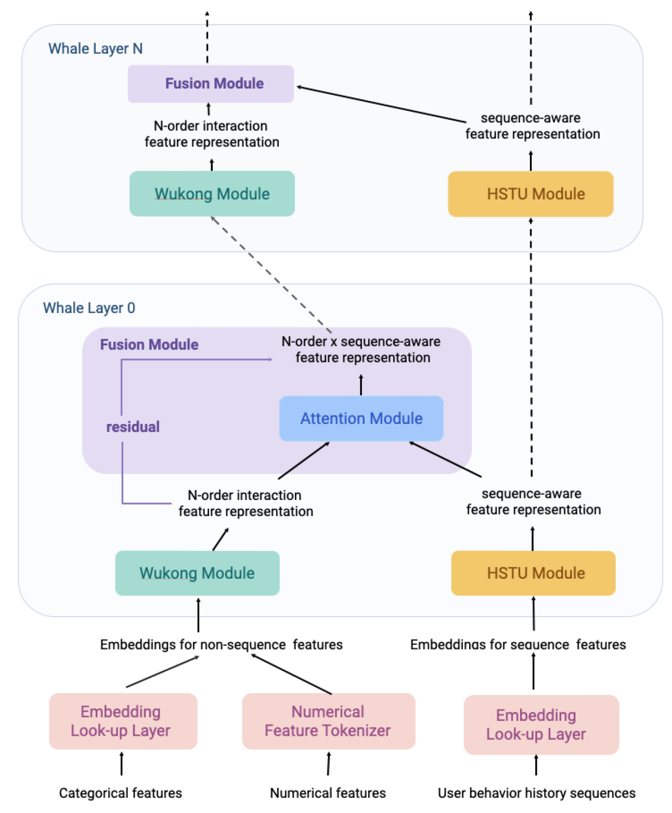

# WHALE: A unified Wukong–HSTU recommender

<!-- source-sha256: 1b14d300547e596cf5c3eb2628b50ca8ebba2fefdb8785aa7ff8edcbea29fec6 -->

[简体中文](README.md)

> Actual Wukong, HSTU, and per-layer exchange; no production kernels or private features.

## Paper information

| Field | Details |
|---|---|
| Paper | [Paper or original source](https://arxiv.org/abs/2607.17017) |
| Institution | Meta Platforms, Inc. |
| First public release | 2026-07-19 (arXiv v1) |
| Author code | No official author code linked by the paper as checked on 2026-08-09. |
| Local adapter or method key | `whale` |
| Local reproduction code | [`src/auto_research/reproductions/whale/`](https://github.com/daiwk/auto-research/tree/main/src/auto_research/reproductions/whale/) |

## Paper method and evidence

A Wukong branch recursively models higher-order feature interactions and an HSTU branch models behavior sequences. Bidirectional cross-attention exchanges states each layer rather than scaling separate towers independently.


<!-- paper-figure:start -->
### Original paper figure

[](https://arxiv.org/html/2607.17017v1/x5.png)

The original figure shows progressive branch exchange. From the [original paper](https://arxiv.org/abs/2607.17017); copyright remains with the authors.
<!-- paper-figure:end -->

### Core equation

$$
x_{l+1}=W_l(x_l)+\operatorname{Attn}(Q=x_l,K=h_l,V=h_l),
$$

$$
h_{l+1}=\operatorname{HSTU}_l(h_l)+
\operatorname{Attn}(Q=h_l,K=x_l,V=x_l).
$$

### Reported results

Meta 14-day A/B: primary metric +0.113%, Metric 1 +0.824%, Metric 2 +1.820%; inference QPS about 5% lower, reflecting a serving tradeoff.

## Local reproduction

Train multiplicative Wukong interactions, gated causal HSTU and layerwise cross-attention. Match late-fusion control width/depth: seed-42 NDCG@10 **0.00429→0.00072 (-83.20%)**. [Metrics](metrics/movielens-100k-seed42.json). No private ultra-sparse features, original scale or Triton/AOTInductor kernels. The local decline is retained.

```bash
auto-research reproduce --paper whale --dataset-dir data --seed 42
```
