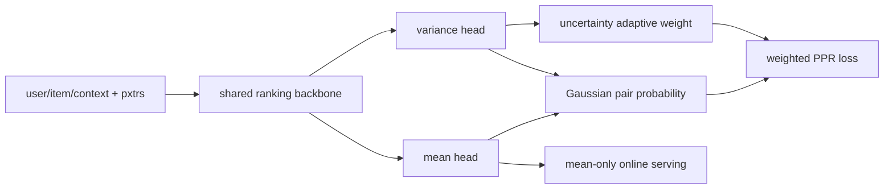
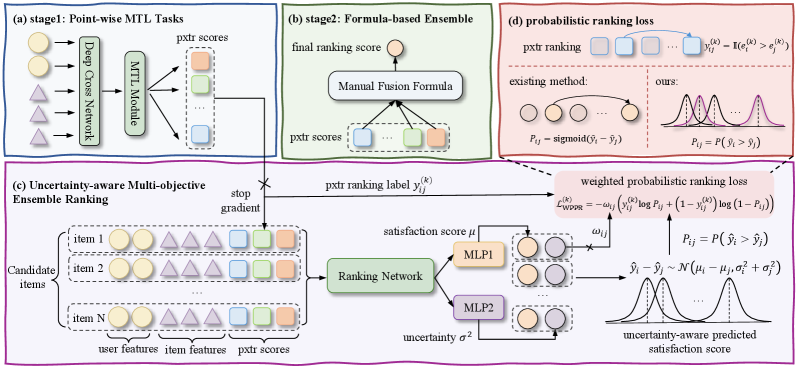

# UAME: Predictive uncertainty for conflicting satisfaction objectives

<!-- source-sha256: a4e044005755b2e95e3d9ae553ff6f5ecd1c5f894b837d77253334721144738c -->

[简体中文](README.md)

> **Fidelity: Core mechanism.** Trains two Gaussian score heads, a probabilistic pairwise loss, conflict constraints, and uncertainty weighting. Public proxies replace eight private pxtr signals and the production backbone.

## Paper information

| Field | Value |
| --- | --- |
| Paper link | [arXiv 2607.17092](https://arxiv.org/abs/2607.17092) |
| Organization | Kuaishou Technology |
| First published | 2026-07-19 (arXiv v1) |
| Original author code | No official or author code was provided in the paper (checked 2026-08-09). |
| Adapter | `uame` |
| Local reproduction code | [`src/auto_research/reproductions/uame/`](https://github.com/daiwk/auto-research/tree/main/src/auto_research/reproductions/uame/) |

## Original paper summary

### Background and main changes

Clicks, views, and likes are conflicting proxies for unobserved true satisfaction. UAME adds mean and variance heads to shared EMER/EASQ representations and treats scores as Gaussian variables. Analytical pair probabilities combine pxtr objectives, giving higher weight to more conflicted pairs. Serving uses only the mean, without extending the online path.



<!-- paper-figure:start -->
### Key figure from the paper

[](https://arxiv.org/html/2607.17092v1/x1.png)

**Original Figure 1 (architecture):** Main modules and their connections. Image from the [original paper](https://arxiv.org/abs/2607.17092); copyright belongs to the authors. Click the image for its source.
<!-- paper-figure:end -->

### Core equations

$$
\hat y_i=\mu_i+\sigma_i\epsilon_i,\quad
P(\hat y_i>\hat y_j)=\Phi\!\left(\frac{\mu_i-\mu_j}{\sqrt{\sigma_i^2+\sigma_j^2}}\right).
$$

$$
\omega_{ij}=\gamma\frac{U_{ij}-\min U}{\max U-\min U},\quad
U_{ij}=\sigma_i^2+\sigma_j^2.
$$

The objective combines weighted multi-pxtr PPR with variance regularization and an auxiliary conflict constraint.

### Offline and online results in the paper

Offline, the largest relative lift on EMER is `5.8%`; plvtr on EASQ gains `+14.2%`. Both online groups use `5%` of main-feed traffic for 7 days at `p<0.005`. EMER LongView and Forward change `+1.614%` and `+1.325%`; EASQ LongView and Forward change `+1.126%` and `+1.598%`.

## Local reproduction

> **Control:** Deterministic multi-objective pairwise ranking on the same backbone versus full UAME loss. Relative NDCG@10 is **`-62.28%`**.

MovieLens-100K uses 220 users and 360 items. Transition, genre similarity, and popularity are three proxies. Conflict is the standard deviation of candidate ranks across them. Baseline/UAME NDCG@10 is `0.05798 / 0.02187`. Both losses decrease, but UAME lowers head share from `0.6736` to `0.0764`. The proxy conflict structure does not align with next-item satisfaction. See [metrics/movielens-100k-seed42.json](metrics/movielens-100k-seed42.json).

```bash
auto-research reproduce --paper uame --seed 42
```

## Reproduction limits

Kuaishou's eight pxtr signals, EMER/EASQ models, survey satisfaction, and hundreds-of-millions-scale traffic are unavailable. The negative result shows this public proxy mapping does not reproduce paper gains and is not interchangeable with online lift.
