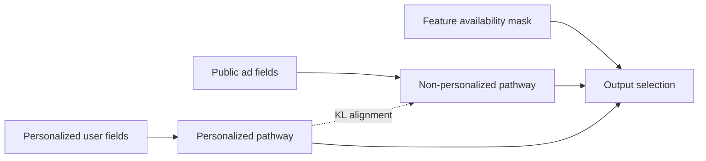
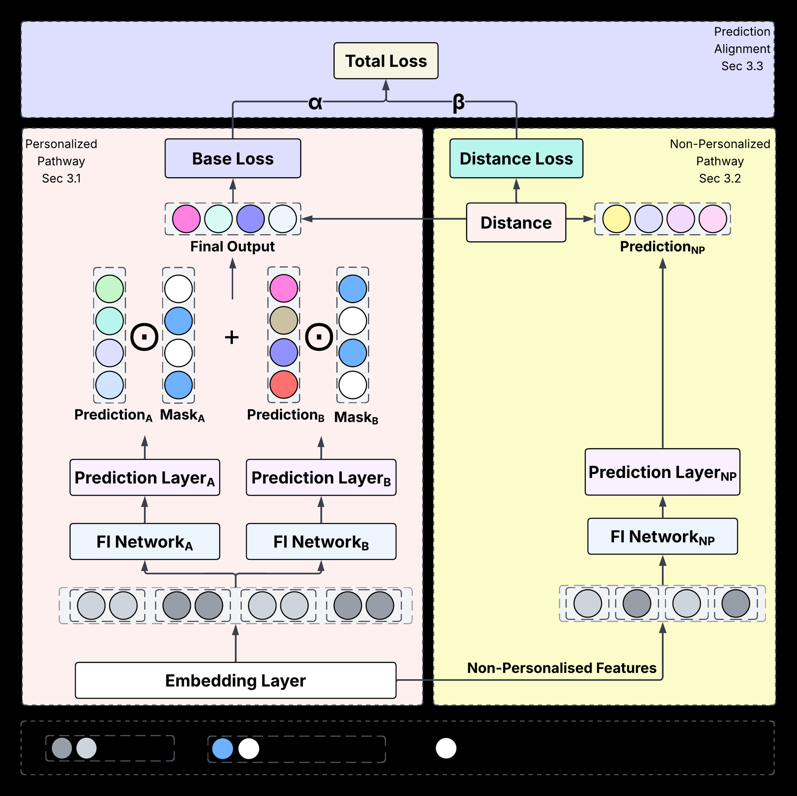

<!-- source-sha256: 8a2ff087e95f405bfca678d8177d83d50345470f1d68863c3f0c8387896afb6f -->

[简体中文](README.md) · English

# RAMP: Robust ad recommendation with restricted personalization features

> **Core mechanism reproduction.** Masked dual pathways and prediction alignment are actually trained. Private industrial CVR data is not reproduced.

## Paper information

| Field | Details |
| --- | --- |
| Paper | [arXiv 2607.17473](https://arxiv.org/abs/2607.17473) |
| Institutions | Huawei Ireland Research Center / University College Dublin |
| First public release | 2026-07-20 (arXiv v1) |
| Author code | Yes: [official repository](https://github.com/Ruixinhua/RAMP) |
| Adapter | `ramp` |
| Local reproduction code | [`src/auto_research/reproductions/ramp/`](https://github.com/daiwk/auto-research/tree/main/src/auto_research/reproductions/ramp/) |

## Original paper summary

### Background and main changes

Privacy choices, permissions and platform limits can hide personalized fields for some traffic. Instead of zero-filling, RAMP maintains personalized and non-personalized paths, selects output with an availability mask, and aligns predictions to distill knowledge from the feature-rich path into the restricted one.



<!-- paper-figure:start -->
### Key figure from the paper

[](https://arxiv.org/html/2607.17473v1/fig/FCN-MT.png)

> **Figure 2:** Core architecture and connections. From the [paper](https://arxiv.org/abs/2607.17473); copyright belongs to the authors. Click for the source.
<!-- paper-figure:end -->

### Core equations

$$
\hat y=m\hat y_{\mathrm{personal}}+(1-m)\hat y_{\mathrm{public}},
$$

$$
\mathcal L=\mathcal L_{\mathrm{CTR}}+
\lambda\,\operatorname{KL}\!\left(
p_{\mathrm{personal}}\;\|\;p_{\mathrm{public}}
\right).
$$

### Offline and online results

Relative AUC gains on the paper's public data are around 0.10%–0.87%, with offline significance $p<0.001$. Industrial CVR A/B reports more than 3% lift in Total Advertiser Value.

## Local reproduction

MovieLens behavior vectors proxy restricted personalization fields, and genres proxy public ad fields. Training runs both paths, output masking and KL alignment from the feature-rich teacher to the restricted path. Test specifically evaluates traffic without personalized fields.

> **Comparison:** Shared CTR tower with missing personalization versus the RAMP masked dual tower. Seed 42 NDCG@10 rises from 0.00103 to 0.00533, +417.23% relative.

Stable metrics: `metrics/movielens-100k-seed42.json`. Absolute values are low and the proxy task is much smaller than industrial CVR. This shows relative robustness to missing features only.

```bash
auto-research reproduce --paper ramp --dataset-dir data --seed 42
```
