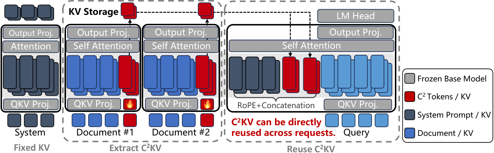

# C²KV: Compressed and Composable KV Cache Reuse for Efficient LLM Inference

<!-- source-sha256: 23cf32876877e8f309779a699bd74df42b7725d1a291dee167283fd4a745c149 -->

[简体中文](README.md)

> Small NumPy core diagnostic, not paper-scale inference.

## Paper information

| Field | Details |
|---|---|
| Paper | [Paper or original source](https://arxiv.org/abs/2607.17715) |
| Institution | Shanghai Jiao Tong University; first author Chuheng Du. |
| First public release | 2026-07-20 (arXiv v1) |
| Author code | [s7a9/C2KV](https://github.com/s7a9/C2KV). |
| Local adapter or method key | `c2kv` |
| Local reproduction code | [`src/auto_research/reproductions/c2kv/`](https://github.com/daiwk/auto-research/tree/main/src/auto_research/reproductions/c2kv/) |

## Paper method and evidence

Learn position-independent, composable KV representations with compression tokens and structured attention, jointly training compression and reuse.


<!-- paper-figure:start -->
### Original paper figure

[](https://arxiv.org/html/2607.17715v1/3.1.Architecture.png)

Figure shows composable cache reuse. From the [original paper](https://arxiv.org/abs/2607.17715); copyright remains with the authors.
<!-- paper-figure:end -->

### Core equation

$$
Z=\operatorname{Extractor}(KV),\quad \hat y=F([Z_1;\ldots;Z_m])
$$

### Reported results

The paper reports up to 17× inference speedup across long-context benchmarks while retaining generation quality.

## Local reproduction

Same 64 examples and seed: recent-window baseline **0.0781**, C²KV **0.8438**, **+76.56 percentage points**. [Metrics](metrics/public-seed42.json), [batch index](../../experiments/historical-b07-b11-seed42.json). No paper-scale checkpoint, custom CUDA kernel or full benchmark.

```bash
auto-research reproduce --paper c2kv --seed 42
```
