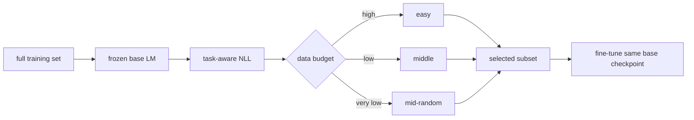
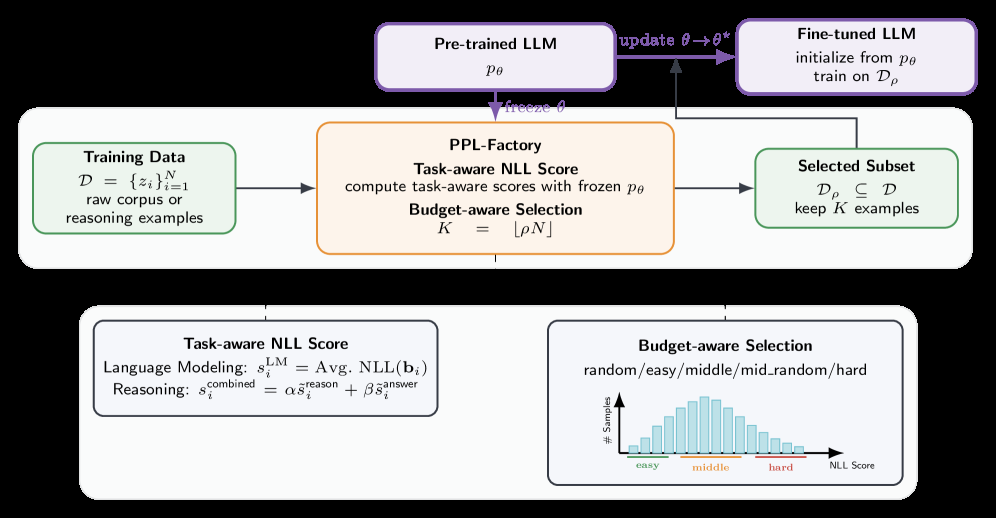

<!-- source-sha256: c5cdf8c6bbab440b533bce87167510fca894bb6eda24c621db3c7fc649f4b699 -->

[简体中文](README.md) · English

# PPL-Factory: Task- and budget-aware data selection

> **Fidelity: core-mechanism reproduction.** Trains and freezes a scorer, computes per-block NLL, and fine-tunes equally budgeted random, easy, and middle subsets from the same checkpoint.

## Paper information

| Field | Details |
| --- | --- |
| Paper | [arXiv 2607.18199](https://arxiv.org/abs/2607.18199) |
| Institution | McGill University |
| First public release | 2026-07-20 (arXiv v1) |
| Author code | No official or author-released code found in the paper (checked 2026-08-09). |
| Local adapter or method key | `ppl-factory` |
| Local reproduction code | [`src/auto_research/reproductions/ppl_factory/`](https://github.com/daiwk/auto-research/tree/main/src/auto_research/reproductions/ppl_factory/) |

## Original paper summary

### Background and main changes

A fixed rule to choose the hardest or easiest examples can fail as the task and budget change. PPL-Factory uses a frozen base model to compute task-aware NLL: packed blocks for language modeling, and only reasoning/answer tokens for reasoning SFT. High budgets favor easy examples, lower budgets select middle examples, and very low budgets sample randomly from the middle pool to preserve coverage.



<!-- paper-figure:start -->
### Key figure from the paper

[](https://arxiv.org/html/2607.18199v1/x1.png)

> **Figure 1:** The core architecture, its main modules, and their connections. From the [paper](https://arxiv.org/abs/2607.18199); copyright belongs to the authors. Click for the source.
<!-- paper-figure:end -->

### Core equations

The score of a language-model block is:

$$
s_i^{\mathrm{LM}}=\frac{1}{B-1}\sum_{t=1}^{B-1}-\log p_\theta(b_{i,t+1}\mid b_{i,1:t}).
$$

The paper expresses the selection distribution as a trade-off between utility and coverage:

$$
Q_\rho^*(s)\propto P(s)\exp\!\left(u_\rho(s)/\lambda_\rho\right).
$$

### Offline and online results

On GSM8K, the method beats competing selection approaches with just `1%` of the data. With `10%` of the data, it gains `+0.9` points on GSM8K and `+4.8` points on MATH versus full-data fine-tuning. The industrial online A/B gate does not apply to a standalone LLM paper.

## Local reproduction

> **Local comparison:** The baseline uses 20% random blocks. The experimental arm selects blocks near the median by the paper's budget rule. The relative perplexity improvement is **`-1.79%`**, meaning perplexity worsens by `1.79%`.

On WikiText-2, the scorer is frozen after 25 steps and scores 65-token blocks by NLL. Each arm selects 430 blocks and trains for 45 steps from the same checkpoint. Random, Easy, and PPL-Factory test PPL are `329.214 / 324.926 / 335.097`. Easy works best at the local 20% budget; the paper's middle rule does not transfer. See [`metrics/wikitext-2-seed42.json`](metrics/wikitext-2-seed42.json).

```bash
auto-research reproduce --paper ppl-factory --seed 42
```

## Scope

Only the CLM packed-block branch is reproduced. The run does not use Qwen2.5-7B, GSM8K/MATH response-only NLL, or answer accuracy. The negative local result is retained but does not refute the original paper.
