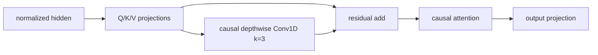
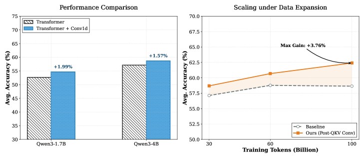

<!-- source-sha256: 90d40f31121da55e257ddc9dc2b37bd5ef73f70d34dbaefe3e2cb511eef16c36 -->

[简体中文](README.md) · English

# Convolution for LLMs: Lightweight local convolution complements attention

> **Core mechanism reproduction.** Actual matched-budget pretraining of a Transformer and a post-QKV residual depthwise Conv1D variant, with smaller model and corpus.

## Paper information

| Field | Details |
| --- | --- |
| Paper | [arXiv 2607.18413](https://arxiv.org/abs/2607.18413) |
| Institution | Huawei / Peking University / Tsinghua University |
| First public release | 2026-07-20 (arXiv v1) |
| Author code | No official author code in the paper when checked on 2026-08-09. |
| Local adapter or method key | `conv-llm` |
| Local reproduction code | [`src/auto_research/reproductions/conv_llm/`](https://github.com/daiwk/auto-research/tree/main/src/auto_research/reproductions/conv_llm/) |

## Original paper summary

### Background and main changes

Self-attention handles global dependencies without an explicit short-range inductive bias. The paper compares 17 convolution placements on a fixed Qwen3 backbone and selects depthwise 1D convolution with `kernel=3` after linear Q/K/V projection and before attention aggregation. A residual keeps the original projection; no normalization or activation is added, and additional parameters are below `0.01%`.



<!-- paper-figure:start -->
### Key figure from the paper

[](https://arxiv.org/html/2607.18413v1/x1.png)

> **Figure 1:** Training workflow and key optimizations. From the [paper](https://arxiv.org/abs/2607.18413); copyright belongs to the authors. Click for the source.
<!-- paper-figure:end -->

### Core equations

For concatenated projection $Z=[Q;K;V]$, local augmentation is

$$
\widetilde Z=Z+\operatorname{DWConv}_{k=3}(Z),\qquad
\operatorname{Attention}(\widetilde Q,\widetilde K,\widetilde V).
$$

The local convolution pads on the left, so it cannot read future tokens.

### Offline and online results

Qwen3-1.7B perplexity falls from `13.42` to `12.79` in the ablation. Mean scores on seven downstream benchmarks improve overall across Qwen3 sizes and pretraining token budgets. The production A/B gate does not apply to this LLM study.

## Local reproduction

> **Comparison:** Same 96-dimensional, 3-layer, 60-step Transformer, adding only post-QKV residual depthwise Conv1D. Test perplexity is **`0.29%`** lower.

WikiText-2: 240k train tokens, 32k test tokens. Both arms share seed, tokens, optimizer and update count. Transformer PPL `305.664`; QKV-Conv `304.787`. See [stable metrics](metrics/wikitext-2-seed42.json).

```bash
auto-research reproduce --paper conv-llm --seed 42
```

## Scope

The Qwen3-0.6B/1.7B/4B models, large pretraining corpus and seven downstream tasks were not run. Results only establish the direction of change for a small model with a short budget.
