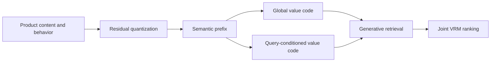
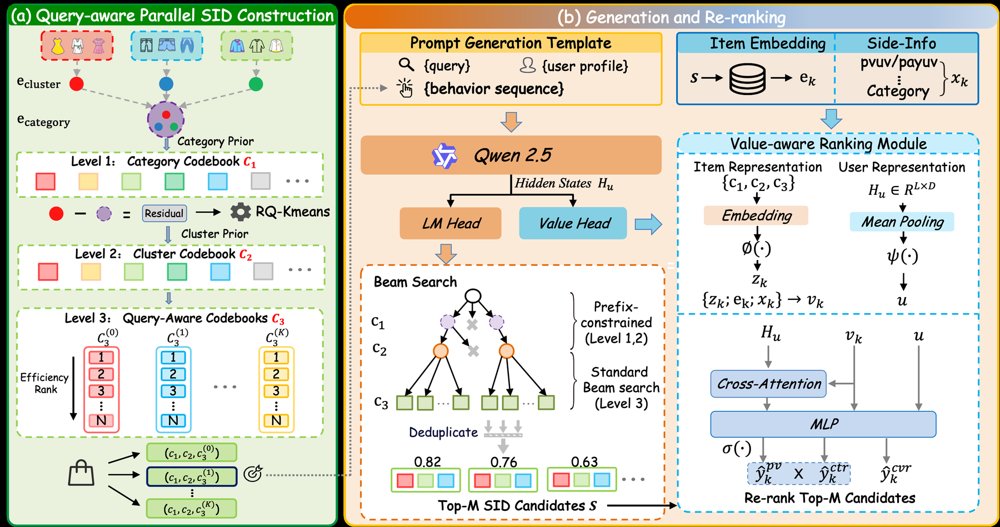

<!-- source-sha256: accdf6b5cdc9385e2b529a43da3d68ee3c68b578523f2d50cb930aa2a6280045 -->

[简体中文](README.md) · English

# TSGR: Generative retrieval for Taobao Search

> **Fidelity: core-mechanism reproduction.** Runs parallel value Semantic IDs and a jointly trained VRM. Private Taobao logs and production serving are not reproduced.

## Paper information

| Field | Details |
| --- | --- |
| Paper | [arXiv 2607.18796](https://arxiv.org/abs/2607.18796) |
| Institution | Taobao & Tmall Group of Alibaba / Zhejiang University |
| First public release | 2026-07-21 (arXiv v1) |
| Author code | No official or author-released code found in the paper (checked 2026-08-09). |
| Local adapter or method key | `tsgr` |
| Local reproduction code | [`src/auto_research/reproductions/tsgr/`](https://github.com/daiwk/auto-research/tree/main/src/auto_research/reproductions/tsgr/) |

## Original paper summary

### Background and main changes

Taobao Search must retrieve relevant products while incorporating commercial value into generation. TSGR uses residual quantization for a semantic prefix and assigns global and query-conditioned value codes in parallel to products sharing that prefix. A Value-aware Ranking Module (VRM), trained jointly with the generative backbone, does fine ranking without appending an independent pre-ranker to the generator.



<!-- paper-figure:start -->
### Key figure from the paper

[](https://arxiv.org/html/2607.18796v2/Figures/main.png)

> **Figure 1:** The core architecture, its main modules, and their connections. From the [paper](https://arxiv.org/abs/2607.18796); copyright belongs to the authors. Click for the source.
<!-- paper-figure:end -->

### Core equations

The item identifier combines semantic and parallel value codes:

$$
\operatorname{ID}(i,q)=(c_1,\ldots,c_L,v_i^{\mathrm{global}},v_{i,q}^{\mathrm{query}}).
$$

VRM jointly scores the generative state, product-side information, and value signals:

$$
s(q,i)=f_\theta(h_q,e_i,v_i^{\mathrm{global}},v_{i,q}^{\mathrm{query}}),
\qquad
\mathcal L=-\sum_{i\in P_q}w_i\log \sigma(s_{q,i})
-\sum_{j\in N_q}\log \sigma(-s_{q,j}).
$$

### Offline and online results

Paper offline HR@1000 improves 9.16% relative. In a 38-day A/B test on 1% of Taobao Search traffic, IPV rose +0.43%, completed transactions +1.12%, and GMV +1.64%. The paper reports full deployment.

## Local reproduction

On MovieLens 100K, the local run builds a two-level residual semantic prefix and global/conditional value codes. It fits the joint VRM using 23,027 weighted positives and 115,135 negatives, choosing the blend weight on validation only.

> **Local comparison:** The baseline uses semantic retrieval and a proxy for traditional pre-ranking. The experimental arm uses QP-SID and joint VRM. At seed 42, NDCG@10 rises from 0.02629 to 0.05672, a relative gain of +115.73%.

Stable metrics: `metrics/movielens-100k-seed42.json`. This verifies that the mechanism runs on public substitute data; it is not Taobao's private queries, commercial labels, or H20 beam-search serving stack.

```bash
auto-research reproduce --paper tsgr --dataset-dir data --seed 42
```
