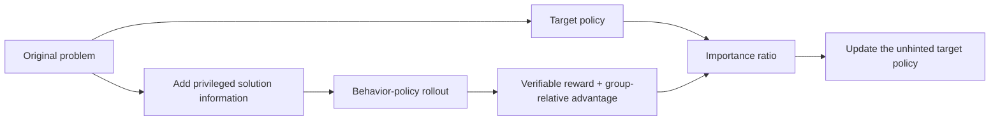
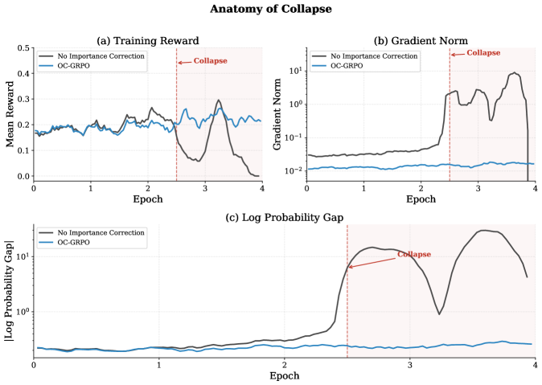

<!-- source-sha256: af4d6b64a44e67a1a979d634fb12e4af7b73778ac971d59ff62baeaa7815e95f -->

[简体中文](README.md) · English

# Off-Context GRPO: Learning difficult reasoning with privileged information

> **Fidelity: core-mechanism reproduction.** Runs privileged rollouts and importance correction without reproducing large Qwen2.5 training.

## Paper information

| Field | Details |
| --- | --- |
| Paper | [arXiv 2607.19313](https://arxiv.org/abs/2607.19313) |
| Institution | Meta AI / Columbia University |
| First public release | 2026-07-21 (arXiv v1) |
| Author code | [Official author code](https://github.com/AgPriyank/OC-GRPO) |
| Local adapter or method key | `off-context-grpo` |
| Local reproduction code | [`src/auto_research/reproductions/off_context_grpo/`](https://github.com/daiwk/auto-research/tree/main/src/auto_research/reproductions/off_context_grpo/) |

## Original paper summary

### Background and main changes

On hard problems, vanilla GRPO can lack a useful advantage signal because every rollout in a group fails. Off-Context GRPO gives the behavior policy privileged information such as solution drafts or hints only during sampling, making successful trajectories more likely. The target remains the original unhinted policy, and an importance ratio corrects for the difference in sampling distributions. Inference does not need privileged context.



<!-- paper-figure:start -->
### Key figure from the paper

[](https://arxiv.org/html/2607.19313v1/x2.png)

> **Figure 3:** Overall design and components. From the [paper](https://arxiv.org/abs/2607.19313); copyright belongs to the authors. Click for the source.
<!-- paper-figure:end -->

### Core equations

$$
\hat A_i=r_i-\frac{1}{G}\sum_{j=1}^{G}r_j,
\qquad
\rho_i=\frac{\pi_\theta(y_i\mid x)}
{q(y_i\mid x,z_{\mathrm{priv}})},
$$

$$
\mathcal L_{\mathrm{OC}}
=-\frac{1}{G}\sum_i
\operatorname{clip}(\rho_i)\hat A_i
\log\pi_\theta(y_i\mid x).
$$

### Offline and online results

This is a standalone LLM training paper, so the industrial online A/B criterion does not apply. On Qwen2.5-7B, the paper improves over vanilla GRPO by 3.9 absolute points, or 13.8% relative. The 3B and 1.5B gains are 7.2% and 10.2% relative.

## Local reproduction

The script downloads and uses official GSM8K. Vanilla GRPO samples from the original problem; OC-GRPO samples from a behavior distribution given the official solution process. It computes exact-answer rewards, group-relative advantages, and target/behavior importance correction.

> **Local comparison:** Both vanilla and Off-Context GRPO use 2,400 steps and group size 8. Pass@1 rises from 2.67% to 3.33% at seed 42, a relative gain of +25.00%.

Stable metrics: `metrics/gsm8k-seed42.json`. To run on a Mac CPU, the local experiment uses an interpretable math candidate policy instead of Qwen2.5 1.5B–7B token rollouts. The sampling and correction algorithms run; the model is not at paper scale.

```bash
scripts/download_public_data.sh gsm8k
auto-research reproduce --paper off-context-grpo --dataset-dir data --seed 42
```
