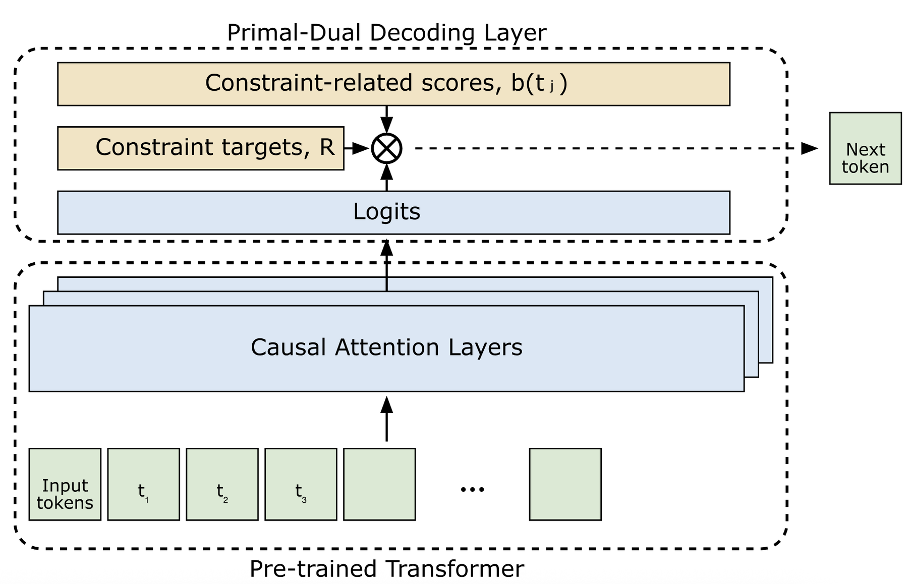

# Stochastic primal–dual decoding for multi-objective generative recommendation

<!-- source-sha256: 7cd976d8da6e8e0502793eaba5cfb218e64b75c15c9b9be0973dd450174d922e -->

[简体中文](README.md)

> Core public-data decoding mechanism.

## Paper information

| Field | Details |
|---|---|
| Paper | [Paper or original source](https://arxiv.org/abs/2607.19357) |
| Institution | Spotify. |
| First public release | 2026-05-26 (arXiv v1) |
| Author code | No public author code found as of 2026-09-02. |
| Local adapter or method key | `primal-dual-decoding` |
| Local reproduction code | [`src/auto_research/reproductions/primal_dual_decoding/`](https://github.com/daiwk/auto-research/tree/main/src/auto_research/reproductions/primal_dual_decoding/) |

## Paper method and evidence

Without retraining, add auxiliary objective contributions to relevance logits at each decoding position. Mirror descent updates Lagrange multipliers from remaining constraint slack.


<!-- paper-figure:start -->
### Original paper figure

[](https://arxiv.org/html/2607.19357v1/ml_architecture.png)

Figure shows multi-objective decoding. From the [original paper](https://arxiv.org/abs/2607.19357); copyright remains with the authors.
<!-- paper-figure:end -->

### Core equation

$$
j^*=\arg\max_j\\{p_\theta(t_j\mid x,t_{<k})+\lambda_k b(t_j)\\},\qquad \lambda_{k+1}=\lambda_k e^{-\eta(b(t_{j^*})-R/K)}.
$$

### Reported results

Spotify large-scale A/B reports +1.8% on the auxiliary objective with no user satisfaction loss.

## Local reproduction

MovieLens-1M full catalog: NDCG@10 **0.05401→0.02109 (-60.95%)**. [Three-seed metrics, mean, SD, and 95% CI](metrics/public-seeds42-44.json). No private logs, production models, bucketing or serving. Public proxies cannot establish online lift.

```bash
auto-research reproduce --paper primal-dual-decoding --dataset-dir data --seeds 42,43,44
```
