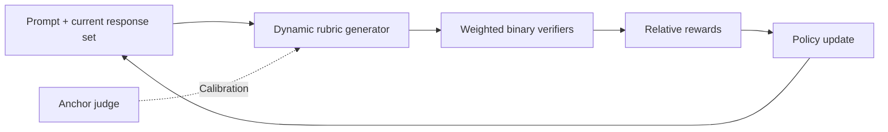
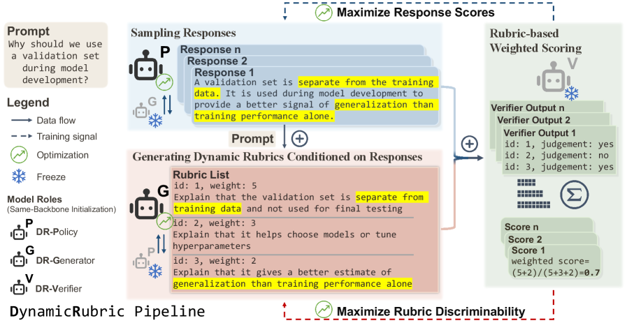

<!-- source-sha256: c07b566ed4926d31d375558d5d4dcab3989d6dddb98123114dc9584c60480c7d -->

[简体中文](README.md) · English

# DynamicRubric: Co-evolving an evaluator and policy

> **Fidelity: core-mechanism reproduction.** Runs dynamic rubrics and multi-round co-evolution. It does not reproduce Qwen3 or production judge scale.

## Paper information

| Field | Details |
| --- | --- |
| Paper | [arXiv 2607.20083](https://arxiv.org/abs/2607.20083) |
| Institution | WeChat / Tencent and Tsinghua University |
| First public release | 2026-07-22 (arXiv v1) |
| Author code | No official or author-released code found in the paper (checked 2026-08-09). |
| Local adapter or method key | `dynamic-rubric` |
| Local reproduction code | [`src/auto_research/reproductions/dynamic_rubric/`](https://github.com/daiwk/auto-research/tree/main/src/auto_research/reproductions/dynamic_rubric/) |

## Original paper summary

### Background and main changes

A fixed judge or rubric can lose discriminative power as a policy improves. DynamicRubric generates evaluation criteria and weights from the prompt and current set of responses. A discriminability objective targets criteria that distinguish current hard negatives, while an anchor objective limits evaluator drift. The evaluator and policy then co-evolve over multiple rounds.



<!-- paper-figure:start -->
### Key figure from the paper

[](https://arxiv.org/html/2607.20083v2/x1.png)

> **Figure 1:** Overall design and components. From the [paper](https://arxiv.org/abs/2607.20083); copyright belongs to the authors. Click for the source.
<!-- paper-figure:end -->

### Core equations

$$
R(x,y;\mathcal Y)=\sum_{k=1}^{K}
w_k(x,\mathcal Y)\,r_k(x,y),
$$

$$
\mathcal L_{\mathrm{eval}}
=-\log \sigma\!\left(R(x,y^+)-R(x,y^-)\right)
+\lambda\lVert w-w_{\mathrm{anchor}}\rVert_2^2.
$$

### Offline and online results

The paper reports continued offline improvement in both evaluator and policy. A WeChat Search online A/B test found statistically significant gains in total search volume, user time, and absolute positive feedback. The method serves all AI-answer traffic, amounting to tens of millions of requests per day. The paper does not disclose individual metric lifts, so no percentages are inferred here.

## Local reproduction

Public Alpaca responses plus deterministic truncation and reordering produce auditable preference candidates. The code executes response-set-conditioned weight generation, four binary rubric criteria, the discriminability and anchoring objectives, and co-evolution with policy-induced hard negatives.

> **Local comparison:** The baseline is a fixed prompt-only rubric policy; the experimental arm co-evolves the DynamicRubric evaluator and policy. Preference accuracy at seed 42 rises from 83.89% to 87.78%, a relative gain of +4.64%.

Stable metrics: `metrics/alpaca-seed42.json`. The local run uses a compact text policy suitable for a Mac CPU. It is not a full-scale reproduction of Qwen3-8B or the 70B/235B judges.

```bash
scripts/download_public_data.sh alpaca
auto-research reproduce --paper dynamic-rubric --dataset-dir data --seed 42
```
