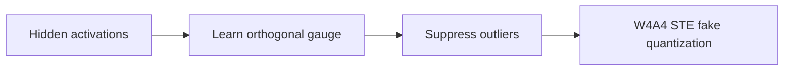
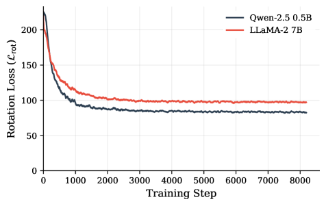

# GaugeQuant: Learn a quantization-friendly basis during training

<!-- source-sha256: 04bb91219fc741193f4b2d3ed1ec18b1fa006814b3e0d1931d9d7d75cf807e59 -->

[简体中文](README.md)

> Actual orthogonal gauge learning and W4A4 straight-through fake quantization.

## Paper information

| Field | Details |
|---|---|
| Paper | [arXiv 2607.20757](https://arxiv.org/abs/2607.20757) |
| Institution | University of Cambridge. |
| First public release | 2026-07-22 (arXiv v1) |
| Author code | [MPedraBento/gauge-quant](https://github.com/MPedraBento/gauge-quant). |
| Local adapter or method key | `gaugequant` |
| Local reproduction code | [`src/auto_research/reproductions/gaugequant/`](https://github.com/daiwk/auto-research/tree/main/src/auto_research/reproductions/gaugequant/) |

## Paper method and evidence

Function-preserving channel transformations can have very different quantization errors. Learn an orthogonal gauge online and suppress activation outliers with LogSumExp without a separate calibration corpus.



<!-- paper-figure:start -->
### Original paper figure

[](https://arxiv.org/html/2607.20757v2/x1.png)

The original figure illustrates online gauge learning. From the [original paper](https://arxiv.org/abs/2607.20757); copyright remains with the authors.
<!-- paper-figure:end -->

### Core equation

$$
h'=hQ,\quad W'=Q^\top W,\quad Q^\top Q=I,\qquad
\mathcal L=\mathcal L_{\mathrm{LM}}+
\lambda\log\sum_i e^{|h'_i|}.
$$

### Reported results

The paper reports LLaMA-2 7B W4A4 perplexity **8.22→6.73**. Industrial A/B criteria do not apply to this quantization work.

## Local reproduction

Compare float `llama_modern` to a learned Householder gauge with W4A4 STE: loss **5.7471→5.7313 (-0.27%)**, PPL **313.27→308.38 (-1.56%)**. Householder avoids `matrix_exp`, unavailable on MPS; same code supports CPU/MPS/CUDA. [Metrics](metrics/wikitext2-seed42.json).

```bash
auto-research reproduce --paper gaugequant --dataset-dir data --seed 42
auto-research evolve --model micro-llm --dataset wikitext-2 --direction "GaugeQuant W4A4 quantization"
```

No LLaMA-2 7B training or int4 kernel; fake quantization verifies the mechanism, not throughput.
