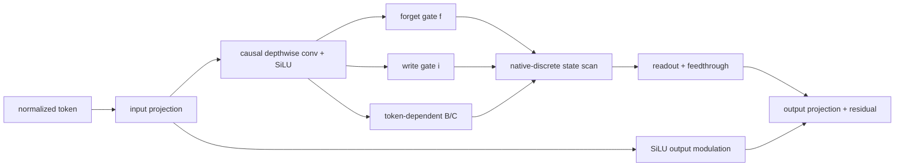
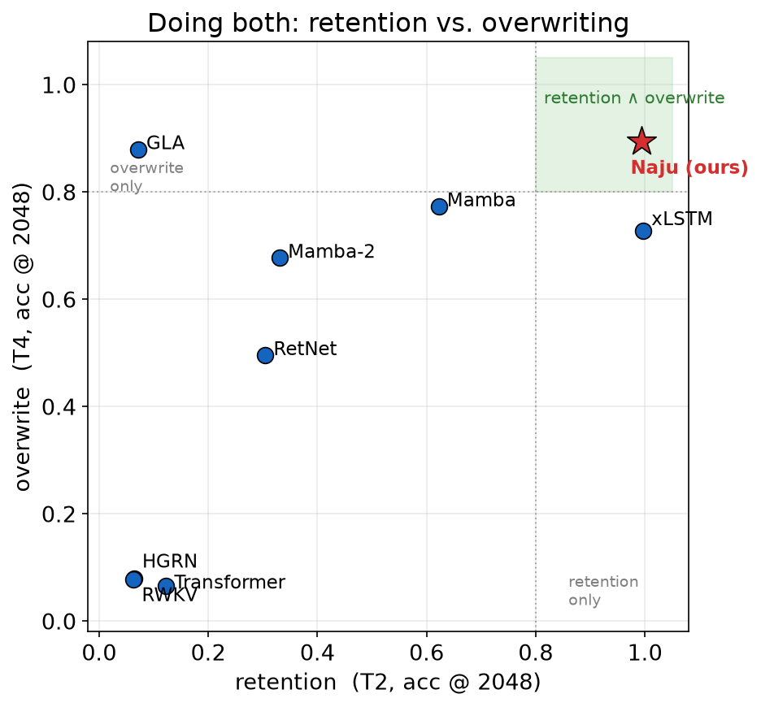

<!-- source-sha256: 69b254a8bf182e5301d4f950e7f54ad78b011fe53a20cd0c33d0c7f973678cab -->

[简体中文](README.md) · English

# Naju: A native discrete SSM with independent retention and writing

> **Fidelity: core-mechanism reproduction.** Runs the full native-discrete selective recurrence block with a smaller model and pretraining budget.

## Paper information

| Field | Details |
| --- | --- |
| Paper | [arXiv 2607.21000](https://arxiv.org/abs/2607.21000) |
| Institution | Independent researchers |
| First public release | 2026-07-23 (arXiv v1) |
| Author code | No official or author-released code found in the paper (checked 2026-08-09). |
| Local adapter or method key | `naju` |
| Local reproduction code | [`src/auto_research/reproductions/naju/`](https://github.com/daiwk/auto-research/tree/main/src/auto_research/reproductions/naju/) |

## Original paper summary

### Background and main changes

Mamba derives transitions by discretizing a continuous-time system. A single coupled gate can also make strong retention incompatible with writing. Naju parameterizes discrete poles directly, separates retain and write gates, and keeps token-dependent $B/C$ directions, short-range causal convolution, direct feedthrough, and output modulation.



<!-- paper-figure:start -->
### Key figure from the paper

[](https://arxiv.org/html/2607.21000v1/retention_overwrite.png)

> **Figure 1:** The training pipeline and key optimization stages in the paper. From the [paper](https://arxiv.org/abs/2607.21000); copyright belongs to the authors. Click for the source.
<!-- paper-figure:end -->

### Core equations

$$
x_n=f_n\odot x_{n-1}+i_n\odot(h_nB_n^\top),
\qquad f_n=\sigma(a_n),\quad i_n=\sigma(b_n),
$$

$$
y_n=\frac{1}{\sqrt{d_{\rm state}}}x_nC_n+D\odot h_n.
$$

The implementation uses the paper's preserve-first initialization: `forget_bias=5` and `write_bias=-2`.

### Offline and online results

On the paper's matched 1.2B-token WikiText-103 budget, Naju has PPL `26.20±0.17` and Mamba-2 `28.31±0.17`. Retention/overwrite diagnostics at length 2048 are `0.99/0.89`. The online A/B gate does not apply to a standalone LLM paper.

## Local reproduction

> **Local comparison:** The baseline is a 96-dimensional, 3-layer Transformer with the same tokens, optimizer, and 70 steps. Naju's PPL goes from `324.930` to `408.342`, a relative **`+25.67%`** deterioration.

The mean retain/write values after training are `0.993/0.125`, confirming execution of the preserve-first gates. The paper's gains do not transfer to the short-budget WikiText-2 run. See [`metrics/wikitext-2-seed42.json`](metrics/wikitext-2-seed42.json).

```bash
auto-research reproduce --paper naju --dataset-dir data --seed 42
```

## Scope

The Python sequential recurrence is mathematically equivalent to the paper's affine scan but does not use the authors' fused parallel kernel. The run does not repeat 1.2B-token WikiText-103, Mamba/Mamba-2/xLSTM, or the full LRA/MQAR suite. The negative result applies only at this scale.
