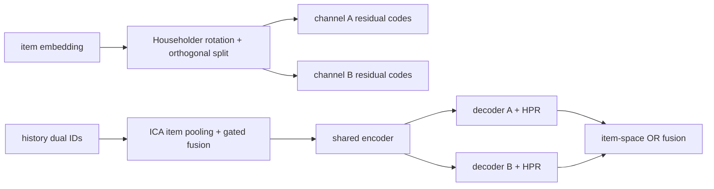
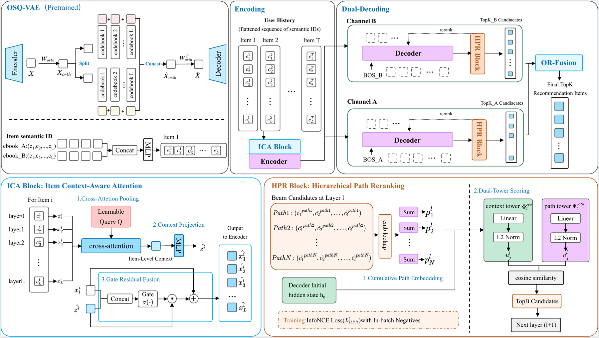

# BARGE: Repairing item structure and semantic drift in generative recommendation

<!-- source-sha256: 3c3f0c2b28c1ffa085a83af531d6c09dd67d1f2e0e25ed02d9bff99395cb324d -->

[简体中文](README.md)

> **Fidelity: Core mechanism.** Trains dual semantic OSQ paths, ICA, HPR, two decoders, and item-space OR fusion on scaled-down public data and serving.

## Paper information

| Field | Value |
| --- | --- |
| Paper link | [arXiv 2607.21028](https://arxiv.org/abs/2607.21028) |
| Organization | Tencent |
| First published | 2026-07-23 (arXiv v1) |
| Original author code | No official or author code was provided in the paper (checked 2026-08-09). |
| Adapter | `barge` |
| Local reproduction code | [`src/auto_research/reproductions/barge/`](https://github.com/daiwk/auto-research/tree/main/src/auto_research/reproductions/barge/) |

## Original paper summary

### Background and main changes

RQ-VAE expands an item into several Semantic ID tokens, obscuring item boundaries in a standard Transformer. With one quantization path, early beam errors can compound across levels. BARGE pools tokens within each item and writes back a gated ICA context. HPR contrastively reranks cumulative semantic paths at every level. An orthogonal split produces two complementary decoding paths.



<!-- paper-figure:start -->
### Key figure from the paper

[](https://arxiv.org/html/2607.21028v2/picture/overview_v2.png)

**Original Figure 2 (overview):** The overall design and key components. Image from the [original paper](https://arxiv.org/abs/2607.21028); copyright belongs to the authors. Click the image for its source.
<!-- paper-figure:end -->

### Core equation

ICA first obtains item context, then applies a gated writeback:

$$
z^{(i)}=\operatorname{LN}(\operatorname{CrossAttn}(q,X^{(i)},X^{(i)})),
\qquad
\hat x_l^{(i)}=x_l^{(i)}+\sigma(W_g[x_l^{(i)}\Vert\hat z^{(i)}])\odot\hat z^{(i)}.
$$

HPR applies symmetric InfoNCE to cumulative path $p^{(l)}=\sum_{j=1}^{l}e_{c_j}$ and user context. Inference adds generation log-probability and reranker score. DPD enforces $R^\top R=I$, splits $Rz$ into two orthogonal subspaces, and quantizes each separately.

### Offline and online results in the paper

The paper reports gains on Amazon Beauty, Sports, Toys, Yelp, and private Tencent offline data. Tencent A/B reports CTR `+0.60%`, unique clickers `+1.34%`, and total reading duration `+1.70%`.

## Local reproduction

> **Control:** Single-path RQ-VAE/TIGER with matching width, layers, rows, optimizer, and 140 steps. Adding OSQ, ICA, HPR, and DPD increases NDCG@10 from `0.01147` to `0.02131`, or **`+85.77%`** relative.

On 180 MovieLens-100K users and 300 items, Hit@10 rises `+60.00%`, but head share also rises `+165.02%`, so the accuracy gain has a trade-off. OSQ reconstruction loss decreases from `0.05969` to `0.01947`, with orthogonality error `2.98e-7`. See [metrics/movielens-100k-seed42.json](metrics/movielens-100k-seed42.json).

```bash
auto-research reproduce --paper barge --dataset-dir data --seed 42
```

## Reproduction limits

MovieLens genres substitute for Tencent item embeddings. Full-catalog teacher-forced path scoring substitutes for production beam kernels. Private impression negatives and online serving are absent. OSQ, ICA, HPR, and DPD are actually trained, but local percentages are not online lifts.
