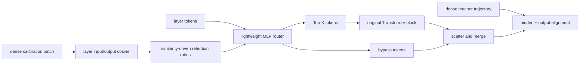
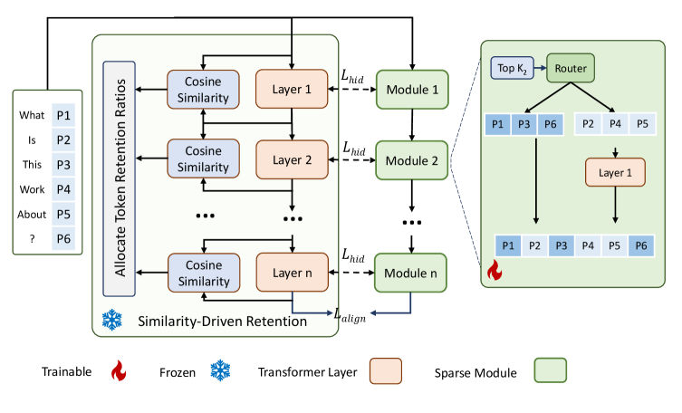

# AdaDSF: Allocating Dynamic Depth Compute by Layer Similarity

<!-- source-sha256: 2b46889facecb5e59d751fc2bc3e30b6072ef171ac8e83addad76092695d1d41 -->

[简体中文](README.md)

> **Fidelity: core mechanism.** Executes dense calibration, layer-wise token budgets, Top-K routing, and feature alignment with a smaller model and training budget.

## Paper information

| Field | Details |
|---|---|
| Paper | [arXiv 2607.21291](https://arxiv.org/abs/2607.21291) |
| Organization | Huawei ACS Lab / Southern University of Science and Technology |
| First public release | 2026-07-23 (arXiv v1) |
| Authors' code | No official or author implementation is linked by the paper (checked 2026-08-09). |
| Adapter / method | `adadsf` |
| Local reproduction code | [`src/auto_research/reproductions/adadsf/`](https://github.com/daiwk/auto-research/tree/main/src/auto_research/reproductions/adadsf/) |

## Original paper

### Motivation and method

Fixed-ratio Mixture-of-Depths budgets every layer alike even though some layers change representations more. AdaDSF measures layer input/output cosine on a dense teacher and assigns more compute where representations change most. An MLP router sends only Top-K tokens through the original Transformer block; other tokens take a residual bypass. Hidden states and output distributions are aligned jointly.



<!-- paper-figure:start -->
### Key figure from the paper

[](https://arxiv.org/html/2607.21291v1/x1.png)

> **Figure 1:** Core architecture, its modules, and their connections. From the [original paper](https://arxiv.org/abs/2607.21291); copyright remains with the authors.
<!-- paper-figure:end -->

### Core equations

Layer transformation similarity and temperature-normalized weights:

$$
s_i=\frac{x_{\mathrm{in}}^{(i)}\cdot x_{\mathrm{out}}^{(i)}}
{\lVert x_{\mathrm{in}}^{(i)}\rVert\lVert x_{\mathrm{out}}^{(i)}\rVert},
\qquad
w_i=\frac{\exp((s_i-\max_j s_j)/\tau)}
{\sum_j\exp((s_j-\max_k s_k)/\tau)}.
$$

Map $w_i$ to bounded ratios and correct the allocation to global budget $t$:

$$
z_i=\beta\left(\frac{1}{L}\sum_j w_j-w_i\right),\quad
r'_i=0.05+0.9\sigma(z_i),\quad
r_i=\frac{tL}{\sum_j r'_j}r'_i.
$$

The alignment objective is:

$$
\mathcal L=\mathrm{KL}(P_{\rm dense}\Vert P_{\rm sparse})
+\frac1L\sum_l
\left\|\operatorname{softmax}(h_{\rm sparse}^{(l)})
-\operatorname{softmax}(h_{\rm dense}^{(l)})\right\|_2.
$$

### Paper results

On WikiText-103, dense GPT-NeoX-130M has PPL 17.9. At 80% retention, MoD has 21.6 and AdaDSF 18.9, with normalized FLOPs 0.787. For Qwen2.5-0.5B, the mean over six commonsense tasks moves from dense 51.7 to AdaDSF 49.1, above equal-FLOPs MoD 44.4. Industrial online A/B is not a criterion for this LLM paper.

## Local reproduction

> **Local comparison.** One 96-dimensional, four-layer dense teacher; Uniform MoD and AdaDSF share 80% token budget, checkpoint, 35 alignment steps, and optimizer. AdaDSF PPL 321.933 is **0.30% worse** than uniform MoD 320.969 and **1.01% worse** than the dense teacher 318.717.

Layer cosine calibration gives [0.560, 0.749, 0.793, 0.928]; the paper formula allocates retention [1.0, 1.0, 1.0, 0.2], with actual mean active fraction 0.7995. This small-model negative result does not support automatic superiority over uniform allocation. See [stable metrics](metrics/wikitext-2-seed42.json).

```bash
auto-research reproduce --paper adadsf --dataset-dir data --device mps --seed 42
```

The executable `micro-llm` Evolve stage first trains a dense checkpoint and then calibrates and aligns the sparse model.

## Limits

A WikiText-2 tiny decoder replaces GPT-NeoX-130M/Qwen2.5 and WikiText-103; those checkpoints and dataset were not downloaded. Active-token fraction is not measured GPU FLOPs. Top-K physically selects tokens for the block, rather than masking outputs, but does not reproduce large-model kernels or the full six-task commonsense evaluation.
