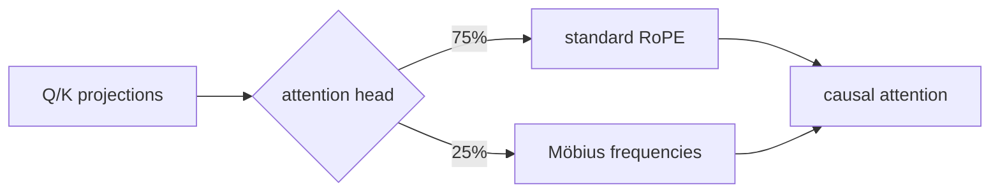
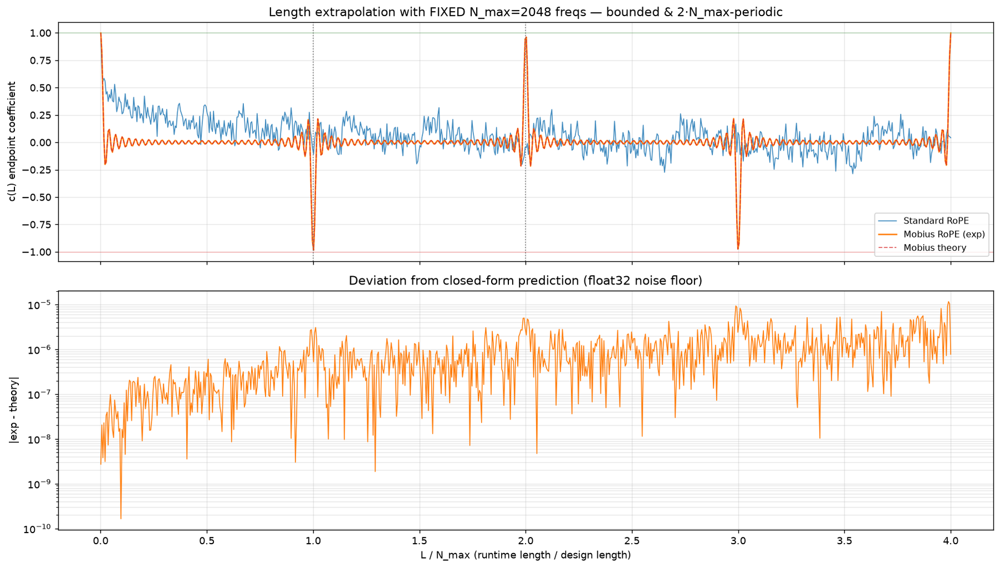

<!-- source-sha256: da5c700577e80ae4298fd3e99564f5db000a30b26a0a87e0fa4e35ec26f9e329 -->

[简体中文](README.md) · English

# Möbius RoPE: Antiperiodic boundaries for more stable long-distance retrieval

> **Core mechanism reproduction.** Trains standard RoPE and 25% Möbius-head variants, with smaller model, corpus and seed count.

## Paper information

| Field | Details |
| --- | --- |
| Paper | [arXiv 2607.21405](https://arxiv.org/abs/2607.21405) |
| Institution | Independent researcher |
| First public release | 2026-07-23 (arXiv v1) |
| Author code | No official author code in the paper when checked on 2026-08-09. |
| Local adapter or method key | `mobius-rope` |
| Local reproduction code | [`src/auto_research/reproductions/mobius_rope/`](https://github.com/daiwk/auto-research/tree/main/src/auto_research/reproductions/mobius_rope/) |

## Original paper summary

### Background and main changes

Standard RoPE needle retrieval at long distances is sensitive to random seed. The paper applies antiperiodic frequencies to some heads so the rotation across the full training window is always $-I$. Other heads retain standard RoPE for language modeling.



<!-- paper-figure:start -->
### Key figure from the paper

[](https://arxiv.org/html/2607.21405v1/figures/stageA_length_extrapolation.png)

> **Figure 3:** Overall design and components. From the [paper](https://arxiv.org/abs/2607.21405); copyright belongs to the authors. Click for the source.
<!-- paper-figure:end -->

### Core equations

For fixed training context $N$, each 2D rotation plane uses

$$
\theta_i=\frac{\pi(2i+1)}{N},\qquad
R(N)=-I,\qquad R(2N)=I.
$$

Locally `N=64` and one of four heads uses these frequencies.

### Offline and online results

48 runs at 160M/410M with 2B FineWeb-Edu tokens per run. At 160M, hybrid PPL is `29.66` versus standard `29.72`; single-needle retrieval at context 512 is `90.3±5.7%` versus `63.3±31.4%`. The production A/B gate does not apply.

## Local reproduction

> **Comparison:** Standard RoPE versus replacing 25% of heads. Both use the same 96-dimensional, 3-layer initialization, WikiText-2/single-needle curriculum and 90 steps. Möbius PPL goes from `291.000` to `290.922`, **`-0.03%`** relative, while needle accuracy falls from `97.40%` to `95.31%`, **`-2.08`** percentage points.

This small single-seed run does not reproduce retrieval stability and cannot establish effectiveness under short budgets. See [stable metrics](metrics/wikitext-2-needle-seed42.json).

```bash
auto-research reproduce --paper mobius-rope --dataset-dir data --seed 42
```

## Scope

No 48 large runs, 2B tokens per run or six-seed variance test. The local needle task verifies an auditable mechanism with the same retrieval curriculum in both arms.
