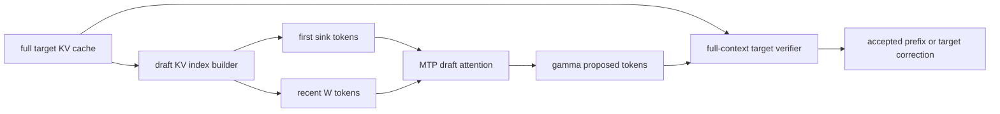
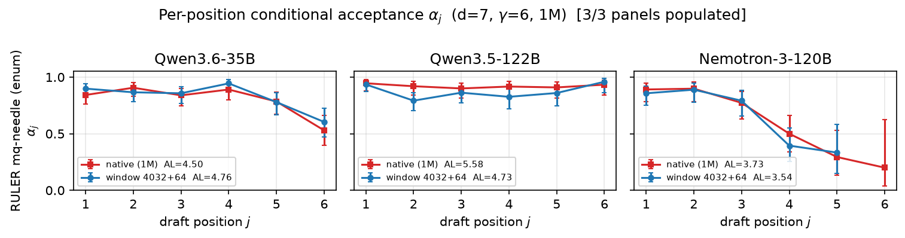

<!-- source-sha256: b840656c94bd1f6eeab2911ed89d384660a0b285516ae14c7119aa552ac698cf -->

[简体中文](README.md) · English

# Windowed-MTP: Keep sinks and a recent window only for the draft

> **Fidelity: core-mechanism reproduction.** Trains the MTP draft, switches the KV key set, and runs target verification. Model, context, and serving runtime are scaled down.

## Paper information

| Field | Details |
| --- | --- |
| Paper | [arXiv 2607.21535](https://arxiv.org/abs/2607.21535) |
| Institution | NVIDIA |
| First public release | 2026-07-23 (arXiv v1) |
| Author code | [Official author code](https://github.com/avalliappan-nvidia/windowed-mtp-b200) |
| Local adapter or method key | `windowed-mtp` |
| Local reproduction code | [`src/auto_research/reproductions/windowed_mtp/`](https://github.com/daiwk/auto-research/tree/main/src/auto_research/reproductions/windowed_mtp/) |

## Original paper summary

### Background and main changes

Built-in MTP/NEXTN drafts typically read the entire KV cache for every proposed token. At one million tokens, this can bottleneck even a cheap GDN/Mamba verifier. Windowed-MTP changes only the draft: it keeps initial attention sinks and the latest $W$ tokens. The target still reads full context and verifies every candidate. The window can affect acceptance and speed, but not the output distribution determined by the target.



<!-- paper-figure:start -->
### Key figure from the paper

[](https://arxiv.org/html/2607.21535v1/figs/perpos_alpha_row_mqe_d7.png)

> **Figure 2:** Overall design and components. From the [paper](https://arxiv.org/abs/2607.21535); copyright belongs to the authors. Click for the source.
<!-- paper-figure:end -->

### Core equations

Cost of one speculative step:

$$
\mathrm{step}=t_{\mathrm{verify}}+t_{\mathrm{draft}},\qquad
t_{\mathrm{draft}}=t_{\mathrm{draft}}^{\mathrm{ctx}}
+\gamma t_{\mathrm{draft}}^{\mathrm{fwd}},\qquad
\mathrm{TPOT}=\frac{\mathrm{step}}{\mathrm{AL}}.
$$

Windowed-MTP limits the draft key set from $S$ to $n_{\rm sink}+W$:

$$
\mathcal K_{\rm draft}
=\{0,\ldots,n_{\rm sink}-1\}
\cup\{S-W,\ldots,S-1\},
$$

while the verifier still uses full $\mathcal K_{\rm target}=\{0,\ldots,S-1\}$. The draft distribution $q$ can change without changing target distribution $p(\cdot\mid x_{<t})$ or the final output.

### Offline and online results

On a single B200 at 1M context and $d=7$, step time falls `26.4 → 18.3 ms` for Qwen3.6-35B (`+44.3%` speedup), `34.5 → 26.5 ms` for Qwen3.5-122B (`+30.2%`), and `33.1 → 25.8 ms` for Nemotron-3-120B (`+28.3%`). Draft KV is `7.7–11.1%` of total KV, and a ring buffer can recover unread entries. The industrial online A/B gate does not apply to standalone LLM serving papers.

## Local reproduction

> **Local comparison:** The same-weight full-history MTP draft is the baseline. The experimental arm changes only the draft key set to `8 sink + 64 recent`, holding target, vocabulary, draft weights, and verification fixed. At 16K context, KV reads fall from `16384` keys to `72`, **99.56% fewer**. Apple MPS draft attention falls from `1.0413 ms` to `0.5180 ms`, **50.25% lower**.

In 24-token greedy generation, native and windowed speculative decoding exactly match the dense target. Small-model acceptance drops from `41.67%` to `25.00%`. Lossless output does not mean unchanged acceptance; local latency gains come from fewer KV reads. See [`metrics/wikitext-2-seed42.json`](metrics/wikitext-2-seed42.json).

```bash
auto-research reproduce --paper windowed-mtp --dataset-dir data --device mps --seed 42
```

## Scope

The local run trains a lightweight MTP head sharing target token embeddings and executes sink+window attention and token-by-token target verification. It does not reproduce SGLang paged KV, Triton ring buffers, continuous batching, B200/H100, or million-token experiments. MPS latency verifies only the complexity trend and is not directly comparable with paper hardware results.
