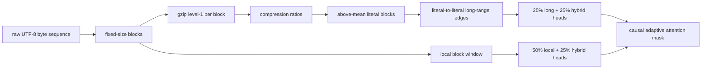
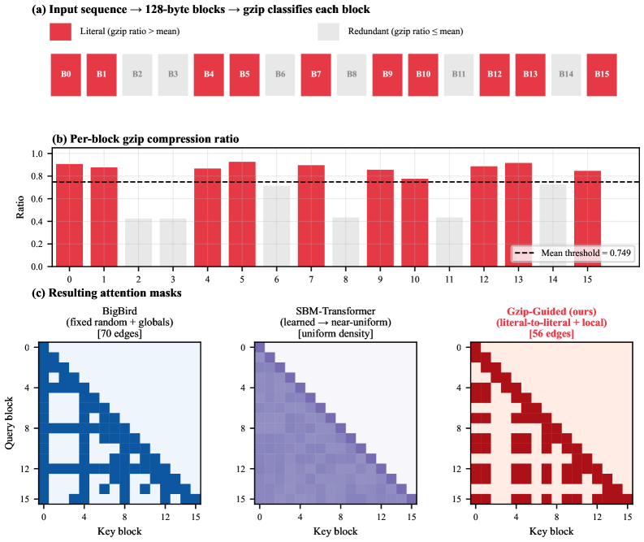

<!-- source-sha256: 28aee2e24a8fdafb54798a27080bc107fad5611ae47a60bd423c2d7f4b1dbd43 -->

[简体中文](README.md) · English

# Gzip-guided sparse attention: Selecting long-range content by compressibility

> **Fidelity: core-mechanism reproduction.** Runs gzip per block, generates input-adaptive masks, and trains a parameter-matched ByteLM at smaller context, model, and step counts.

## Paper information

| Field | Details |
| --- | --- |
| Paper | [arXiv 2607.21752](https://arxiv.org/abs/2607.21752) |
| Institution | Pennsylvania State University |
| First public release | 2026-07-23 (arXiv v1) |
| Author code | No official or author-released code found in the paper (checked 2026-08-09). |
| Local adapter or method key | `gzip-sparse-attention` |
| Local reproduction code | [`src/auto_research/reproductions/gzip_sparse_attention/`](https://github.com/daiwk/auto-research/tree/main/src/auto_research/reproductions/gzip_sparse_attention/) |

## Original paper summary

### Background and main changes

Fixed BigBird/Longformer masks ignore content. Learned masks require extra parameters, gradient estimates, or specialized kernels. This paper divides bytes into fixed blocks and uses gzip compression ratio as a training-free information density signal. Above-mean literal blocks connect at long range, all blocks retain a local window, and no fixed global token is used. Of the heads, 50% are local only, 25% literal-long-range only, and 25% use both.



<!-- paper-figure:start -->
### Key figure from the paper

[](https://arxiv.org/html/2607.21752v1/x1.png)

> **Figure 1:** Overall design and components. From the [paper](https://arxiv.org/abs/2607.21752); copyright belongs to the authors. Click for the source.
<!-- paper-figure:end -->

### Core equations

For block $i$, the compression ratio and hyperparameter-free literal flag are:

$$
r_i=\frac{|\operatorname{gzip}(x_{ib:(i+1)b})|}{b},
\qquad
\ell_i=\mathbb 1[r_i>\bar r],
\qquad
\bar r=\frac1B\sum_{j=1}^{B}r_j.
$$

The final block mask combines literal long-range links, local windows, and self-connections, then intersects with the causal mask:

$$
M=M^{\mathrm{lit}}\cup M^{\mathrm{local}}\cup I,\qquad
M^{\mathrm{lit}}_{ij}=\mathbb 1[\ell_i=\ell_j=1],\qquad
M^{\mathrm{local}}_{ij}=\mathbb 1[|i-j|\le w].
$$

For $L$ literal blocks, attention edge complexity is:

$$
O(L^2+Nw),
$$

which is approximately linear in sequence length when $L=O(\sqrt N)$.

### Offline and online results

On PG-19 at 92M parameters, 8K bytes, and 20K steps, Gzip-Guided reaches `1.71 BPB` versus Dense `2.89`, BigBird `2.34`, Longformer `3.21`, and SBM-Transformer `3.38`. It reaches `2.5 BPB` in `3.3×` fewer steps than BigBird. From 4K to 8K, the BPB advantage over BigBird grows from `0.05` to `0.63`. The industrial online A/B gate does not apply to standalone LLM papers.

## Local reproduction

> **Local comparison:** The fixed BigBird mask baseline has the same 132,032 parameters, initialization, raw WikiText-2 bytes, 256 context, and 120 steps. The experimental arm changes only the mask to input-dependent gzip. BPB is `5.1129`, **1.02% worse** than BigBird's `5.0614` and `0.61%` above Dense's `5.0819`.

The sample gzip mask has `70.82%` fewer edges than dense causal attention. The 256-byte context and 120 steps do not transfer the training gains seen at 8K and 20K steps in the paper. See [`metrics/wikitext-2-byte-seed42.json`](metrics/wikitext-2-byte-seed42.json).

```bash
auto-research reproduce --paper gzip-sparse-attention --dataset-dir data --device mps --seed 42
```

## Scope

The implementation runs gzip per input and applies all three head masks, but PyTorch still computes dense scores before masking, so fewer edges do not imply a wall-clock speedup. It does not download the 28,602 PG-19 books, train a 92M model, or use an 8K context. This small-budget negative result does not refute the paper's long-context result.
