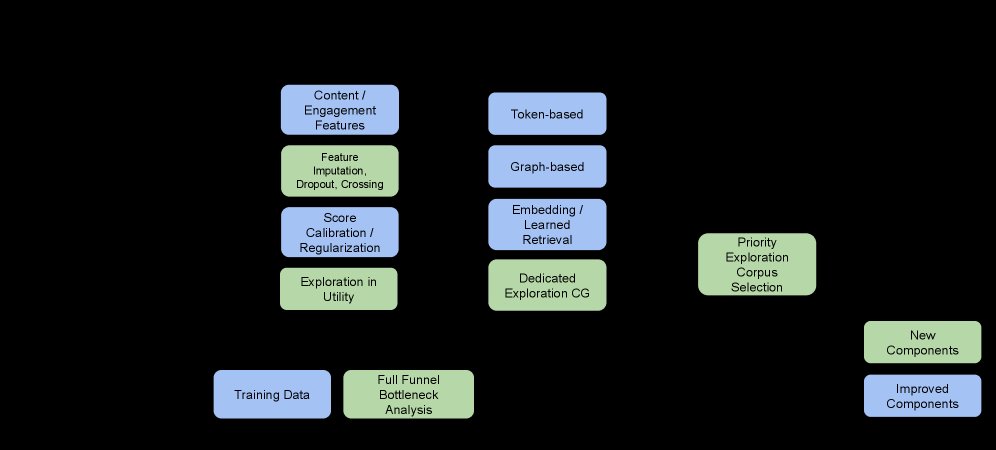

# PinEqualizer: Full-funnel cold-start debiasing and exploration

<!-- source-sha256: c8ad2e564668e9e9969b49180dbd2cfcde2e0603821eb071e7d2a03d6afe3745 -->

[简体中文](README.md)

> **Fidelity: core mechanism reproduction.** Exercises engagement dropout, content interactions, cohort calibration, an exploration corpus and relevance-scaled UCB on public proxy data.

## Paper information

| Field | Details |
|---|---|
| Paper | [Paper or original source](https://arxiv.org/abs/2607.22518) |
| Institution | Pinterest |
| First public release | 2026-07-23 (arXiv v1) |
| Author code | No official author code identified (checked 2026-08-09). |
| Local adapter or method key | `pinequalizer` |
| Local reproduction code | [`src/auto_research/reproductions/pinequalizer/`](https://github.com/daiwk/auto-research/tree/main/src/auto_research/reproductions/pinequalizer/) |

## Paper method and evidence

A lack of graph connections and engagement creates a self-reinforcing exposure disadvantage for fresh items. PinEqualizer monitors their share and survival at corpus selection, retrieval, ranking and utility. Models use content/VLM/SID features, individual engagement dropout, content–age–engagement crossings, cohort calibration and fresh/old score regularization. A separate exploration corpus uses Thompson posteriors, real-time impression UCB or Neural Linear UCB. Less observed exposure increases the bonus; search relevance suppresses off-topic exploration.


<!-- paper-figure:start -->
### Original paper figure

[](https://arxiv.org/html/2607.22518v1/x2.png)

Figure 2 shows the overall method and its main components. From the [original paper](https://arxiv.org/abs/2607.22518); copyright remains with the authors.
<!-- paper-figure:end -->

### Core equation

$$
\hat r_i=\frac{\alpha_iN+e_i}{N+n_i}.
$$

$$
\mathrm{UCB}_i=\frac{\alpha}{\sqrt{1+\beta\,\mathrm{impressions}_i}},
\qquad
\mathrm{UCB}'_i=\mathrm{relevance}_i^\gamma\mathrm{UCB}_i.
$$

$$
\hat y_i=\phi(x_i)^\top\theta+
\alpha\sqrt{\phi(x_i)^\top\Sigma\phi(x_i)},\qquad
\Sigma=\left(\sum_i\phi(x_i)\phi(x_i)^\top+\lambda I\right)^{-1}.
$$

The exploration posterior uses model prior $\alpha$ and strength $N$, positives $e$, and exposures $n$; the neural linear variant uses hidden representation $\phi(x)$.

### Reported results

Rollout from 2024 accumulated 350% fresh-content impression growth. Long-running A/B holdouts show underexplored engagement +37%/+13%/+27% on Homefeed/Search/Related Pins. Related Pins component A/B: ranking architecture +8.63% all-fresh and +6.57% underexplored engagement; feature improvements +5.57%/+18.52%. Twenty-eight-day graduate corpus and successful providers grow 41% and 99% year over year.

## Local reproduction

Matched MovieLens-1M arms use the same user/content features, 100 steps and seeds 42/43/44 with independent test. The treatment adds dropout, crossings, score regularization, cohort Platt calibration and validation-only UCB selection. Overall NDCG@10 drops 16.44%, fresh NDCG@10 increases 448.62%, and underexplored exposure@10 increases 471.02%. All three seeds select `UCB alpha=0`: extra UCB worsens the validation objective after debiasing pushes exposure. Report the overall precision/exploration tradeoff, not just the fresh metric. [Stable metrics](metrics/movielens-1m-seed42-44.json).

Fresh is the latest 20% by first observed time, and underexplored falls below the fresh popularity median. These are proxies. No PinCLIP, SID, merchant data, three production surfaces, long-term holdout or real-time Flink features; local NDCG does not establish online engagement.

```bash
auto-research reproduce --paper pinequalizer --dataset-dir data --device mps --seed 42
```
