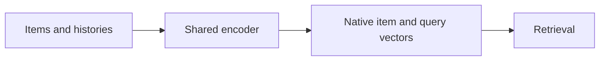
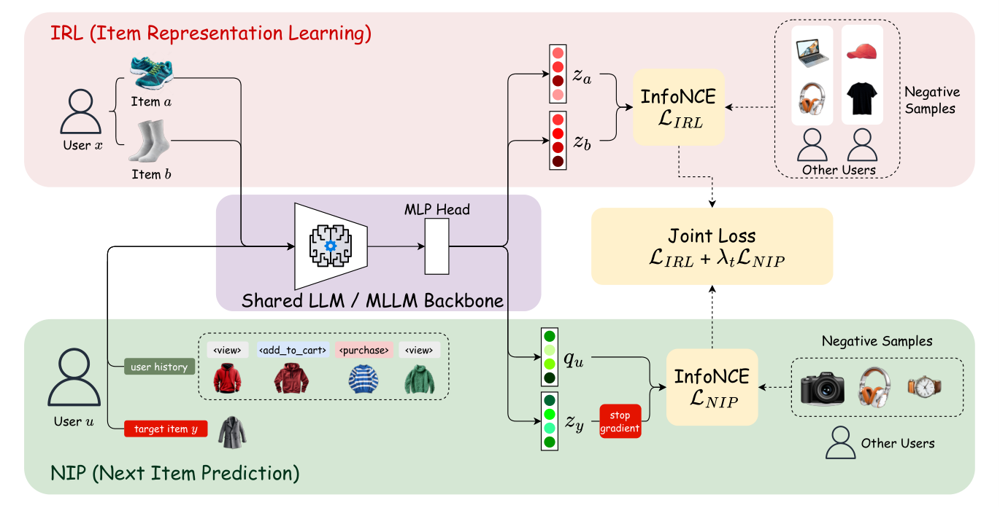

# EGR: Shared-LM Native Vector Retrieval

<!-- source-sha256: 7f94902dd3769b73bb0f977937acfdf5e0b523cabd0261d16392bc7ad60d0880 -->

[简体中文](README.md)

> **Core mechanism evidence.** Paper and local evaluations are separate.

## Paper information

| Field | Value |
| --- | --- |
| Paper | [arXiv 2607.23038](https://arxiv.org/abs/2607.23038) |
| Affiliations | Snap Inc. |
| First public release | 2026-07-25 (arXiv v1) |
| Authors' code | No official author code linked as of 2026-09-02. |
| Adapter / method | `egr` |
| Local code | [`src/auto_research/reproductions/egr/`](https://github.com/daiwk/auto-research/tree/main/src/auto_research/reproductions/egr/) |

## Original paper

### Background and contribution

One encoder produces indexed item vectors and user query vectors. Train item representation learning and next-item prediction jointly throughout.



<!-- paper-figure:start -->
### Key figure from the paper

[](https://arxiv.org/html/2607.23038v1/methodology.png)

Original Figure 2: EGR. From the [paper](https://arxiv.org/abs/2607.23038); copyright belongs to the authors. Not a local result.
<!-- paper-figure:end -->

### Core mechanism

$$
\mathcal L=\mathcal L_{IRL}+\lambda_t\mathcal L_{NIP},\quad s(u,i)=q_u^\top z_i.
$$

### Paper results

Snap DPA two-week 10%/10% traffic experiment: impressions +0.15%, CTR +0.23%, CVR +2.91%, then full deployment. Not local effects.

## Local reproduction

Matched full-catalog MovieLens-1M subset: NDCG@10 0.05401→0.05025 (−6.95%). [Three-seed results, SD, and 95% CI](metrics/public-seeds42-44.json).

```bash
auto-research reproduce --paper egr --dataset-dir data --seed 42
```

## Reproduction limits

Negative public proxy result. No private logs, online bucketing, production scale, or serving stack.
