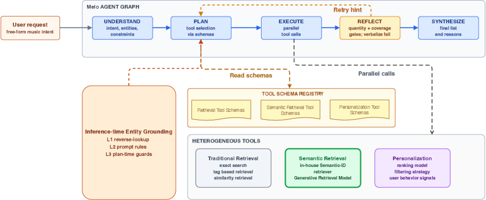

# Melo: Production LLM Music Recommendation Agent

<!-- source-sha256: d330d8f5faac74a74748f7a00b328d671a65fee4186aa825637f4cf51d2d3fb5 -->

[简体中文](README.md)

> **Core mechanism evidence.** Paper and local evaluation are separate.

## Paper information

| Field | Value |
| --- | --- |
| Paper | [arXiv 2607.23718](https://arxiv.org/abs/2607.23718) |
| Affiliations | NetEase Cloud Music / Zhejiang University of Technology |
| First public release | 2026-07-26 (arXiv v1) |
| Authors' code | No official author code linked as of 2026-08-09. |
| Adapter / method | `melo` |
| Local code | [`src/auto_research/reproductions/melo/`](https://github.com/daiwk/auto-research/tree/main/src/auto_research/reproductions/melo/) |

## Original paper

### Background and contribution

Orchestrate intent, retrieval, recommendations, and explanations across agent nodes. Catalog grounding prevents unsupported entities; failures trigger reflection and retry.


<!-- paper-figure:start -->
### Key figure from the paper

[](https://arxiv.org/html/2607.23718v1/x2.png)

Original Figure 2: Melo. From the [paper](https://arxiv.org/abs/2607.23718); copyright belongs to the authors. Not a local result.
<!-- paper-figure:end -->

### Core mechanism

$$
\hat e=\arg\max_{e\in\mathcal E}s(q,e),\quad \text{retry}=\mathbf1[\hat e\notin\mathcal E\ \lor\ score<\tau].
$$

### Paper results

System A/B on roughly one million users, 2026-04-02 through 05-10, reports >2 pp playlist retention. Includes Muse Mix UI/product effects.

## Local reproduction

MovieLens executes grounding, validation, and one retry with repair traces. Against no repair: Hit@10 −20.00%, NDCG@10 −8.16%, fresh Hit@10 +50.00%. [Metrics](metrics/result-seed42.json).

```bash
auto-research reproduce --paper melo --data-root data --seed 42
```

## Reproduction limits

Not a production reproduction. Model, product, and UI effects cannot be isolated and no confidence intervals were reported.
