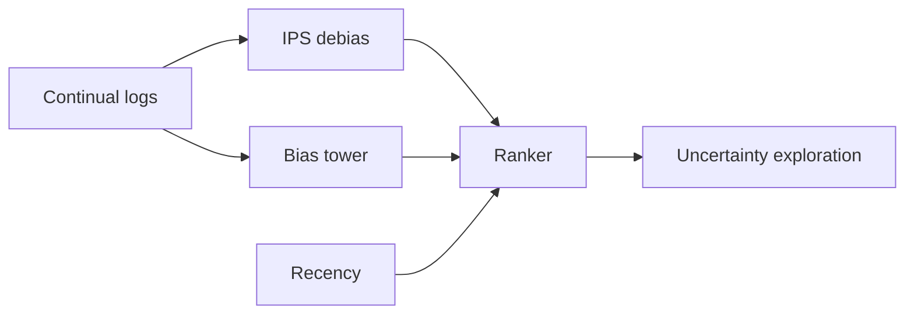
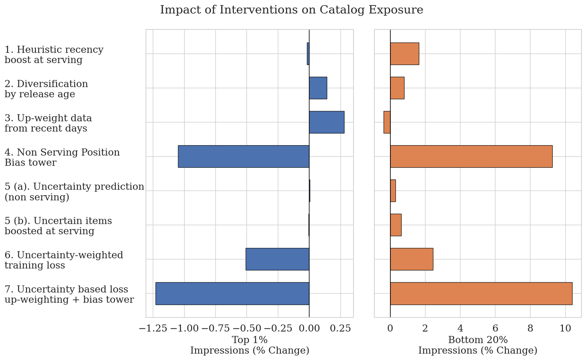

# YouTube Music: Breaking the Novelty and Freshness Feedback Loop

<!-- source-sha256: 1684254a676cd5108f2de90d964fea6413530e8b7d1ed1a00ded77cb0f1dea38 -->

[简体中文](README.md)

> **Local core-mechanism evidence.** Paper outcomes and local results are separate.

## Paper information

| Field | Value |
| --- | --- |
| Paper | [arXiv 2607.23749](https://arxiv.org/abs/2607.23749) |
| Affiliations | YouTube Music / Google |
| First public release | 2026-07-26 (arXiv v1) |
| Authors' code | No official author code linked as of 2026-08-09. |
| Adapter / method | `youtube-freshness` |
| Local code | [`src/auto_research/reproductions/youtube_freshness/`](https://github.com/daiwk/auto-research/tree/main/src/auto_research/reproductions/youtube_freshness/) |

## Original paper

### Background and contribution

Compare recency, IPS debiasing, a removable bias tower, and SNGP uncertainty exploration. Distinguish training debiasing from serving exploration.



<!-- paper-figure:start -->
### Key figure from the paper

[](https://arxiv.org/html/2607.23749v1/popularity_bias_imp_vertical.png)

Original Figure 2: YouTube Music. From the [paper](https://arxiv.org/abs/2607.23749); copyright belongs to the authors. Not a local result.
<!-- paper-figure:end -->

### Core mechanism

$$
\mathcal L_{\mathrm{IPS}}=-\frac{y}{\max(p_{\mathrm{log}},\epsilon)}\log\hat y,\quad score=\mu(x)+\beta\sigma(x).
$$

### Paper results

Six two-week A/B tests with millions of daily users per arm; uncertainty loss improved one-day new-release engagement by +4.33%.

## Local reproduction

Against a popularity-biased continual ranker, four combined mechanisms give Hit@10 +0.00%, NDCG@10 −6.35%, head share −28.72%. MovieLens runs recency, IPS, training-only bias tower, and distance-based uncertainty. [Metrics](metrics/result-seed42.json).

```bash
auto-research reproduce --paper youtube-freshness --data-root data --seed 42
```

## Reproduction limits

No YouTube continual stack or large SNGP. The local negative result does not invalidate paper production interventions.
