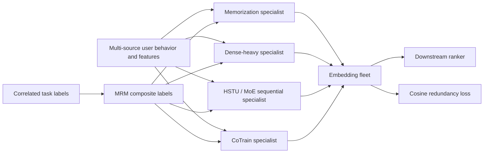
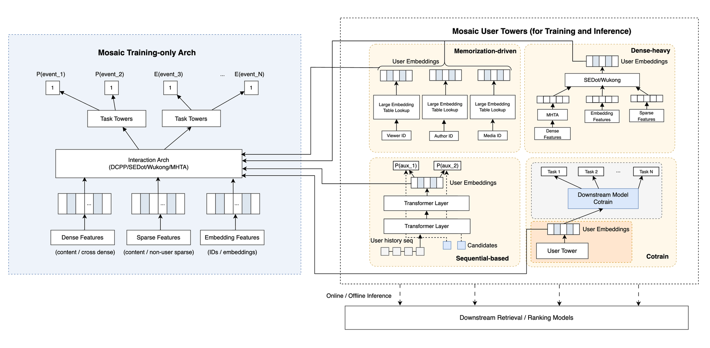

<!-- source-sha256: ae51ea1aef0a795e9b5f7c98d24f1e74e5fdbb6dd6171670da4256d306e952d7 -->

[简体中文](README.md) · English

# Mosaic: Scaling user representations with a fleet of specialists

> **Fidelity: core-mechanism reproduction.** Trains four specialists, composite MRM tasks, and a cosine redundancy loss, with scaled-down data, sequence lengths, and serving.

## Paper information

| Field | Details |
| --- | --- |
| Paper | [arXiv 2607.24015](https://arxiv.org/abs/2607.24015) |
| Institution | Meta |
| First public release | 2026-07-27 (arXiv v1) |
| Author code | No official or author-released code found in the paper (checked 2026-08-09). |
| Local adapter or method key | `mosaic` |
| Local reproduction code | [`src/auto_research/reproductions/mosaic/`](https://github.com/daiwk/auto-research/tree/main/src/auto_research/reproductions/mosaic/) |

## Original paper summary

### Background and main changes

A single general-purpose user embedding struggles to cover long-term memory, dense features, long sequential interests, and specific downstream tasks. Mosaic organizes user representations into an independently evolving fleet: memorization-driven, dense-heavy, sequential HSTU+MoE, and CoTrain jointly trained with a downstream task. Downstream rankers consume several embeddings as needed instead of assigning every goal to one network.

As the fleet grows, new embeddings can duplicate existing information. Multi-Task Relation Mining (MRM) forms a Cartesian product of binary labels for highly correlated tasks to learn joint behavior explicitly. A cosine redundancy loss steers new specialists toward subspaces orthogonal to existing representations.



<!-- paper-figure:start -->
### Key figure from the paper

[](https://arxiv.org/html/2607.24015v1/sections/figures/model_arch.png)

> **Figure 2:** The core architecture, its main modules, and their connections. From the [paper](https://arxiv.org/abs/2607.24015); copyright belongs to the authors. Click for the source.
<!-- paper-figure:end -->

### Core equations

Mine Spearman correlations among task labels:

$$
\rho_{ij}=
\frac{\operatorname{cov}(\operatorname{rg}(\mathbf y_i),
\operatorname{rg}(\mathbf y_j))}
{\sigma_{\operatorname{rg}(\mathbf y_i)}
\sigma_{\operatorname{rg}(\mathbf y_j)}}.
$$

For a correlated task group $\mathcal C_g$, form joint labels $\ell_n^{(\mathcal C_g)}=(y_{g_1,n},\ldots,y_{g_m,n})$. The redundancy objective for a new specialist against $K$ deployed embeddings is:

$$
\mathcal L_{\mathrm{red}}
=\frac1K\sum_{k=1}^K
\frac{\mathbf e^{(\mathrm{new})}\cdot\mathbf e_k^{(\mathrm{old})}}
{\|\mathbf e^{(\mathrm{new})}\|\,\|\mathbf e_k^{(\mathrm{old})}\|},
\qquad
\mathcal L=\mathcal L_{\mathrm{main}}+\lambda(t)\mathcal L_{\mathrm{red}},
$$

where $\lambda(t)$ warms up so orthogonality does not dominate before the main task converges.

### Offline and online results

Increasing the sequential specialist's length from 512 to 1024/2048 yields eval $\Delta$NE `-0.21%/-0.45%`. MoE and 256-dimensional embeddings further improve NE by `-0.07%` to `-0.25%`. CoEval speeds up embedding iterations by `3–5×`. Online top-line metrics across three product surfaces rise `+0.10%`, `+0.15%`, and `+0.28%`, all statistically significant. AOTI, model splitting, and memcache together reduce GPU serving usage by `79%`.

## Local reproduction

> **Local comparison:** A single GRU sequential embedding is the baseline on the same MovieLens-1M split and full-catalog candidates. The experimental arm trains memorization, dense-heavy, sequential, and CoTrain-MoE specialists with MRM and warmed-up CRL. Relative NDCG@10 **+3.49%**, Hit@10 **-7.69%**.

| Variant | Hit@10 | NDCG@10 | Head share@10 |
| --- | ---: | ---: | ---: |
| Single sequential embedding | 0.0406 | 0.0164 | 0.1347 |
| Mosaic fleet + MRM + CRL | 0.0375 | 0.0170 | 0.1553 |

Late-run mean cosine redundancy is `-0.1508`, consistent with specialists being pushed toward different subspaces. Head share rises `15.31%`, so the local gain accompanies stronger popularity bias. See [`metrics/movielens-1m-seed42.json`](metrics/movielens-1m-seed42.json).

```bash
auto-research reproduce --paper mosaic --dataset-dir data --device mps --seed 42
```

## Scope

MovieLens genres and popularity proxy Meta's private cross-surface behavior labels. The local sequential specialist is a GRU, not a 2048-token HSTU, and CoTrain is a small routed MoE. The run does not reproduce cross-product features, CoEval, User Tower Zero-Out, AOTI, memcache, or hybrid CPU/GPU serving. Local `+3.49%` is not directly comparable with the paper's online lift.
