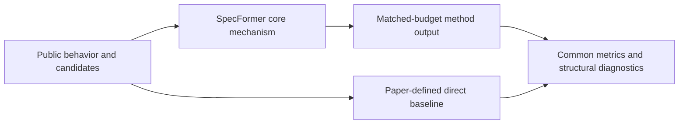
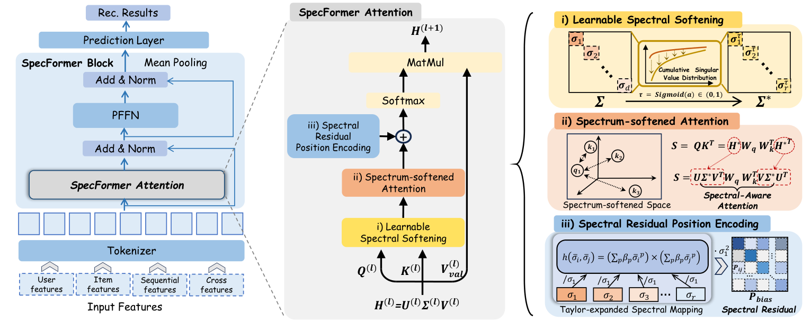

# SpecFormer: a spectrum-aware Transformer to reduce representation collapse

<!-- source-sha256: ddeb84aeae4ca4ea7e2801a9979b85a75d0deb3e1d0e202796ca613f342251c0 -->

[简体中文](README.md)

> **Fidelity: core mechanism.** Runs the defining mechanism verifiable on public data. Private data, production models, and serving remain outside scope.

## Paper information

| Field | Details |
|---|---|
| Paper | [arXiv 2607.24025](https://arxiv.org/abs/2607.24025) |
| Organization | Zhejiang University |
| First public release | 2026-07-27 (arXiv v1) |
| Authors' code | [istarryn/SpecFormer](https://github.com/istarryn/SpecFormer) |
| Adapter / method | `specformer` |
| Local reproduction code | [`src/auto_research/reproductions/specformer/`](https://github.com/daiwk/auto-research/tree/main/src/auto_research/reproductions/specformer/) |

## Original paper

### Motivation and method

Soften the singular-value spectrum and use spectral residual positional encoding to mitigate embedding and attention collapse in recommendation Transformers.



<!-- paper-figure:start -->
### Key figure from the paper

[](https://arxiv.org/html/2607.24025v2/method.png)

> **Figure 4:** Core architecture, modules, and connections. From the [original paper](https://arxiv.org/abs/2607.24025); copyright remains with the authors.
<!-- paper-figure:end -->

### Core equations

$$
\\tilde X=U\\sqrt{\\Sigma}V^\\top,\\qquad A=\\operatorname{softmax}(QK^\\top/\\sqrt d+R_{spec}).
$$

### Paper results

A ten-day Alibaba e-commerce ads experiment at 10% traffic reports CTR +1.34%, CVR +15.97%, and orders +16.72% (p<0.05). This is paper evidence, not a local public-data outcome.

## Local reproduction

> **Local comparison:** Under the same full-catalog protocol, baseline NDCG@10 is 0.05401 and SpecFormer NDCG@10 is 0.04999, **-7.44%** relative, a negative public-proxy result. The local proxy does not extrapolate to online lift.

See the [three-seed artifact](metrics/public-seeds42-44.json) for complete results, means, standard deviations, and 95% confidence intervals.

```bash
auto-research reproduce --paper specformer --dataset-dir data --seed 42
```

## Reproduction boundaries

The local run uses a public MovieLens-1M subset and auditable proxies to validate the core computation. It does not reproduce private logs, production models, online traffic assignment, or serving. No claim is made to reproduce absolute paper metrics or online gains.
