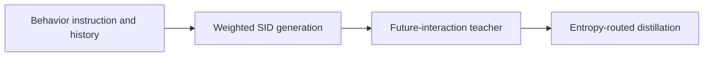
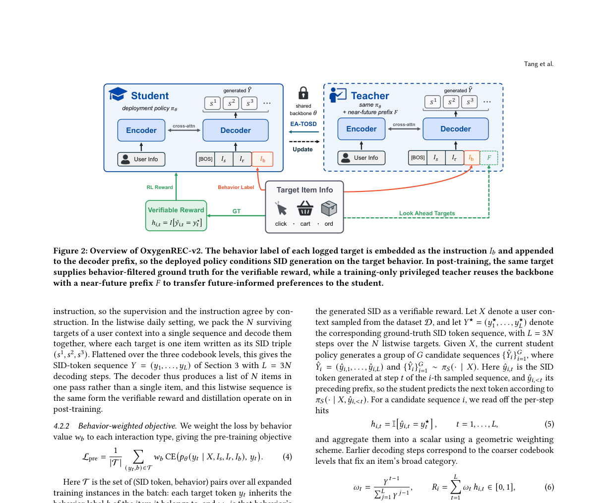

# OxygenREC-v2: Behavior-conditioned generative recommendation

<!-- source-sha256: a86b4356ddfee3b2e10be59ba08df9af3206e6553da57ac1d450014b7038a111 -->

[简体中文](README.md)

> **Fidelity: core mechanism reproduction.** Trains behavior instructions, weighted objectives, privileged future interactions and entropy-routed distillation. No JD production model or private funnel data.

## Paper information

| Field | Details |
|---|---|
| Paper | [Paper or original source](https://arxiv.org/abs/2607.24255) |
| Institution | JD.COM |
| First public release | 2026-07-27 (arXiv v1) |
| Author code | No official author code identified (checked 2026-08-09). |
| Local adapter or method key | `oxygenrec-v2` |
| Local reproduction code | [`src/auto_research/reproductions/oxygenrec_v2/`](https://github.com/daiwk/auto-research/tree/main/src/auto_research/reproductions/oxygenrec_v2/) |

## Paper method and evidence

A reranker cannot recover candidates the generator missed. Click/cart/order instructions enter the decoder prefix from the first SID token and weight pretraining. Post-training combines verifiable trajectories with privileged future-interaction self-distillation. Low-entropy positions get dense teacher supervision; high-entropy positions get forward KL to retain uncertainty. Inference never consumes future interactions.



<!-- paper-figure:start -->
### Original paper figure

[](https://arxiv.org/abs/2607.24255)

The paper's architecture shows instruction-controlled generation and post-training. From the [original paper](https://arxiv.org/abs/2607.24255); copyright remains with the authors.
<!-- paper-figure:end -->

### Core equation

$$
\mathcal L=\mathcal L_{\mathrm{VR}}
+\lambda\mathcal L_{\mathrm{SD}}
+\beta\mathcal L_{\mathrm{FKL}},
$$

### Reported results

Matched backbone HR@512 goes 43.24%→44.14%, Recall@512 34.95%→36.39%. In six JD production settings at 5%–20% traffic for 5–8 days, feed/floor UCTCVR rises 1.61%–4.44%, homepage GMV +21.21% and unified product-detail GMV +4.25%.

## Local reproduction

MovieLens-1M subset: 240 users, 400 items, matched full-catalog candidates, steps and seed. Behavior-weighted generation uses 20% high-entropy routing. Popularity terciles stand in for missing behavior labels; inference marginalizes over all three behaviors to avoid leaking test targets. PT-only Hit@10/NDCG@10 is 0.0625/0.02861; treatment 0.0250/0.01313 (NDCG −54.09%). Popularity is not a reliable buying-intent proxy; this is a negative local transfer, not a rebuttal of private-data gains. [Stable metrics](metrics/movielens-1m-seed42.json) · [Cross-domain summary](../../experiments/latest-cross-domain-20260730-seed42.json). No private multibehavior logs, production three-level SIDs, 3B-A1B MoE or serving.

```bash
auto-research reproduce --paper oxygenrec-v2 --dataset-dir data --seed 42
```
