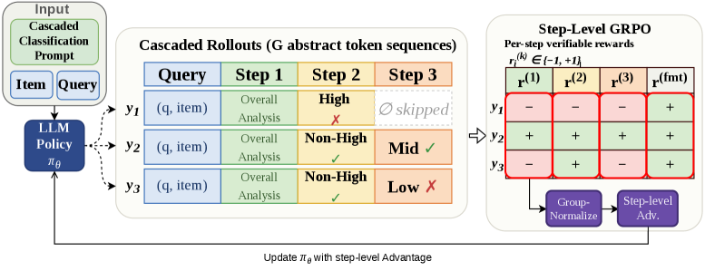

# CORE: Cascaded ordinal relevance, step-GRPO and PostCoT distillation

<!-- source-sha256: b58ce63f8a5ca1ba459a9c3204caad009071e6b0e77b150bf7cc6347d12abb1f -->

[简体中文](README.md)

> **Fidelity: core mechanism reproduction.** Implements flat and cascade classifiers, conditional step reward, group-normalized clipped GRPO and PostCoT logit aggregation with smaller models/data.

## Paper information

| Field | Details |
|---|---|
| Paper | [Paper or original source](https://arxiv.org/abs/2607.24417) |
| Institution | Meituan / Beijing Institute of Technology |
| First public release | 2026-07-27 (arXiv v1) |
| Author code | No official author code identified (checked 2026-08-09). |
| Local adapter or method key | `core-relevance` |
| Local reproduction code | [`src/auto_research/reproductions/core_relevance/`](https://github.com/daiwk/auto-research/tree/main/src/auto_research/reproductions/core_relevance/) |

## Paper method and evidence

A flat three-class relevance model treats unequal ordinal boundaries symmetrically. CORE first asks High vs Non-High, then Mid vs Low only when applicable. The first head focuses on strict entity/intent match, the second on substitutability. The LLM learns structured reasoning through SFT, then assigns independently normalized verifiable ±1 rewards to final answer, High/Non-High, applicable Mid/Low and format. Skipped Mid/Low contributes no reward/gradient. Valid tokens use clipped GRPO ratios plus reference KL. For low latency, PostCoT logits distill into two conditional BERT heads with BCE and temperature-$T$ distillation.


<!-- paper-figure:start -->
### Original paper figure

[](https://arxiv.org/html/2607.24417v1/x3.png)

Figure 3 shows the main flow and stages. From the [original paper](https://arxiv.org/abs/2607.24417); copyright remains with the authors.
<!-- paper-figure:end -->

### Core equation

$$
A_i^{(k)}=
\frac{r_i^{(k)}-\mu_k}{\sigma_k+\epsilon},
\qquad r_i^{(k)}\in\{-1,+1\},
$$

$$
\mathbf z_{\mathrm{LLM}}^{(1)}
=\left[\log(e^{z_M}+e^{z_L}),z_H\right]^\top,
\qquad
\mathbf z_{\mathrm{LLM}}^{(2)}=[z_L,z_M]^\top.
$$

$G$ sampled trajectories normalize each valid step $k$ separately. Teacher logits are $\mathbf z=[z_H,z_M,z_L]^\top$.

### Reported results

On 90,000 private query–item pairs, Direct-BERT accuracy is 0.7441, Cascaded-BERT 0.7558, and distilled cascade 0.7622. Direct-GRPO is 0.7478, Cascaded-GRPO 0.7541, Cascaded-StepGRPO 0.7648 and PostCoT-CORE 0.7706. In production, Cascaded-BERT vs flat BERT improves NDCG@5 from 0.9020 to 0.9038 (+0.20%) and reduces Badcase@5 from 13.8% to 11.6% (−15.9% relative).

## Local reproduction

Shared MovieLens-1M Low/Mid/High examples use user genre profiles and candidate genre overlap, not Meituan labels. A small MLP replaces Qwen3-14B and production BERT.

| Variant | Accuracy | Macro-F1 | NDCG@5 | Badcase@5 |
|---|---:|---:|---:|---:|
| Flat classifier | 0.5833 | 0.5640 | 0.9104 | 0.0625 |
| Cascade | 0.5781 | 0.5657 | 0.8986 | 0.0625 |
| Cascade + step-GRPO | 0.5781 | 0.5649 | 0.9012 | 0.0625 |
| PostCoT-distilled cascade | 0.5781 | 0.5672 | 0.9194 | 0.0313 |

Final NDCG@5 improves 0.98%, Badcase@5 drops 50.00% and accuracy drops 0.52 percentage points vs flat. Late mean active step reward is 0.3811. This validates the component chain, not production search semantics or thresholds. [Stable metrics](metrics/movielens-1m-ordinal-seed42.json).

```bash
auto-research reproduce --paper core-relevance --dataset-dir data --device mps --seed 42
```
