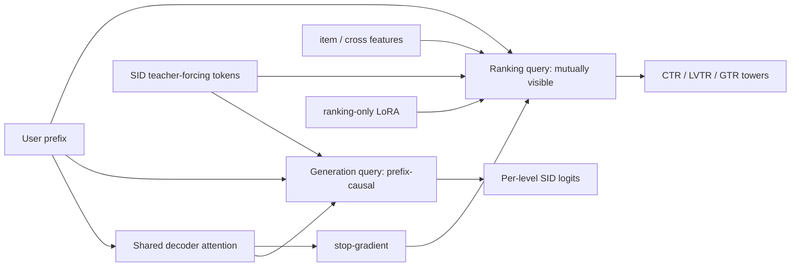
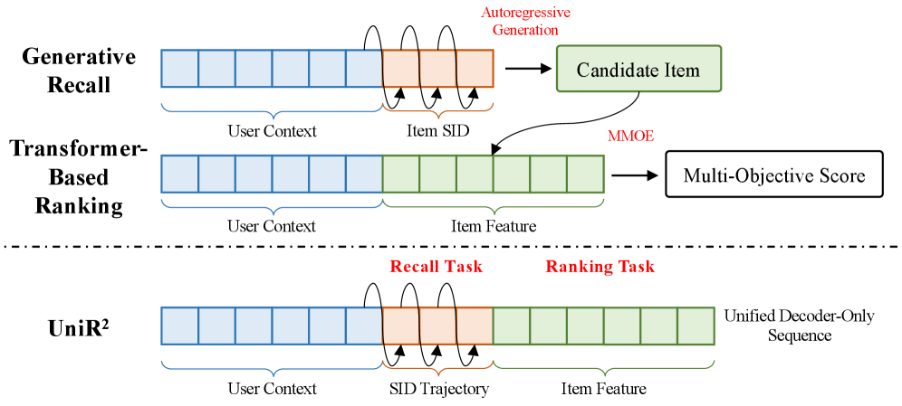

# UniR²: One decoder for generative retrieval and multi-objective ranking

<!-- source-sha256: 70479cf7cf2158bbfc8315682a4ebd128136744a865976dbd6ca1b414ce97eed -->

[简体中文](README.md)

> **Fidelity: Core mechanism.** The local run trains hierarchical SIDs, Dual-Query Prefix-Causal Attention, ranking-only LoRA, and joint generation/ranking objectives with smaller codebooks, model, and business-label proxies.

## Paper information

| Field | Value |
| --- | --- |
| Paper link | [arXiv 2607.24439](https://arxiv.org/abs/2607.24439) |
| Organization | Kuaishou / IIE, CAS / UCAS |
| First published | 2026-07-27 (arXiv v1) |
| Original author code | No official or author code was provided in the paper (checked 2026-08-09). |
| Adapter | `unir2` |
| Local reproduction code | [`src/auto_research/reproductions/unir2/`](https://github.com/daiwk/auto-research/tree/main/src/auto_research/reproductions/unir2/) |

## Original paper summary

### Background and main changes

Conventional cascades train retrieval and ranking separately. Both encode user history, handoff loses generation trajectories, and objectives can conflict. UniR² combines user context, the target item's SID trajectory, and ranking features in a heterogeneous decoder-only sequence. The trajectory connects retrieval with ranking.

DQ-PCA uses two query types in one layer. Generation queries read the full user prefix and prior SIDs. Ranking queries read compressed user state, the entire SID trajectory, and mutually visible item tokens. Q/K/V are shared, but the ranking branch stops gradient on shared output and learns ranking-specific interactions through LoRA so ranking gradients do not disrupt generation.



<!-- paper-figure:start -->
### Key figure from the paper

[](https://arxiv.org/html/2607.24439v1/x1.png)

**Original Figure 1 (architecture):** Main modules and their connections. Image from the [original paper](https://arxiv.org/abs/2607.24439); copyright belongs to the authors. Click the image for its source.
<!-- paper-figure:end -->

### Core equations

Hierarchical SID generation:

$$
p_\theta(s_v\mid u)=\prod_{i=1}^{L}
p_\theta(q_i\mid u,q_{<i}).
$$

The generation mask lets SID query $i$ read the full user prefix and SID tokens up through itself:

$$
M^{\mathrm{gen}}_{i,j}=
\begin{cases}
0,&j\le |\mathcal P|\ \text{or}\ |\mathcal P|<j\le|\mathcal P|+i,\\
-\infty,&j>|\mathcal P|+i.
\end{cases}
$$

Ranking LoRA isolates optimization:

$$
\Delta W_X^{\mathrm{rank}}=B_X^{\mathrm{rank}}A_X^{\mathrm{rank}},
\qquad
X^{\mathrm{rank}}=\operatorname{sg}(WX)+\Delta W_X^{\mathrm{rank}}X,
\quad X\in\{Q,K,V\}.
$$

### Offline and online results in the paper

On private offline data, HR/MRR gain `+3.05%` to `+5.29%` over the best retrieval baseline. AUC/UAUC for CTR, LVTR, and GTR gain `+0.16%` to `+1.45%`. The two-week online test in June 2026 covers `5%` of traffic and replaces both OneLive retrieval and the production pre-ranker. Kuaishou app plays change `+1.177%`, follow rate `+0.655%`, and like rate `+2.560%`. On Kuaishou Lite, gifting users change `+0.717%`, intent to gift `+1.567%`, and gift value `+2.569%`.

## Local reproduction

> **Control:** Separate generative retrieval and ranking cascade versus one DQ-PCA sequence with stop-gradient and LoRA. MovieLens-1M data, SIDs, training steps, and full-catalog candidates match. SID code accuracy rises **+34.04%**, while NDCG@10 falls **-13.19%**.

| Variant | SID code accuracy | Hit@10 | NDCG@10 | Parameters |
| --- | ---: | ---: | ---: | ---: |
| Separate cascade | 0.2203 | 0.0344 | 0.0143 | 51,116 |
| UniR² | 0.2953 | 0.0313 | 0.0124 | 41,274 |

Sharing the heterogeneous sequence improves SID learning, but ranking under the 40-dimension, 130-step budget does not offset the capacity of a separate tower. See [metrics/movielens-1m-seed42.json](metrics/movielens-1m-seed42.json).

```bash
auto-research reproduce --paper unir2 --dataset-dir data --device mps --seed 42
```

## Reproduction limits

MovieLens next-item prediction and genre affinity proxy Kuaishou clicks, long views, and gifts. The local run uses two 16-way SID levels rather than the three-level 8129 codebook. It does not run beam search, the 3×640 serving model, or pipeline parallelism. It validates DQ-PCA and optimization isolation, not transfer of production business gains.
