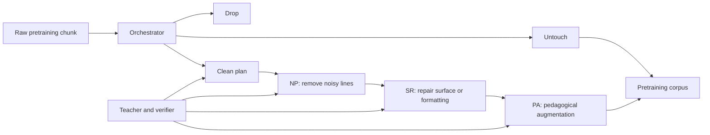
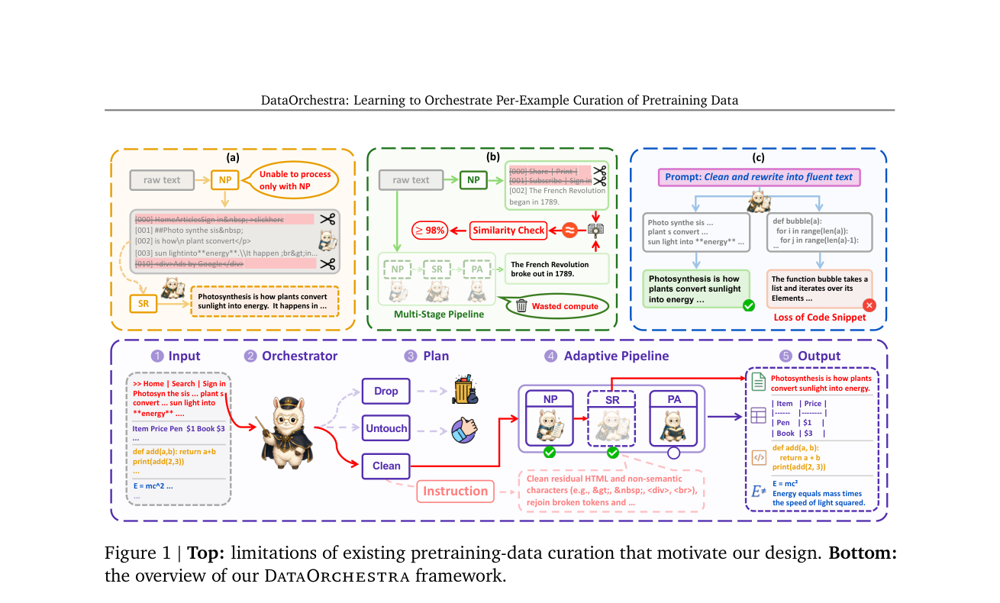

# DataOrchestra: Per-Example Orchestration of Pretraining Data Processing

<!-- source-sha256: b9e3c1068982f4cb1526077c71b64e6baa645c98ad36eeae7a0060badc3456fe -->

[简体中文](README.md)

> **Fidelity: core mechanism.** Trains a per-example orchestrator, executes multi-operation routing, and pretrains again at equal budget. A programmatic teacher and small models replace the large LLM toolchain.

## Paper information

| Field | Details |
|---|---|
| Paper | [arXiv 2607.24717](https://arxiv.org/abs/2607.24717) |
| Organization | Fudan University / Shanghai Jiao Tong University / SII-GAIR |
| First public release | 2026-07-27 (arXiv v1) |
| Authors' code | [Public author implementation](https://github.com/GAIR-NLP/DataOrchestra). |
| Adapter / method | `data-orchestra` |
| Local reproduction code | [`src/auto_research/reproductions/data_orchestra/`](https://github.com/daiwk/auto-research/tree/main/src/auto_research/reproductions/data_orchestra/) |

## Original paper

### Motivation and method

Corpus-level cleaning can over-process clean text and apply the same transformation to unlike noise. DataOrchestra plans separately for each 1024-token chunk: choose Drop, Untouch, or Clean; for Clean, decide which of Noise Pruning (NP), Surface Rectification (SR), and Pedagogical Augmentation (PA) to execute in that order, and write chunk-specific rewrite instructions.

A strong teacher drafts a plan. Tool models execute it and a verifier checks the result. Failed rewrites can be corrected up to five times; stages are removed if they lose content or change too little. Verified (chunk, evolved plan) pairs supervise a 1.7B orchestrator so costly tools run only on examples that need them.



<!-- paper-figure:start -->
### Key figure from the paper

[](https://arxiv.org/pdf/2607.24717#page=2)

> **Figure 1:** Core architecture, its modules, and their connections. From the [original paper](https://arxiv.org/abs/2607.24717); copyright remains with the authors.
<!-- paper-figure:end -->

### Core equations

The orchestrator learns each example's action and conditional operations:

$$
p_\phi(\pi\mid x)
=p_\phi(a\mid x)
\prod_{j\in\{\mathrm{NP,SR,PA}\}}
p_\phi(o_j,I_j\mid x,a=\mathrm{Clean}),
$$

Training uses teacher-forced SFT over serialized JSON plans. Processed corpus $\mathcal D_\phi$ then trains a standard causal LM:

$$
\mathcal L_{\mathrm{LM}}(\theta;\mathcal D_\phi)
=-\sum_{x\in\mathcal D_\phi}\sum_t
\log p_\theta(x_t\mid x_{<t}).
$$

The objective is not to maximize cleaning rate, but to select a per-example Pareto point between downstream quality and processing compute. Drop and Untouch skip unnecessary NP/SR/PA.

### Paper results

Models trained from scratch at 0.5B, 1.5B, and 7B improve their 11-benchmark mean from 37.63→39.99, 39.87→42.44, and 44.79→47.66, exceeding single-processing baselines such as ProX. The method generalizes to RedPajama-v2, DCLM-RefinedWeb, C4, FineWeb, and continued mathematical pretraining. Industrial online A/B criteria do not apply to this pretraining paper.

## Local reproduction

> **Local comparison.** The same 208,872-parameter Llama-style LM trains on raw WikiText-2 or on outputs of the trained orchestrator selecting Drop/Untouch/Clean and four local operations. Both use 150k tokens, 55 steps, and the same optimizer and model. Perplexity is **8.60% worse than raw** but **about 1.03% better than static cleaning**.

| Variant | Final train loss | Test loss | Perplexity |
| --- | ---: | ---: | ---: |
| Raw | 6.0638 | 5.8861 | 359.985 |
| Static cleaner | 6.0248 | 5.9790 | 395.036 |
| DataOrchestra | 6.0590 | 5.9686 | 390.954 |

Held-out action/operation accuracy is 76.11%/84.78%; routes exercise normalize, repair, deduplicate, and wiki. On already clean WikiText-2, the programmatic teacher still drops or cleans too much. Large heterogeneous web-corpus gains cannot be inferred from this negative result. See [complete metrics](metrics/wikitext-2-seed42.json).

```bash
auto-research reproduce --paper data-orchestra --dataset-dir data --device mps --seed 42
```

## Limits

An eight-feature MLP and programmatic rules replace Qwen3-235B teacher/verifier, Qwen3-1.7B orchestrator, 0.6B NP, and 4B SR/PA. Four deterministic edits replace natural-language chunk-specific rewrites; WikiText-2 replaces the 20B/30B-token corpora. This reproduces orchestration decisions and downstream pretraining mechanics, not the paper's data-quality scaling claims.
