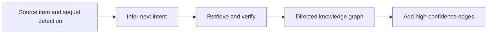
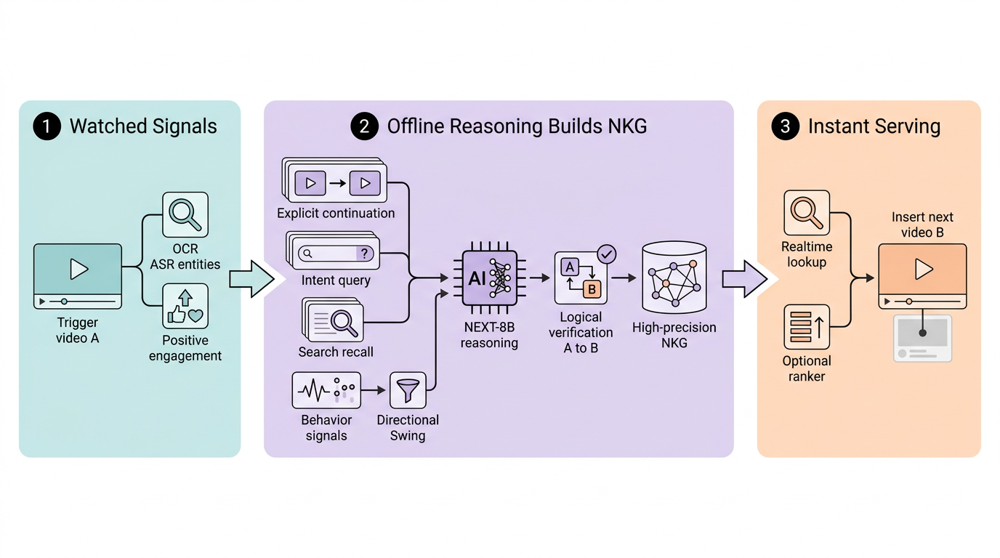

# NEXT: Visual-language reasoning about what the user wants next

<!-- source-sha256: 7ade278bf2de314d5cbe6105509d20c689efd9c23672050765f5acac4c17a8bf -->

[简体中文](README.md)

> **Fidelity: core mechanism reproduction.** Executes item→intent→item, directed edge generation and validation, and additive injection without claiming to train NEXT-8B.

## Paper information

| Field | Details |
|---|---|
| Paper | [Paper or original source](https://arxiv.org/abs/2607.24789) |
| Institution | Meta |
| First public release | 2026-06-27 (arXiv v1) |
| Author code | No official author code identified as of 2026-08-24. |
| Local adapter or method key | `next-vlm` |
| Local reproduction code | [`src/auto_research/reproductions/next_vlm/`](https://github.com/daiwk/auto-research/tree/main/src/auto_research/reproductions/next_vlm/) |

## Paper method and evidence

Co-engagement and similarity identify related videos, not what someone wants to do next. NEXT detects explicit sequels and uses NEXT-8B to generate an implicit next-intent query, retrieve candidates and verify directed Next Knowledge Graph edges. Offline VLM inference keeps it off the request path. After positive engagement, serving adds high-confidence edges. Training uses perception-enhanced GRPO, distribution-aligned SFT and last-mile preference optimization.



<!-- paper-figure:start -->
### Original paper figure

[](https://arxiv.org/html/2607.24789v1/figures/next_system_strict_pro.png)

Figure 1 shows the architecture and directed knowledge graph. From the [original paper](https://arxiv.org/abs/2607.24789); copyright remains with the authors.
<!-- paper-figure:end -->

### Core equation

$$
q_A=\operatorname{VLM}_{intent}(A),\quad
B^*=\arg\max_{B\in\operatorname{Retrieve}(q_A)}
\operatorname{VLM}_{verify}(A,q_A,B).
$$

$$
\mathcal C(u,t)=\mathcal C_{prod}(u,t)\cup\operatorname{NKG}(v_t)
\quad\text{if positive engagement}(u,v_t).
$$

### Reported results

The paper reports best single-model DocVQA for NEXT-8B. A multi-week A/B involving roughly 100 million users compares against a strong HSTU-path baseline: watch time +0.53%, distinct video exposure +0.51%, with no significant negative-feedback, safety or latency degradation.

## Local reproduction

One MovieLens-1M seed: transition+semantic ranker Hit@10/NDCG@10 0.1750/0.0997; adding verified directed edges gives 0.1917/0.1200 (+9.52%/+20.33%), and head share drops 0.4146→0.2150. [Stable metrics](metrics/movielens-1m-seed42.json). Title/genre and transitions proxy visuals and verification. No 8B training, original GRPO/SFT/preference stages, short-video pixels, private safety models or online service. This is single-seed public-proxy evidence, not Meta's online lift.

```bash
auto-research reproduce --paper next-vlm --dataset-dir data --seed 42
```
