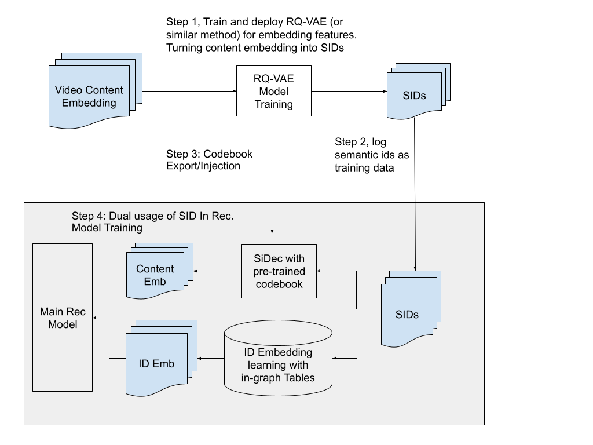

# Dual-purpose Semantic IDs: Encode collaborative identity and content semantics together

<!-- source-sha256: da33e5c858186dfe70e1066fb1a001ec39ece825ddc149e4a60a82f059e5f8ce -->

[简体中文](README.md)

> Core SID learning, transitions and SiDec reconstruction/scoring.

## Paper information

| Field | Details |
|---|---|
| Paper | [Paper or original source](https://arxiv.org/abs/2607.24865) |
| Institution | Google DeepMind / YouTube. |
| First public release | 2026-07-26 (arXiv v1) |
| Author code | No official author code linked by the paper as checked on 2026-08-09. |
| Local adapter or method key | `dual-sid` |
| Local reproduction code | [`src/auto_research/reproductions/dual_sid/`](https://github.com/daiwk/auto-research/tree/main/src/auto_research/reproductions/dual_sid/) |

## Paper method and evidence

Hierarchically quantized collaborative SIDs also reconstruct content via a Semantic Decoder (SiDec), so one token sequence supports generative retrieval, ranking and low-I/O online embedding reconstruction.


<!-- paper-figure:start -->
### Original paper figure

[](https://arxiv.org/html/2607.24865v1#S3.F1)

The original figure shows shared SID purposes. From the [original paper](https://arxiv.org/abs/2607.24865); copyright remains with the authors.
<!-- paper-figure:end -->

### Core equation

$$
\mathcal L=\mathcal L_{rec}+\lambda\left\|D\,[\operatorname{onehot}(c_1);\ldots;\operatorname{onehot}(c_L)]-v_i\right\|_2^2.
$$

Let the hierarchical code be $c(i)$ and decoder parameters be $D$; optimize collaborative prediction and content reconstruction together.

### Reported results

Watchpage ranking: sitewide +0.09%, watchpage +0.80%. Homepage ranking: sitewide +0.08%, homepage +0.22%. Retrieval: sitewide +0.06%, homepage +0.13%, watchpage +0.09%.

## Local reproduction

Three levels of residual k-means with eight codes each; ridge SiDec reconstruction MSE **0.006760**. Against same-split dense transition+content retrieval: Hit@10 **-8.33%**, NDCG@10 **-12.40%**, head share **-7.65%**. Small-codebook I/O proxy has a clear quality cost. [Metrics](metrics/movielens-100k-seed42.json). Genre proxies YouTube multimodal content; no large codebook, online reconstruction or private logs.

```bash
auto-research reproduce --paper dual-sid --dataset-dir data --seed 42
```
