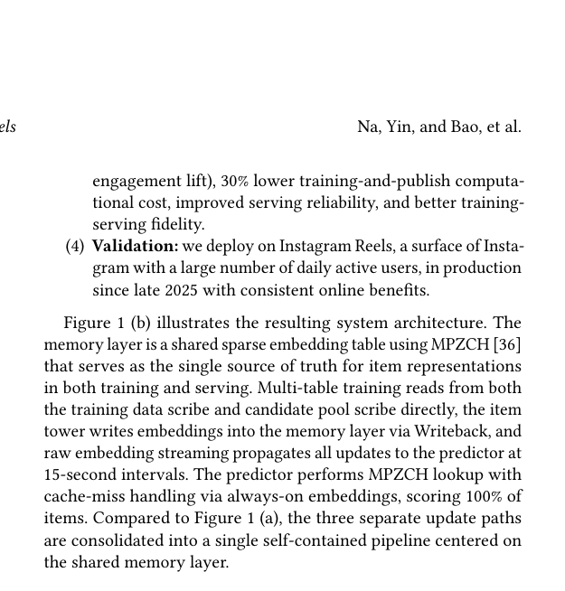

# Memory Layer: Make the recommendation cache part of model training

<!-- source-sha256: 8dec7948e5bdeb38194e87767b197d06c1546397bde19cab64e12be2c4c870f7 -->

[简体中文](README.md)

> **Fidelity: core mechanism reproduction.** Executes in-training writeback, shared cache reads, a frozen external snapshot control and always-on miss fallback. This is not Meta's MPZCH infrastructure.

## Paper information

| Field | Details |
|---|---|
| Paper | [Paper or original source](https://arxiv.org/abs/2607.25110) |
| Institution | Meta / Instagram Reels |
| First public release | 2026-07-27 (arXiv v1) |
| Author code | Yes for shared infrastructure: [TorchRec](https://github.com/meta-pytorch/torchrec/), with MPZCH, Writeback and RES components in TorchRec/FBGEMM. Full model integration is internal. |
| Local adapter or method key | `memory-layer` |
| Local reproduction code | [`src/auto_research/reproductions/memory_layer/`](https://github.com/daiwk/auto-research/tree/main/src/auto_research/reproductions/memory_layer/) |

## Paper method and evidence

Early-stage rankers often train with fresh item-tower features but serve a separate precomputed cache; misses may bypass scoring, so training/evaluation/serving see different inputs. Memory Layer makes the cache a sparse model table: the tower writes during training with learning rate one, and downstream and serving read the same representation. A cache miss uses a zero embedding plus always-on attributes such as creator/topic.


<!-- paper-figure:start -->
### Original paper figure

[](https://arxiv.org/pdf/2607.25110#page=2)

Figure 1 shows writeback and the shared feature flow. From the [original paper](https://arxiv.org/abs/2607.25110); copyright remains with the authors.
<!-- paper-figure:end -->

### Core equation

$$
M[i]\leftarrow e_i,\qquad \hat e_i=M[i].
$$

$$
z_i=\operatorname{Fuse}(\hat e_i,a_i),\qquad \hat e_i=0\ \text{when miss}.
$$

The tower outputs $e_i=f_{item}(x_i;\theta_t)$; scoring uses $\hat e_i$ and generalizable attributes $a_i$.

### Reported results

Instagram Reels coverage goes 96%→100%, freshness from about five minutes to about 20 seconds, and pselect training/serving NE gap 12.11%→1.64% (86% relative reduction). A/B backtest: plays of media under one hour rise 6%–7%, under five minutes more than 2×, and reshares/time spent 5%–6%. Training and publishing compute fall 30%, with neutral serving compute.

## Local reproduction

Matched baseline uses the same tower with 96% external frozen cache capacity and no always-on fallback; treatment writes back during training and can score 100% of items. Seed 42 NDCG@10 improves about 4.36% relative; structural diagnosis is the main point, not public-proxy lift. Processes training events in order with `eta=1`, logging coverage, mean staleness steps and writeback error. [Three-seed metrics, SD and 95% CI](metrics/public-seeds42-44.json).

MovieLens lacks creation time, Instagram cold-start exposure and online NE. No distributed MPZCH/FBGEMM store, 15-second streaming, int8 row-wise quantization or production cache capacity.

```bash
auto-research reproduce --paper memory-layer --dataset-dir data --seed 42
```
